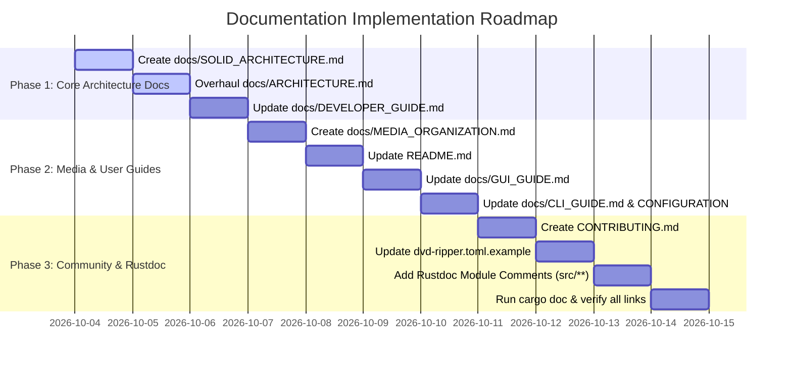

# DVD Ripper (`dvd-ripper`) Documentation Architecture & Modernization Plan

> **Document Version**: 1.0.0  
> **Date**: October 2026  
> **Status**: Approved for Implementation  
> **Target Repository**: `clockworkengineer/dvd-ripper`

---

## 1. Executive Summary & Codebase Audit Findings

Following the recent architectural modernization (Phases 1–4 SOLID refactoring) and feature enhancements (intelligent `/Films` and `/TV` directory routing, cooperative rip cancellation UI cleanup, sensible OS default directories, and expanded test coverage), a comprehensive audit was conducted across the source code and existing documentation.

### 1.1 Key Discrepancies Identified

1. **Architecture Mismatch**:
   - Existing documentation (`docs/ARCHITECTURE.md`, `docs/DEVELOPER_GUIDE.md`) depicts a monolithic structure of interconnected helper files (`main.rs` directly binding to `ffmpeg.rs`, `dvd.rs`, `imdb.rs`).
   - The active code now utilizes a Clean/Hexagonal SOLID architecture with decoupled layers:
     - `src/domain/`: Pure domain entities (`disc`, `metadata`, `rip`, `drive`), heuristic algorithms (`speedup`, `cluster_detector`, `tv_detector`), and abstracted ports (`transcoder`, `optical_drive`, `metadata`, `storage`, `notification`, `dialogs`).
     - `src/infrastructure/`: Concrete adapters for FFmpeg, OMDb/IMDb HTTP client, Win32/Linux optical drive demuxers, disk space guards, MQTT, and Webhooks.
     - `src/application/`: Independent use cases (`ProbeDiscUseCase`, `RipSingleTitleUseCase`, `RipTvBatchUseCase`, `DrivePool`).
     - `src/main.rs`: `AppContainer` Composition Root managing dependency inversion.
2. **Outdated Test Metrics**:
   - `docs/ARCHITECTURE.md` cites "66 automated unit tests". The codebase currently features **163 passing unit and integration tests**, including mock-based pipeline tests and cluster detection heuristics.
3. **Media Routing & Destination Hierarchy**:
   - The `/Films` and `/TV` separation logic was recently upgraded to feature intelligent sibling root detection (e.g., preventing duplicate `Films/Films` nesting, routing TV episodes to sibling `TV` folders when `out_dir` ends with `Films`, and defaulting to `%USERPROFILE%\Videos\DVD Rips` on Windows or `~/Videos/DVD Rips` on Unix).
   - This behavior is partially documented in `README.md` but missing from `docs/CLI_GUIDE.md`, `docs/CONFIGURATION.md`, `docs/GUI_GUIDE.md`, and `dvd-ripper.toml.example`.
4. **GUI Lifecycle & Cancellation Flow**:
   - Enhanced cooperative cancellation handling cleans up the progress bar, statistics, and drive statuses immediately, while logging `Cancelled` status to `ripping_history.json`.
   - `docs/GUI_GUIDE.md` lacks documentation for these cancellation behaviors, the new `📂 Browse...`, `↗ Open`, and `↺ Reset` directory controls, and the media destination informational caption.
5. **Missing Standard Open Source Documents**:
   - The project lacks a `CONTRIBUTING.md` guide for open-source contributors, a dedicated `docs/MEDIA_ORGANIZATION.md` specification for home-lab and media server setups (Plex, Jellyfin, Emby), and a deep-dive `docs/SOLID_ARCHITECTURE.md` reference.
6. **Code Rustdoc Gaps**:
   - Several new modules in `src/application/` and `src/infrastructure/` lack module-level rustdoc documentation (`//!`) explaining their role in the Clean Architecture.

---

## 2. Document Inventory & Action Matrix

| Document | Path | Type | Action | Priority | Key Focus Areas |
|---|---|---|---|---|---|
| **Root README** | `README.md` | Existing | **Modify** | P0 | SOLID architecture badge/overview, `/Films` & `/TV` folder hierarchy, 163 tests, updated CLI & GUI features |
| **System Architecture** | `docs/ARCHITECTURE.md` | Existing | **Modify** | P0 | Overhaul module graph with Hexagonal/Clean Architecture, Ports & Adapters, AppContainer, 163 unit tests |
| **SOLID Architecture** | `docs/SOLID_ARCHITECTURE.md` | **New** | **Create** | P1 | Dedicated specification on SRP, OCP, LSP, ISP, DIP implementations, heuristics, and mock test suites |
| **Developer Guide** | `docs/DEVELOPER_GUIDE.md` | Existing | **Modify** | P1 | Clean architecture layers (`domain`, `application`, `infrastructure`), mock testing, adding use cases & adapters |
| **Media Organization** | `docs/MEDIA_ORGANIZATION.md` | **New** | **Create** | P1 | `/Films` and `/TV` routing, sibling folder resolution, Plex/Jellyfin conventions, NFO and artwork sidecars |
| **Contributor Guide** | `CONTRIBUTING.md` | **New** | **Create** | P1 | Code conventions, PR process, architecture boundaries, local test validation, issue reporting |
| **Desktop GUI Guide** | `docs/GUI_GUIDE.md` | Existing | **Modify** | P2 | Output folder controls (`Browse`, `Open`, `Reset`), cancellation UI reset, info caption, media server triggers |
| **Configuration Guide** | `docs/CONFIGURATION.md` | Existing | **Modify** | P2 | `out_dir` resolution, sensible default locations, fallback directories, new TOML keys |
| **CLI User Manual** | `docs/CLI_GUIDE.md` | Existing | **Modify** | P2 | Updated `--out-dir` behavior, `--fallback-out-dir`, `--no-overwrite`, and sibling detection |
| **Example Config** | `dvd-ripper.toml.example` | Existing | **Modify** | P2 | Comments explaining `/Films` and `/TV` automated subfolder routing |
| **Rustdoc Module Docs** | `src/**/mod.rs` | Existing | **Modify** | P2 | Add inner module doc comments (`//!`) across `domain`, `application`, and `infrastructure` |

---

## 3. Detailed Specifications for Modifying Existing Documents

### 3.1 `README.md`
- **Location**: [`README.md`](file:///c:/Users/User/.gemini/antigravity-ide/scratch/dvd-ripper/README.md)
- **Modifications Needed**:
  1. **Architecture & SOLID Section**: Add a high-level overview highlighting the Clean/Hexagonal Architecture (Domain Entities & Ports, Application Use Cases, Infrastructure Adapters, AppContainer Composition Root).
  2. **Automated Folder Hierarchy**: Clarify the `/Films` and `/TV` separation rule:
     - Movies: `<out_dir>/Films/<Title (Year)>/<Title (Year)>.<ext>`
     - TV Shows: `<out_dir>/TV/<Show (Year)>/Season <SS>/<Show - SxxExx>.<ext>`
     - Document automatic sibling folder detection (avoiding duplicate `Films/Films` and routing TV episodes to sibling `../TV` when `out_dir` is `Films`).
     - Document sensible OS defaults: `%USERPROFILE%\Videos\DVD Rips` on Windows, `~/Videos/DVD Rips` on Linux/macOS.
  3. **Testing Section**: Update test count from 66 to **163 automated unit and integration tests**.
  4. **Cancellation Feature**: Highlight real-time cancellation cleanup in GUI, CLI, and Webhook/API streams.
  5. **Documentation Links**: Update the documentation index table with links to new guides (`docs/SOLID_ARCHITECTURE.md`, `docs/MEDIA_ORGANIZATION.md`, `CONTRIBUTING.md`).

### 3.2 `docs/ARCHITECTURE.md`
- **Location**: [`docs/ARCHITECTURE.md`](file:///c:/Users/User/.gemini/antigravity-ide/scratch/dvd-ripper/docs/ARCHITECTURE.md)
- **Modifications Needed**:
  1. **New Architectural Diagram**: Replace the old top-down dependency graph with a Mermaid diagram illustrating Hexagonal/Clean Architecture:
     - Core Domain (`src/domain/entities`, `src/domain/heuristics`, `src/domain/ports`)
     - Application Layer (`src/application/probe_disc`, `src/application/rip_single_title`, `src/application/rip_tv_batch`, `src/application/drive_pool`)
     - Infrastructure Layer (`src/infrastructure/ffmpeg`, `optical`, `metadata`, `storage`, `notifications`, `ocr`, `system`)
     - Composition Root (`src/main.rs: AppContainer`)
  2. **Layer Responsibilities**:
     - Detail each port trait (`OpticalDriveReader`, `TranscoderEngine`, `MetadataProvider`, `HistoryRepository`, `DiskSpaceGuard`, `Notifier`).
     - Detail domain heuristics (PAL 25fps speedup duration matching, duration cluster ranking to bypass copy-protection decoy loops like John Wick 3).
  3. **Updated Test Suite Metrics**:
     - Document the 163 unit and integration tests across domain heuristics, mock adapters, command building, and API routing.

### 3.3 `docs/DEVELOPER_GUIDE.md`
- **Location**: [`docs/DEVELOPER_GUIDE.md`](file:///c:/Users/User/.gemini/antigravity-ide/scratch/dvd-ripper/docs/DEVELOPER_GUIDE.md)
- **Modifications Needed**:
  1. **Crate Layout Update**: Expand Section 1 tree diagram to detail `src/domain/`, `src/application/`, and `src/infrastructure/`.
  2. **Clean Architecture Extension Workflow**:
     - How to add a new domain entity or heuristic.
     - How to declare a new port in `src/domain/ports/`.
     - How to implement a new infrastructure adapter in `src/infrastructure/`.
     - How to register services in `src/main.rs: AppContainer`.
     - How to write mock-based unit tests using trait implementations without executing external processes.

### 3.4 `docs/GUI_GUIDE.md`
- **Location**: [`docs/GUI_GUIDE.md`](file:///c:/Users/User/.gemini/antigravity-ide/scratch/dvd-ripper/docs/GUI_GUIDE.md)
- **Modifications Needed**:
  1. **Output Directory Management**:
     - Document the `📂 Browse...` button (native OS file dialog).
     - Document the `↗ Open` button (opens destination directly in Windows File Explorer / Linux file manager).
     - Document the `↺ Reset` button (reverts to system default Videos directory).
     - Document the informational routing hint: `Films are saved to /Films and TV Shows to /TV within this directory`.
  2. **Cancellation Lifecycle**:
     - Describe user cancellation behavior: clicking `⏹ Cancel` sends cooperative atomic cancellation, cleans up the UI progress bar and throughput gauges, updates history status to `Cancelled`, and frees optical drives immediately.

### 3.5 `docs/CONFIGURATION.md`
- **Location**: [`docs/CONFIGURATION.md`](file:///c:/Users/User/.gemini/antigravity-ide/scratch/dvd-ripper/docs/CONFIGURATION.md)
- **Modifications Needed**:
  1. **Output Directory Configuration**:
     - Clarify `out_dir` behavior: serves as the base media directory under which `Films/` and `TV/` are created.
     - Detail how sibling directories are resolved if `out_dir` is set directly to a `Films` or `TV` folder.
     - Document default path resolution rules across Windows, Linux, and macOS.
  2. **Fallback Directory**: Detail `fallback_out_dir` behavior when primary storage partition falls below `min_free_gb`.

### 3.6 `docs/CLI_GUIDE.md`
- **Location**: [`docs/CLI_GUIDE.md`](file:///c:/Users/User/.gemini/antigravity-ide/scratch/dvd-ripper/docs/CLI_GUIDE.md)
- **Modifications Needed**:
  1. Update `--out-dir` documentation to specify that Film rips resolve to `Films/` and TV series rips resolve to `TV/`, with automatic sibling detection.
  2. Document precedence between explicit file output (`-o / --output`) and directory-based resolution (`-d / --out-dir`).

### 3.7 `dvd-ripper.toml.example`
- **Location**: [`dvd-ripper.toml.example`](file:///c:/Users/User/.gemini/antigravity-ide/scratch/dvd-ripper/dvd-ripper.toml.example)
- **Modifications Needed**:
  - Update comments on `out_dir`: explain that Films are placed into `out_dir/Films/` and TV series into `out_dir/TV/`.

---

## 4. Detailed Specifications for New Documents

### 4.1 `docs/SOLID_ARCHITECTURE.md` (New Document)
- **Target Path**: `docs/SOLID_ARCHITECTURE.md`
- **Purpose**: Serve as the canonical architectural design specification detailing how the 5 SOLID principles and Clean Architecture were implemented in Rust for `dvd-ripper`.
- **Table of Contents**:
  1. Architectural Goals & Overview (Clean/Hexagonal Architecture)
  2. Single Responsibility Principle (SRP)
     - Segregation of FFmpeg command building (`builder.rs`), process management (`process_runner.rs`), and output parsing (`progress_parser.rs`).
     - Decoupling of application bootstrapping (`AppInitializer`) from execution.
  3. Open/Closed Principle (OCP)
     - Extensible Video Codec Resolvers (`VideoCodecResolver`).
     - Strategy pattern for deinterlacing filters and hardware encoders.
  4. Liskov Substitution Principle (LSP)
     - Contract consistency in `OpticalDriveReader`, `TranscoderEngine`, `HistoryRepository`, and `DiskSpaceGuard`.
  5. Interface Segregation Principle (ISP)
     - Granular, fine-grained trait definitions (`DriveDetector`, `TrayController`, `TitleDurationProvider`, `MetadataProvider`).
     - Segregated CLI encoding options (`TranscodeConfig`, `AudioConfig`, `SubtitleConfig`).
  6. Dependency Inversion Principle (DIP)
     - High-level application use cases depending exclusively on abstract domain ports.
     - Composition Root (`AppContainer`) wiring production dependencies at startup.
  7. Domain Heuristics & Decoy Traps
     - Cluster Duration Matching: Defeating 99-title decoy obfuscations (e.g. John Wick 3).
     - PAL Speedup Compensation: 25fps vs 23.976fps runtime discrepancy resolution (4% runtime compression).
     - Multi-Episode TV Disc Filtering.
  8. Testability & Mock Architectures
     - Fast, deterministic in-memory mock testing without hardware optical drives or FFmpeg processes.

### 4.2 `docs/MEDIA_ORGANIZATION.md` (New Document)
- **Target Path**: `docs/MEDIA_ORGANIZATION.md`
- **Purpose**: Comprehensive guide to output directory conventions, media server compatibility (Plex, Jellyfin, Emby, Kodi), artwork, and sidecar files.
- **Table of Contents**:
  1. Standard Media Directory Layout
     - Structure of `<out_dir>/Films/<Movie Title (Year)>/<Movie Title (Year)>.<ext>`
     - Structure of `<out_dir>/TV/<Show Name (Year)>/Season <SS>/<Show Name> - S<SS>E<EE>.<ext>`
  2. Sibling Directory Auto-Resolution
     - What happens when pointing `out_dir` to `C:\Media\Films` vs `C:\Media\TV` vs `C:\Media`.
     - Prevention of redundant nested folders (`Films/Films`).
  3. Media Server Metadata Sidecars
     - Kodi / Jellyfin / Emby XML `.nfo` file structure.
     - Cover artwork sidecars (`cover.jpg`, `folder.jpg`, `poster.jpg`).
     - Subtitle sidecars: SubRip (`.srt`) OCR text streams vs embedded Matroska (`.mkv`) `dvdsub` bitmaps.
  4. Best Practices for Network Attached Storage (NAS)
     - Setting up NFS/SMB shares.
     - Disk space guard thresholds (`--min-free-gb`) and fallback drives (`--fallback-out-dir`).
  5. Automated Library Refresh Triggers
     - Automatic HTTP library scan API webhooks for Plex, Jellyfin, and Emby upon rip completion.

### 4.3 `CONTRIBUTING.md` (New Document)
- **Target Path**: `CONTRIBUTING.md`
- **Purpose**: Community and contributor onboarding manual establishing repository standards and workflows.
- **Table of Contents**:
  1. Welcome & Code of Conduct
  2. Development Environment Setup (Rust 2024, Cargo, FFmpeg, libdvdcss, Tesseract OCR)
  3. Architectural Boundaries (Preserving SOLID layers)
  4. Coding Standards (Rust formatting, clippy, naming conventions, docstrings)
  5. Testing Requirements (Writing unit tests for domain heuristics and mock use cases; ensuring 100% test pass rate)
  6. Submitting Pull Requests & Commit Guidelines

---

## 5. Code Documentation (Rustdoc) Specifications

To ensure developer ergonomics and `cargo doc` completeness, add inner module-level doc comments (`//!`) and symbol docs (`///`) to the newly introduced modules:

1. **`src/domain/mod.rs`**: Add top-level `//!` documenting the pure domain layer, isolation from external I/O, entities, heuristics, and ports.
2. **`src/domain/ports/mod.rs`**: Add `//!` explaining DIP trait contracts (transcoder, storage, optical, metadata, notification, dialogs).
3. **`src/domain/heuristics/mod.rs`**: Add `//!` detailing business heuristics (PAL speedup, cluster detection, TV episode heuristics).
4. **`src/application/mod.rs`**: Add `//!` documenting the application orchestration layer, use cases (`ProbeDiscUseCase`, `RipSingleTitleUseCase`, `RipTvBatchUseCase`), and `DrivePool`.
5. **`src/infrastructure/mod.rs`**: Add `//!` explaining concrete adapters, external I/O boundaries (FFmpeg, Win32/Linux optical demuxers, OMDb HTTP, MQTT).
6. **`src/main.rs: AppContainer`**: Add comprehensive `///` doc comments detailing the Composition Root and service injection pattern.

---

## 6. Phased Implementation Roadmap

### Phase Breakdown

- **Phase 1: Core Architecture & Developer Alignment**
  - Create [`docs/SOLID_ARCHITECTURE.md`](file:///c:/Users/User/.gemini/antigravity-ide/scratch/dvd-ripper/docs/SOLID_ARCHITECTURE.md).
  - Update [`docs/ARCHITECTURE.md`](file:///c:/Users/User/.gemini/antigravity-ide/scratch/dvd-ripper/docs/ARCHITECTURE.md) with Hexagonal architecture diagrams and 163 unit test metrics.
  - Update [`docs/DEVELOPER_GUIDE.md`](file:///c:/Users/User/.gemini/antigravity-ide/scratch/dvd-ripper/docs/DEVELOPER_GUIDE.md) with instructions for extending ports, adapters, and use cases.

- **Phase 2: Media Organization & User-Facing Documentation**
  - Create [`docs/MEDIA_ORGANIZATION.md`](file:///c:/Users/User/.gemini/antigravity-ide/scratch/dvd-ripper/docs/MEDIA_ORGANIZATION.md).
  - Update [`README.md`](file:///c:/Users/User/.gemini/antigravity-ide/scratch/dvd-ripper/README.md) with media hierarchy, cancellation, and architecture overviews.
  - Update [`docs/GUI_GUIDE.md`](file:///c:/Users/User/.gemini/antigravity-ide/scratch/dvd-ripper/docs/GUI_GUIDE.md), [`docs/CLI_GUIDE.md`](file:///c:/Users/User/.gemini/antigravity-ide/scratch/dvd-ripper/docs/CLI_GUIDE.md), and [`docs/CONFIGURATION.md`](file:///c:/Users/User/.gemini/antigravity-ide/scratch/dvd-ripper/docs/CONFIGURATION.md).
  - Update [`dvd-ripper.toml.example`](file:///c:/Users/User/.gemini/antigravity-ide/scratch/dvd-ripper/dvd-ripper.toml.example).

- **Phase 3: Community Standards & Code Rustdocs**
  - Create [`CONTRIBUTING.md`](file:///c:/Users/User/.gemini/antigravity-ide/scratch/dvd-ripper/CONTRIBUTING.md).
  - Add inner module `//!` doc comments to `src/domain/`, `src/application/`, and `src/infrastructure/`.
  - Validate documentation via `cargo doc --no-deps` to guarantee zero broken links or compilation warnings.

---

## 7. Verification & Success Criteria

1. **Accuracy**: Every document matches the exact current behavior and module hierarchy in the codebase.
2. **Completeness**: All 163 unit tests, domain heuristics, ports, adapters, and directory routing rules are comprehensively documented.
3. **Hyperlink Integrity**: All cross-document markdown links and clickable code links resolve cleanly.
4. **Documentation Quality**: Clean formatting using GitHub alerts (`> [!NOTE]`, `> [!TIP]`, `> [!IMPORTANT]`), syntax-highlighted code blocks, and valid Mermaid diagrams.
