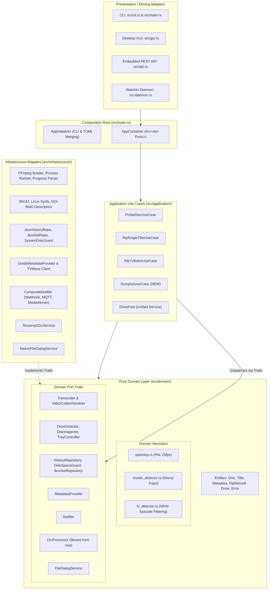

# Concrete Architecture Refactoring & Feature Implementation Plan
## Crate: `dvd-ripper` | Target: Full Clean Architecture & Missing Features Alignment

---

## 1. Executive Summary & Audit Overview

A comprehensive code and documentation audit was conducted across all documentation guides (`README.md`, `docs/*.md`, `CHANGELOG.md`, `dvd-ripper.toml.example`) and source files (`src/domain/`, `src/application/`, `src/infrastructure/`, `src/cli.rs`, `src/gui.rs`, `src/api.rs`, `src/daemon.rs`, `src/main.rs`, and utility modules).

While the application possesses 185 passing automated tests and extensive documentation, there is a distinct gap between the architectural specifications in [`docs/SOLID_ARCHITECTURE.md`](file:///c:/Users/User/.gemini/antigravity-ide/scratch/dvd-ripper/docs/SOLID_ARCHITECTURE.md) / [`docs/ARCHITECTURE.md`](file:///c:/Users/User/.gemini/antigravity-ide/scratch/dvd-ripper/docs/ARCHITECTURE.md) and the current code implementation. Specifically:
1. **Presentation Layer Decoupling Failure**: Desktop GUI (`gui.rs`), Web REST API (`api.rs`), and Watcher Daemon (`daemon.rs`) completely bypass `AppContainer` and Application Use Cases (`RipSingleTitleUseCase`, `RipTvBatchUseCase`, `ProbeDiscUseCase`). They invoke monolithic procedural functions (`run_ffmpeg_with_channel`, `record_rip_event`, `load_history`) directly.
2. **Missing Domain Heuristics**: The TV Series Multi-Episode Detection Heuristic (`src/domain/heuristics/tv_detector.rs`), explicitly documented in `SOLID_ARCHITECTURE.md` Section 7.3 and `ARCHITECTURE.md` Section 3.3, was never implemented in the domain layer. The logic remains trapped inside `src/ffmpeg.rs` coupled with I/O and process execution.
3. **Interface Segregation Violations**: `SOLID_ARCHITECTURE.md` Section 5.1 specifies granular, segregated traits (`DriveDetector`, `DiscInspector`, `TrayController`). However, only monolithic `OpticalDrive` and basic `DriveDetector` were created.
4. **Broken Transcoder Live Progress**: `FfmpegTranscoder` buffers progress messages in an in-memory `Vec` until the FFmpeg process completes before notifying observers, preventing true real-time streaming progress in use cases.
5. **Cancellation State Misclassification**: Cancelled transcodes in `RipSingleTitleUseCase` are recorded as `"Failed"` in history and dispatched as `NotificationEvent::RipFailed` instead of `"Cancelled"` and `NotificationEvent::RipCancelled`.
6. **Incomplete Application Layer**: Archival 1:1 ISO disc dumps (`--iso`) bypass use cases entirely. `RipTvBatchUseCase` hardcodes `.mp4`, ignoring container flags (`--mkv`), episode title resolution from TVMaze, subtitle OCR sidecars, and multi-disc box set state tracking (`boxsets.json`).
7. **REST API & OpenAPI Discrepancies**: The documented `POST /api/history/clear` endpoint is completely missing from `api.rs`. Additionally, routes such as `/api/boxset`, `/api/boxset/reset`, `/api/thumbnail`, `/api/benchmark`, `/api/pool/status`, and `/api/health` are missing from the embedded OpenAPI 3.0 JSON specification (`/api/openapi.json`).
8. **Incomplete Monolithic Decomposition**: `src/ffmpeg.rs` remains a monolithic 2,566-line file. `builder.rs` and `process_runner.rs` in `src/infrastructure/ffmpeg/` are mere 13-line forwarding stubs rather than true decoupled components.

---

## 2. Comprehensive Inventory of Missing Features & Architectural Defects

### Category 1: Pure Domain Layer (`src/domain/`)
| Component | Documented Specification | Current State | Required Refactor Action |
|---|---|---|---|
| **TV Detection Heuristic** | `src/domain/heuristics/tv_detector.rs` (`SOLID_ARCHITECTURE.md` §7.3) | Missing from `src/domain/heuristics/` | Create `src/domain/heuristics/tv_detector.rs` with pure functions to filter out intros/warnings (<10 mins) and "Play All" composite tracks (>1.6x-2.5x median duration). Export via `heuristics/mod.rs`. |
| **Granular Optical Traits** | `DriveDetector`, `DiscInspector`, `TrayController` (`SOLID_ARCHITECTURE.md` §5.1) | Only monolithic `OpticalDrive` & `DriveDetector` exist | Split `OpticalDrive` into segregated traits: `DiscInspector` (volume labels, fingerprints) and `TrayController` (eject, close, spindown) in `domain/ports/optical_drive.rs`. Implement them on `PhysicalOpticalDrive`. |
| **Video Codec Strategy** | `VideoCodecResolver` (`SOLID_ARCHITECTURE.md` §3.1) | Flagged `#[allow(dead_code)]` in `ffmpeg.rs`; unused by command builders | Promote `VideoCodecResolver` into `domain/ports/transcoder.rs` or `infrastructure/ffmpeg/`. Integrate with `FfmpegCommandBuilder`. |
| **OCR Processor Port** | DIP abstraction for subtitle OCR engine | `OcrProcessor` defined in root `ocr.rs`; concrete adapter imports root crate | Move `OcrProcessor` trait to `domain/ports/ocr.rs`. Make `TesseractOcrService` implement this domain port. |
| **BoxSet & Queue Ports** | Storage abstractions for TV BoxSet tracking & Job Queue | In-memory statics and direct JSON file reading in root `queue.rs` | Define `BoxSetRepository` and `JobQueueRepository` traits in `domain/ports/storage.rs`. |
| **Extended `RipRecord`** | `docs/RIPPING_HISTORY_AND_LOGGING.md` §2 schema (metadata, codec, size, duration) | `RipRecord` in `job.rs` only has 5 basic fields | Extend `RipRecord` with optional `year`, `disc_label`, `duration_secs`, `file_size_bytes`, `video_codec`, `audio_lang`, `subtitles_enabled`. Retain backwards compatibility. |

---

### Category 2: Application Layer (`src/application/`)
| Component | Documented Specification | Current State | Required Refactor Action |
|---|---|---|---|
| **Batch TV Ripping Use Case** | `RipTvBatchUseCase` (`SOLID_ARCHITECTURE.md` §1) | Hardcodes `.mp4`, ignores TVMaze episode names, ignores OCR, ignores `--mkv`, ignores `boxsets.json` tracking; unused by CLI, GUI, and API | Refactor `RipTvBatchUseCase` to accept format parameters, integrate TVMaze titles, coordinate BoxSet episode counters, generate OCR sidecars, and record batch progress. |
| **Archival ISO Dump Use Case** | 1:1 Archival optical imaging (`--iso`) via clean architecture | Bypasses application layer; procedural calls in `main.rs`, `gui.rs`, `api.rs` | Create `src/application/dump_iso.rs` (`DumpIsoUseCase`), orchestrating sector-by-sector copying, disk space validation, cancellation tokens, history recording, and notifications. |
| **Disc Probing Use Case** | `ProbeDiscUseCase` (`ARCHITECTURE.md` §3.2) | Only used in unit test; not used by CLI, GUI, Daemon, or API; no TV probing | Update `ProbeDiscUseCase` to leverage `DiscInspector`, `tv_detector` heuristic, and fingerprint cache. Wire into CLI, GUI, and Daemon workflows. |
| **Drive Pool Management** | `DrivePool` (`src/application/drive_pool.rs`) | Isolated 60-line struct; `api.rs` maintains duplicate static `DRIVE_POOL_REGISTRY` | Unify `DrivePool` to manage multi-drive concurrency, statuses (`DriveStatusInfo`), and independent cancellation tokens as an application service used by both `daemon.rs` and `api.rs`. |
| **AppContainer Composition** | Universal dependency injection container | Wired only partially into CLI `main.rs`; GUI, Daemon, and API bypass it | Wire `AppContainer` into `gui.rs`, `daemon.rs`, and `api.rs`. Pass use cases directly to driving adapters. |

---

### Category 3: Infrastructure & Transcoding Pipeline (`src/infrastructure/`)
| Component | Documented Specification | Current State | Required Refactor Action |
|---|---|---|---|
| **Transcoder Progress Streaming** | Real-time progress updates to observers | `FfmpegTranscoder` buffers progress events in a thread `Vec` until process completion | Stream progress events directly to `observer.on_progress(...)` and `observer.on_log(...)` in real-time as received from mpsc channel. |
| **Cancellation Handling** | Graceful cancellation recording in history & notifications | Cancelled rip returns `Err`, recorded as `"Failed"` in history and triggers `RipFailed` | Distinguish cooperative cancellation (`DvdError::Cancelled`) in `RipSingleTitleUseCase`, record status as `"Cancelled"`, and dispatch `NotificationEvent::RipCancelled`. |
| **FFmpeg Modular Decomposition** | Modular builder, runner, and parser (`SOLID_ARCHITECTURE.md` §2.1) | `builder.rs` and `process_runner.rs` are 13-line and 33-line facades to monolithic `ffmpeg.rs` (2,566 lines) | Complete decomposition: move command generation into `builder.rs`, child process execution into `process_runner.rs`, and progress parsing into `progress_parser.rs`. Keep `ffmpeg.rs` clean as high-level facade. |
| **Artifact & Post-Processing Hooks** | Sidecars (`.nfo`, `.srt`, `.sha256`), cover artwork, post-scripts, media server refresh | Executed procedurally in `main.rs` only; absent from GUI and REST API | Encapsulate post-rip sidecar generation (NFO, checksum, poster artwork, script hook, media server notifications) into `RipSingleTitleUseCase` / `RipTvBatchUseCase` or a dedicated post-processor service. |

---

### Category 4: Presentation & Driving Adapters (`src/api.rs`, `src/gui.rs`, `src/daemon.rs`, `src/cli.rs`)
| Component | Documented Specification | Current State | Required Refactor Action |
|---|---|---|---|
| **REST API Route Missing** | `POST /api/history/clear` (`RIPPING_HISTORY_AND_LOGGING.md` §3.2) | Missing from `src/api.rs` | Implement `POST /api/history/clear` calling `HistoryRepository::clear_history`. Return standard JSON confirmation. |
| **OpenAPI 3.0 Spec Synchronization** | Complete API documentation (`API_REFERENCE.md`) | OpenAPI spec in `api.rs` lacks 8 endpoints | Add schemas in `generate_openapi_spec()` for: `/api/boxset`, `/api/boxset/reset`, `/api/thumbnail`, `/api/benchmark`, `/api/pool/status`, `/api/drives`, `/api/health`, and `/api/history/clear`. |
| **REST API Use Case Execution** | Decoupled execution via use cases | `api.rs` calls `ffmpeg::run_ffmpeg_with_channel` directly | Refactor `execute_rip_for_drive` in `api.rs` to execute `RipSingleTitleUseCase`, `RipTvBatchUseCase`, or `DumpIsoUseCase`. |
| **GUI Use Case Execution** | GUI powered by Clean Architecture | `gui.rs` spawns threads with direct `run_ffmpeg_with_channel` and `history::record_rip_event` | Inject `AppContainer` into `DvdRipperApp`. Execute ripping operations through the use cases, receiving progress via `ProgressObserver` channel bridges. |
| **GUI Safeguards & Features** | GUI feature parity with CLI | GUI lacks toggles for Checksum (`--checksum`), NFO metadata (`--nfo`), Hardware Acceleration Fallback (`--hwaccel-fallback`), LUFS target (`--norm-target`) | Add corresponding controls and checkboxes in GUI settings/tabs. |
| **Daemon Architecture Wiring** | Multi-drive watcher using clean use cases | `daemon.rs` calls `api::execute_rip_for_drive` | Wire `daemon.rs` to instantiate or receive `AppContainer`, delegating disc probing to `ProbeDiscUseCase` and ripping to application use cases. |

---

## 3. Target System Architecture Diagram



---

## 4. Phased Implementation Roadmap

### Phase 1: Pure Domain Layer Enhancement & Interface Segregation
1. **Create `src/domain/heuristics/tv_detector.rs`**:
   - Implement `filter_tv_episodes(titles: &[DvdTitleInfo], min_duration_secs: f64) -> Vec<DvdTitleInfo>`.
   - Implement median duration calculation and composite "Play All" title rejection (`secs > median * 1.6` when multiple titles exist).
   - Add comprehensive unit tests in `src/domain/heuristics/tv_detector.rs` verifying:
     - Filtering of studio warnings and menus (<600s).
     - Elimination of "Play All" tracks (e.g. 4 individual 22-min episodes vs. one 88-min composite track).
     - Single episode edge cases.
   - Re-export in `src/domain/heuristics/mod.rs`.
2. **Segregate Optical Drive Ports in `src/domain/ports/optical_drive.rs`**:
   - Define:
     ```rust
     pub trait DriveDetector: Send + Sync {
         fn detect_available_drives(&self) -> Vec<PathBuf>;
         fn auto_detect_primary(&self) -> Option<PathBuf>;
     }

     pub trait DiscInspector: Send + Sync {
         fn read_volume_label(&self, drive_path: &Path) -> Option<String>;
         fn compute_fingerprint(&self, drive_path: &Path) -> String;
         fn inspect_protection(&self, drive_path: &Path) -> DiscCopyProtectionReport;
     }

     pub trait TrayController: Send + Sync {
         fn eject_tray(&self, drive_path: &Path) -> Result<()>;
         fn close_tray(&self, drive_path: &Path) -> Result<()>;
         fn spindown(&self, drive_path: &Path) -> Result<()>;
     }
     ```
   - Retain `OpticalDrive` for backwards compatibility or implement it via the segregated traits.
   - Implement `DiscInspector` and `TrayController` on `PhysicalOpticalDrive` in `src/infrastructure/optical/windows.rs`.
3. **Move `OcrProcessor` Trait to `src/domain/ports/ocr.rs`**:
   - Define `pub trait OcrProcessor: Send + Sync`.
   - Update `src/infrastructure/ocr/tesseract.rs` to implement the domain port.
4. **Extend `RipRecord` in `src/domain/entities/job.rs`**:
   - Add optional fields with `#[serde(default, skip_serializing_if = "Option::is_none")]`:
     - `disc_label: Option<String>`
     - `year: Option<u32>`
     - `duration_secs: Option<f64>`
     - `file_size_bytes: Option<u64>`
     - `video_codec: Option<String>`
     - `audio_lang: Option<String>`
     - `subtitles_enabled: Option<bool>`
   - Maintain `RipRecord::new(...)` for existing callers while adding `RipRecord::with_details(...)`.

---

### Phase 2: Transcoder Pipeline & Infrastructure Modernization
1. **Fix Real-Time Progress Streaming in `FfmpegTranscoder` (`src/infrastructure/ffmpeg/transcoder.rs`)**:
   - Replace the buffering thread (`obs_thread`) with direct, live event forwarding:
     - Run `run_ffmpeg_with_channel` on a worker thread while the calling thread drains `rx.recv()` in real-time, calling `obs.on_progress(...)` and `obs.on_log(...)` immediately upon event reception.
2. **Correct Cooperative Cancellation Semantics in `RipSingleTitleUseCase`**:
   - Check `cancel_flag` upon error or detect `DvdError::Cancelled`.
   - If cancelled:
     - Record `status: "Cancelled"` in history repository.
     - Dispatch `NotificationEvent::RipCancelled { title }`.
     - Return `Err(DvdError::Cancelled.into())`.
3. **Decompose Monolithic `src/ffmpeg.rs` into Specialized Modules**:
   - Shift argument generation logic from `ffmpeg.rs` into `src/infrastructure/ffmpeg/builder.rs`.
   - Shift process spawning and cancellation token listening into `src/infrastructure/ffmpeg/process_runner.rs`.
   - Keep `src/ffmpeg.rs` as clean high-level facades ensuring 100% backwards compatibility for existing code.
4. **Integrate Extensible Video Codec Resolver**:
   - Move `VideoCodecResolver` and `DefaultVideoCodecResolver` into `src/domain/ports/transcoder.rs`.
   - Connect `VideoCodecResolver` to `FfmpegCommandBuilder` so new encoders can be registered via strategy without modifying command assembly code.

---

### Phase 3: Application Layer Completeness & New Use Cases
1. **Implement `DumpIsoUseCase` in `src/application/dump_iso.rs`**:
   - Define `DumpIsoRequest { source_dvd: PathBuf, output_path: PathBuf, label: Option<String>, min_free_gb: u64 }`.
   - Check `disk_guard.check_free_space(...)`.
   - Dispatch `NotificationEvent::RipStarted`.
   - Execute `iso::dump_disc_to_iso(...)` with live sector observer and cancellation flag.
   - On success: Record `RipRecord` with `media_type: "ISO"`, dispatch `NotificationEvent::RipSuccess`.
   - On cancellation: Record `status: "Cancelled"`, dispatch `NotificationEvent::RipCancelled`.
   - Export via `src/application/mod.rs` and wire into `AppContainer`.
2. **Refactor & Upgrade `RipTvBatchUseCase` in `src/application/rip_tv_batch.rs`**:
   - Support container extensions dynamically (`.mp4`, `.mkv`, `.mpg`).
   - Integrate TVMaze episode titles lookup (`fetch_tvmaze_episodes`, `find_episode_title`).
   - Coordinate BoxSet cumulative episode numbering updates via `record_boxset_episodes_ripped`.
   - Generate subtitle OCR sidecars per episode when requested.
   - Trigger sidecars (NFO XML, cover artwork).
3. **Enhance `ProbeDiscUseCase` in `src/application/probe_disc.rs`**:
   - Incorporate `tv_detector` heuristic to detect TV episodes in addition to single movie titles.
   - Query persistent disc fingerprint cache (`imdb::lookup_fingerprint_cache`).
   - Return rich `DiscProbeResult` including detected TV episodes, movie ranking, and cached metadata.
4. **Unify `DrivePool` in `src/application/drive_pool.rs`**:
   - Elevate `DrivePool` to manage per-drive status (`DriveStatusInfo`), active jobs, and cancellation tokens.
   - Expose thread-safe methods: `register_drive`, `update_status`, `get_status`, `cancel_drive`, `cancel_all`.
   - Connect `src/api.rs` and `src/daemon.rs` to this unified application component.

---

### Phase 4: REST API & OpenAPI 3.0 Alignment
1. **Implement `POST /api/history/clear` in `src/api.rs`**:
   - Route: `POST /api/history/clear`.
   - Require Bearer API key authentication if configured.
   - Invoke `HistoryRepository::clear_history`.
   - Return HTTP `200 OK` with JSON `{"success": true, "message": "Ripping history cleared"}`.
2. **Synchronize OpenAPI 3.0 Specification in `generate_openapi_spec()`**:
   - Add complete OpenAPI endpoint definitions, request parameters, and response schemas for:
     - `POST /api/history/clear`
     - `GET /api/boxset`
     - `POST /api/boxset/reset`
     - `GET /api/thumbnail`
     - `POST /api/benchmark`
     - `GET /api/pool/status`
     - `GET /api/drives`
     - `GET /api/health`
3. **Wire API Ripping to Application Use Cases**:
   - Refactor `execute_rip_for_drive` in `api.rs` to obtain `AppContainer` and execute `RipSingleTitleUseCase`, `RipTvBatchUseCase`, or `DumpIsoUseCase` rather than calling `ffmpeg::run_ffmpeg_with_channel` directly.

---

### Phase 5: Presentation Layer (GUI & Daemon) Refactoring
1. **Wire Desktop GUI (`src/gui.rs`) into `AppContainer`**:
   - Store `Arc<AppContainer>` within `DvdRipperApp`.
   - Refactor **"▶ Start Rip"** and **"▶ Batch Rip All Episodes"** to invoke `RipSingleTitleUseCase`, `RipTvBatchUseCase`, or `DumpIsoUseCase` in background worker threads.
   - Implement `ProgressObserver` bridge sending progress events across the egui update channel.
   - Expose missing GUI configuration options:
     - Checkbox for SHA-256 Checksum generation (`--checksum`).
     - Checkbox for NFO XML metadata sidecar generation (`--nfo`).
     - Checkbox for Hardware Acceleration Fallback (`--hwaccel-fallback`).
     - LUFS target loudness slider (`--norm-target`).
2. **Wire Daemon Appliance Mode (`src/daemon.rs`) into `AppContainer`**:
   - Pass `AppContainer` to `run_daemon(...)` and `spawn_drive_watcher(...)`.
   - Delegate disc probing on insertion to `ProbeDiscUseCase`.
   - Trigger automated rips using the application use cases.

---

### Phase 6: CLI & Main Composition Root Polish
1. **Wire TV Batch CLI Execution through `RipTvBatchUseCase`**:
   - In `src/main.rs`, replace the procedural episode loop (lines 526-574) with a direct call to `container.rip_tv_batch_use_case().execute(...)`.
2. **Wire ISO Dump CLI Execution through `DumpIsoUseCase`**:
   - In `src/main.rs`, replace direct `iso::dump_disc_to_iso` with `container.dump_iso_use_case().execute(...)`.
3. **Ensure Post-Rip Sidecar Consistency**:
   - Ensure NFO generation, cover artwork saving, SHA-256 checksums, and media server triggers are consistently handled across CLI, GUI, and Web API.

---

### Phase 7: Verification, Testing & Quality Assurance
1. **Unit Tests**:
   - Unit tests for `src/domain/heuristics/tv_detector.rs` (short title rejection, "Play All" composite title rejection).
   - Unit tests for segregated traits (`DiscInspector`, `TrayController`).
   - Mock unit tests for `DumpIsoUseCase` and updated `RipTvBatchUseCase`.
   - Real-time progress observer streaming tests in `FfmpegTranscoder`.
2. **Integration Tests (`tests/cli_tests.rs`)**:
   - Test CLI `--iso` parameter validation.
   - Test CLI `--auto-boxset` parameter validation.
   - Test CLI `--check-protection` and `--benchmark` invocations.
3. **API & REST Tests (`src/api.rs`)**:
   - Verify `POST /api/history/clear` clears records and returns `200 OK`.
   - Verify `GET /api/openapi.json` parses successfully and includes all newly synchronized routes.
4. **Code Quality & CI Validation**:
   - Run `cargo fmt --check`.
   - Run `cargo clippy --all-targets -- -D warnings`.
   - Run `cargo test` across all crates (target: >200 passing tests with 0 failures).
   - Test headless compilation: `cargo check --no-default-features`.

---

## 5. Architectural Quality Standards & Invariants

During and following the execution of this plan, the following architectural invariants must strictly hold:

1. **Dependency Direction**:
   - `domain/` must have **ZERO** dependencies on `application/`, `infrastructure/`, `gui.rs`, `api.rs`, or `main.rs`.
   - `application/` depends **ONLY** on `domain/` traits and entities.
   - `infrastructure/` implements `domain/ports/` and depends only on external crates and domain entities.
   - `gui.rs`, `api.rs`, `daemon.rs`, and `cli.rs` depend on `AppContainer` and `application/` use cases.
2. **Headless Build Capability**:
   - The crate must compile cleanly without GUI dependencies when `--no-default-features` is specified.
3. **Deterministic Testing**:
   - Domain heuristics and application use cases must continue to be 100% testable in-memory with zero process spawning or physical file system modification.
4. **Backwards Compatibility**:
   - All existing CLI flags, configuration TOML keys, and REST API contracts must remain fully backward-compatible.

