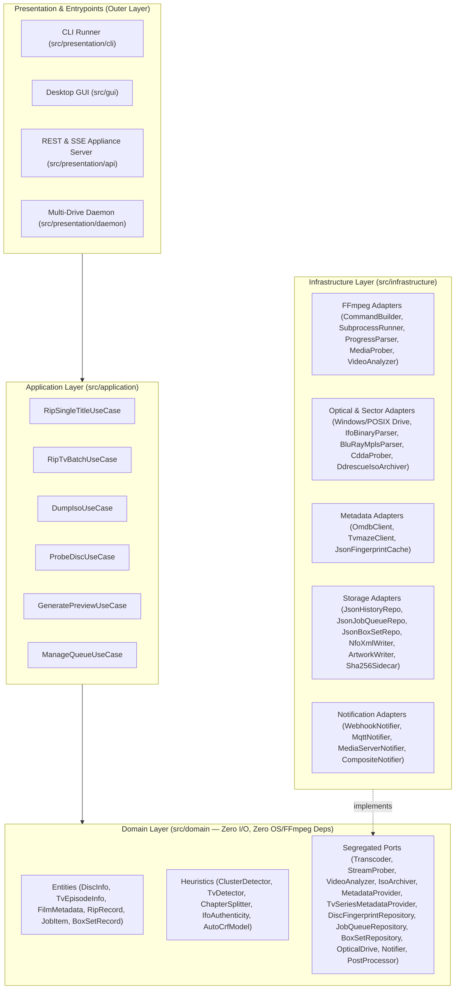

# Concrete SOLID & Clean Architecture Refactoring Plan

## 1. Executive Summary & Current Architecture Audit

While `dvd-ripper` already establishes a foundational Clean Architecture structure (`domain/`, `application/`, `infrastructure/`, `gui/`) with an [`AppContainer`](file:///c:/Users/User/.gemini/antigravity-ide/scratch/dvd-ripper/src/lib.rs#L128-L143) composition root and LSP contract tests, a deep static analysis of all 71 Rust source files (~24,500 LOC) reveals **five categories of residual SOLID violations** where legacy top-level procedural modules (`src/ffmpeg.rs`, `src/api.rs`, `src/utils.rs`, `src/dvd.rs`, `src/imdb.rs`, `src/iso.rs`, `src/queue.rs`) leak across architectural boundaries:

| File / Module | Lines | Primary SOLID Violations | Root Architectural Issue |
| :--- | ---: | :--- | :--- |
| [`src/ffmpeg.rs`](file:///c:/Users/User/.gemini/antigravity-ide/scratch/dvd-ripper/src/ffmpeg.rs) | 3,591 | **SRP, OCP, ISP, DIP** | God module mixing 8 responsibilities (CLI arg building, subprocess management, stderr parsing, IFO/chapter probing, Auto-CRF/crop/forced-sub analysis, Blu-ray/CDDA pipelines, output path resolution, and post-processing). |
| [`src/api.rs`](file:///c:/Users/User/.gemini/antigravity-ide/scratch/dvd-ripper/src/api.rs) | 2,848 | **SRP, OCP, LSP, DIP** | Combines an 800-line HTML UI, 350-line OpenAPI JSON blob, raw HTTP/1.1 socket parsing, auth middleware, a 650-line `if/else if` route handler, and 6 `OnceLock` global mutable singletons. |
| [`src/utils.rs`](file:///c:/Users/User/.gemini/antigravity-ide/scratch/dvd-ripper/src/utils.rs) | 1,555 | **SRP, ISP, DIP** | Catch-all utility kitchen sink mixing filename sanitization, duration math, XML NFO generation, cover art I/O, SHA-256 hashing, OS shell commands, and Plex/Jellyfin URL builders. |
| [`src/gui/state.rs`](file:///c:/Users/User/.gemini/antigravity-ide/scratch/dvd-ripper/src/gui/state.rs) & [`src/gui/mod.rs`](file:///c:/Users/User/.gemini/antigravity-ide/scratch/dvd-ripper/src/gui/mod.rs) | 2,340 | **SRP, ISP, DIP** | [`DvdRipperApp`](file:///c:/Users/User/.gemini/antigravity-ide/scratch/dvd-ripper/src/gui/state.rs#L52-L162) is a 75+ field God struct that calls `crate::ffmpeg::*`, `crate::queue::*`, `crate::history::*`, and `crate::dvd::*` directly instead of going through ports/use cases. |
| [`src/application/*`](file:///c:/Users/User/.gemini/antigravity-ide/scratch/dvd-ripper/src/application/mod.rs) | 2,566 | **LSP, DIP** | [`RipTvBatchUseCase`](file:///c:/Users/User/.gemini/antigravity-ide/scratch/dvd-ripper/src/application/rip_tv_batch.rs#L257-L418), [`RipSingleTitleUseCase`](file:///c:/Users/User/.gemini/antigravity-ide/scratch/dvd-ripper/src/application/rip_single_title.rs#L135-L274), [`DumpIsoUseCase`](file:///c:/Users/User/.gemini/antigravity-ide/scratch/dvd-ripper/src/application/dump_iso.rs#L114-L245), [`ProbeDiscUseCase`](file:///c:/Users/User/.gemini/antigravity-ide/scratch/dvd-ripper/src/application/probe_disc.rs#L61-L162), and [`CliApplicationRunner`](file:///c:/Users/User/.gemini/antigravity-ide/scratch/dvd-ripper/src/application/cli_runner.rs#L221-L550) bypass domain ports and invoke `crate::ffmpeg`, `crate::iso`, `crate::imdb`, `crate::dvd`, and `crate::queue` directly. |
| [`src/cli.rs`](file:///c:/Users/User/.gemini/antigravity-ide/scratch/dvd-ripper/src/cli.rs) | 1,010 | **SRP, ISP** | [`Args`](file:///c:/Users/User/.gemini/antigravity-ide/scratch/dvd-ripper/src/cli.rs#L14-L355) is a 65+ field God configuration struct passed across infrastructure, daemon, API, and GUI layers. |
| [`src/queue.rs`](file:///c:/Users/User/.gemini/antigravity-ide/scratch/dvd-ripper/src/queue.rs) | 561 | **SRP, DIP** | Mixes Job Queue persistence, Spool file management, and TV BoxSet episode tracking behind process-wide `OnceLock<Arc<Mutex<...>>>` globals. |

---

## 2. Target Clean Architecture & Dependency Graph

All dependencies must point strictly **inward** toward the `domain` layer (`Presentation / CLI / GUI / API / Daemon` $\rightarrow$ `Application Use Cases` $\rightarrow$ `Domain Entities & Ports` $\leftarrow$ `Infrastructure Adapters`).



---

## 3. Detailed Violation Analysis & Concrete Remedies by SOLID Principle

### 3.1 Single Responsibility Principle (SRP)

#### Violation S1: [`src/ffmpeg.rs`](file:///c:/Users/User/.gemini/antigravity-ide/scratch/dvd-ripper/src/ffmpeg.rs) (3,591 lines) has 8 reasons to change
- **Current state**: Contains progress event structs, zero-allocation byte parsers, DVD title/chapter/stream probing, cropdetect/SSIM/forced-subtitle analysis passes, NVENC/QSV/AMF hardware probing, CLI argument builders for DVD/Blu-ray/CDDA, process spawning/cancellation, and output path formatting.
- **Concrete Refactor**: Decompose [`src/ffmpeg.rs`](file:///c:/Users/User/.gemini/antigravity-ide/scratch/dvd-ripper/src/ffmpeg.rs) into focused single-responsibility modules under `src/infrastructure/ffmpeg/` and `src/domain/`:
  1. `src/infrastructure/ffmpeg/progress_parser.rs`: `parse_ffmpeg_progress_line_str`, `parse_ffmpeg_progress_bytes`.
  2. `src/infrastructure/ffmpeg/hw_Capabilities.rs`: `resolve_video_codec`, `check_nvenc_support`, `check_qsv_support`, `check_amf_support`, `probe_encoder_available`.
  3. `src/infrastructure/ffmpeg/command_builder.rs`: `FfmpegCommandBuilder`, filter chain assembly (`bwdif`, `hqdn3d`, `cropdetect`, `fieldmatch`/`decimate`, `loudnorm`), chapter/angle selection, and target-bitrate calculation.
  4. `src/infrastructure/ffmpeg/multiformat_builder.rs`: `build_bluray_ffmpeg_args`, `build_audiocd_ffmpeg_args`, `generate_ffmetadata_chapters`, `merge_multi_disc_files`.
  5. `src/infrastructure/ffmpeg/analyzer.rs`: `FfmpegVideoAnalyzer` implementing `VideoAnalyzer` port (`detect_auto_crop_dimensions`, `predict_optimal_crf`, `detect_foreign_audio_forced_subtitle`, `generate_preview_clip`).
  6. `src/infrastructure/ffmpeg/prober.rs`: `FfmpegStreamProber` implementing `StreamProber` and `TitleProber` (`probe_title_stream_details`, `detect_best_title_info`, `detect_tv_episodes`).
  7. `src/infrastructure/ffmpeg/runner.rs`: Subprocess spawning, stderr streaming, and cooperative cancellation (`AtomicBool`).
  8. `src/domain/naming.rs`: Pure output path and Plex/Jellyfin directory resolution (`resolve_output_path`, `resolve_tv_output_path_with_title`, `resolve_tv_root`).

#### Violation S2: [`src/api.rs`](file:///c:/Users/User/.gemini/antigravity-ide/scratch/dvd-ripper/src/api.rs) (2,848 lines) mixes UI assets, HTTP protocol parsing, state, and business routing
- **Current state**: Embeds massive static strings (`EMBEDDED_DASHBOARD_HTML`, `OPENAPI_V3_JSON`), raw socket reading, authentication, Prometheus metrics, and all endpoint logic in one file.
- **Concrete Refactor**: Split into `src/presentation/api/`:
  1. `src/presentation/api/assets.rs` (or `include_str!` from `assets/dashboard.html` and `assets/openapi.json`): Static web dashboard and OpenAPI v3 spec.
  2. `src/presentation/api/http_codec.rs`: `read_http_request_safely`, `parse_http_route`, `extract_header_value`, `send_http_response`, `build_http_json_response_bytes`.
  3. `src/presentation/api/auth.rs`: `ApiKeyAuthenticator` middleware (`validate_api_key_header`, `extract_auth_key`).
  4. `src/presentation/api/state.rs`: `ApplianceStateStore` (encapsulating drive statuses, active rip telemetry, and cancellation tokens without global `OnceLock` leakage).
  5. `src/presentation/api/metrics.rs`: `PrometheusMetricsExporter` implementing `MetricsExporter`.
  6. `src/presentation/api/handlers/`: Individual route handler structs (`StatusHandler`, `RipControlHandler`, `QueueHandler`, `BoxSetHandler`, `HistoryHandler`, `BenchmarkHandler`).

#### Violation S3: [`src/gui/state.rs`](file:///c:/Users/User/.gemini/antigravity-ide/scratch/dvd-ripper/src/gui/state.rs) (1,552 lines) [`DvdRipperApp`](file:///c:/Users/User/.gemini/antigravity-ide/scratch/dvd-ripper/src/gui/state.rs#L52-L162) God Struct
- **Current state**: `DvdRipperApp` holds 75+ fields across 6 domains and directly performs file/history/fingerprint lookups.
- **Concrete Refactor**: Decompose `DvdRipperApp` state into cohesive sub-models under `src/gui/models/`:
  1. `DiscSourceState`: `input_drive`, `title_number`, `iso_mode`, `current_disc_fingerprint`, `last_disc_poll`, `probed_stream_details`.
  2. `EncodingFormState`: `codec`, `profile`, `preset`, `mkv`, `transcode`, `deinterlace`, `deinterlace_algo`, `denoise`, `auto_crop`, `detelecine`, `start_chapter`, `end_chapter`, `split_chapters`, `angle`, `custom_crf`, `all_audio`, `normalize_audio`, `norm_target`, `dual_audio`, `audio_lang`, `subtitles`, `sub_lang`, `sub_format`, `sub_forced_only`, `sub_external_srt`, `ocr`, `ocr_lang`.
  3. `TvSeriesViewState`: `is_tv_mode`, `season_number`, `start_episode`, `end_episode`, `auto_boxset`, `all_episodes`, `detected_episodes`, `completed_episodes`, `current_ripping_title`.
  4. `MediaMetadataViewState`: `film_name`, `film_year`, `expected_runtime_secs`, `plot`, `genre`, `director`, `actors`, `rating`, `raw_poster_bytes`, `poster_texture`, `title_thumbnails`, `search_candidates`.
  5. `RipProgressViewState`: `is_ripping`, `detecting`, `detect_status`, `progress_percent`, `fps`, `speed`, `status_message`, `start_time`, `eta_seconds`, `logs`.
  6. `ModalVisibilityState`: `show_search_modal`, `show_about_modal`, `show_help_modal`, `show_confirm_cancel`, `show_confirm_clear`, `show_confirm_reset`.

#### Violation S4: [`src/utils.rs`](file:///c:/Users/User/.gemini/antigravity-ide/scratch/dvd-ripper/src/utils.rs) (1,555 lines) Kitchen-Sink Module
- **Concrete Refactor**: Split into domain and infrastructure modules and keep `src/utils.rs` only as a thin re-export facade for backward compatibility:
  1. `src/domain/formatting.rs`: Pure string/duration/filename formatting (`sanitize_filename`, `is_safe_filename`, `format_episode_name`, `format_duration_hhmmss`, `parse_duration`, `parse_season_disc_from_label`).
  2. `src/infrastructure/storage/artwork_writer.rs`: `save_cover_artworks`, `resolve_artwork_path`.
  3. `src/infrastructure/storage/checksum_writer.rs`: `generate_sha256_sidecar`.
  4. `src/infrastructure/system/process_hook.rs`: `run_post_processing_hook`, `open_folder_in_explorer`, `command_exists`.

---

### 3.2 Open/Closed Principle (OCP)

#### Violation O1: Procedural Filter & Argument Construction in [`build_ffmpeg_command`](file:///c:/Users/User/.gemini/antigravity-ide/scratch/dvd-ripper/src/ffmpeg.rs)
- **Current state**: Adding a new video/audio filter or container flag requires modifying a monolithic procedural function.
- **Concrete Refactor**: Introduce an open/closed pipeline of `FfmpegArgContributor` strategies in `src/infrastructure/ffmpeg/pipeline.rs`:
  ```rust
  pub trait FfmpegArgContributor: Send + Sync {
      fn contribute_input_args(&self, ctx: &TranscodeContext, args: &mut Vec<String>);
      fn contribute_video_filters(&self, ctx: &TranscodeContext, filters: &mut Vec<String>);
      fn contribute_audio_filters(&self, ctx: &TranscodeContext, filters: &mut Vec<String>);
      fn contribute_output_args(&self, ctx: &TranscodeContext, args: &mut Vec<String>);
  }
  ```
   Concrete contributors: `ChapterRangeContributor`, `AngleSelectionContributor`, `DetelecineFilterContributor`, `DeinterlaceFilterContributor`, `AutoCropFilterContributor`, `DenoiseFilterContributor`, `ToneMapFilterContributor`, `VideoCodecContributor`, `AudioStreamContributor`, `SubtitleStreamContributor`. New filters or codecs can be added without modifying existing contributors.

#### Violation O2: Monolithic HTTP Route Conditional Chain in [`handle_client`](file:///c:/Users/User/.gemini/antigravity-ide/scratch/dvd-ripper/src/api.rs#L1288-L1950)
- **Current state**: 650+ lines of `if method_str == ... && path_str == ...`.
- **Concrete Refactor**: Introduce an `HttpEndpoint` trait and `HttpRouter` registry:
  ```rust
  pub trait HttpEndpoint: Send + Sync {
      fn matches(&self, method: &str, path: &str) -> bool;
      fn requires_auth(&self) -> bool { true }
      fn handle(&self, req: &HttpRequest, ctx: &ApiContext) -> HttpResponse;
  }
  ```
  Adding a new REST endpoint only requires registering a new `Box<dyn HttpEndpoint>` in `HttpRouter::build_default()`.

#### Violation O3: Hardcoded Disc Format Branching (`DVD` vs `BluRay` vs `AudioCd`)
- **Current state**: `match disc_format` in [`src/daemon.rs:91-113`](file:///c:/Users/User/.gemini/antigravity-ide/scratch/dvd-ripper/src/daemon.rs#L91-L113) and `src/ffmpeg.rs`.
- **Concrete Refactor**: Define a `DiscFormatDriver` trait in `src/domain/ports/optical_drive.rs` with implementations `DvdVideoFormatDriver`, `BluRayFormatDriver`, and `AudioCdFormatDriver` registered in a composite `OpticalFormatRegistry`.

---

### 3.3 Liskov Substitution Principle (LSP)

#### Violation L1: [`ProbeDiscUseCase`](file:///c:/Users/User/.gemini/antigravity-ide/scratch/dvd-ripper/src/application/probe_disc.rs#L100-L162) bypasses `&dyn OpticalDrive` to read the host filesystem
- **Current state**: Line 102 calls `crate::dvd::compute_disc_fingerprint(&drive_path.to_string_lossy())` and line 114 calls `crate::imdb::lookup_fingerprint_cache(&fingerprint)` directly instead of using the `drive: &dyn OpticalDrive` trait method `drive.compute_fingerprint()` and an injected `DiscFingerprintRepository` port.
- **Concrete Refactor**:
  1. Call `let fingerprint = drive.compute_fingerprint(&drive_path);` on the `OpticalDrive` (`DiscInspector` supertrait) port.
  2. Inject `fingerprint_repo: Option<Arc<dyn DiscFingerprintRepository>>` into `ProbeDiscUseCase` instead of calling `crate::imdb::lookup_fingerprint_cache`.
  3. Add an LSP contract test in [`tests/lsp_contract_tests.rs`](file:///c:/Users/User/.gemini/antigravity-ide/scratch/dvd-ripper/tests/lsp_contract_tests.rs) verifying `ProbeDiscUseCase` works identically with a pure in-memory `OpticalDrive` double on a non-existent path.

#### Violation L2: `Transcoder::transcode` vs `Transcoder::transcode_chapter_range` and `FfmpegTranscoder` options state
- **Current state**: [`TranscodeJob`](file:///c:/Users/User/.gemini/antigravity-ide/scratch/dvd-ripper/src/domain/ports/transcoder.rs#L10-L17) lacks `chapter_range: Option<(u32, u32)>`, forcing a separate `transcode_chapter_range` method on [`Transcoder`](file:///c:/Users/User/.gemini/antigravity-ide/scratch/dvd-ripper/src/domain/ports/transcoder.rs#L121-L148) with a default implementation that ignores `chapter_range`! That means a mock or alternative `Transcoder` that only implements `transcode` silently drops chapter ranges!
- **Concrete Refactor**:
  1. Add `pub chapter_range: Option<(u32, u32)>` directly to [`TranscodeJob`](file:///c:/Users/User/.gemini/antigravity-ide/scratch/dvd-ripper/src/domain/ports/transcoder.rs#L10-L17).
  2. Keep `transcode_chapter_range` as a convenience wrapper that sets `job.chapter_range = chapter_range` and delegates to `self.transcode(&job, observer, cancel_flag)`, guaranteeing every `Transcoder` implementation honors `chapter_range` consistently.

#### Violation L3: No-Op `SseBroadcastEngine` & Divergent `PrometheusMetricsExporter` in [`src/api.rs`](file:///c:/Users/User/.gemini/antigravity-ide/scratch/dvd-ripper/src/api.rs#L39-L71)
- **Current state**: `PrometheusMetricsExporter::render_metrics()` outputs a 2-metric string while `render_prometheus_metrics()` outputs a 5-metric string; `SseBroadcastEngine::broadcast_json_event` is a no-op stub.
- **Concrete Refactor**:
  1. Unify `PrometheusMetricsExporter::render_metrics(&self)` with `render_prometheus_metrics()` so `GET /metrics` calls `exporter.render_metrics()` via the `MetricsExporter` port.
  2. Wire a real subscriber channel list into `SseBroadcastEngine` so `GET /api/events` and `broadcast_json_event` honor the broadcast contract.

---

### 3.4 Interface Segregation Principle (ISP)

#### Violation I1: [`Args`](file:///c:/Users/User/.gemini/antigravity-ide/scratch/dvd-ripper/src/cli.rs#L14-L355) (65+ fields) used as a universal parameter bag across layers
- **Current state**: Functions in `src/ffmpeg.rs`, `src/daemon.rs`, `src/api.rs`, and `src/gui/controller.rs` construct dummy `Args::default()` instances just to pass 3–5 options into lower layers.
- **Concrete Refactor**: Segregate [`Args`](file:///c:/Users/User/.gemini/antigravity-ide/scratch/dvd-ripper/src/cli.rs#L14-L355) into focused domain option structs in `src/domain/entities/options.rs`:
  1. `VideoEncodingSpec`: `codec`, `profile`, `preset`, `crf`, `target_size_mb`, `hwaccel_fallback`, `tonemap`.
  2. `VideoFilterSpec`: `deinterlace`, `deinterlace_algo`, `denoise`, `auto_crop`, `detelecine`.
  3. `AudioEncodingSpec`: `all_audio`, `audio_lang`, `audio_tracks`, `dual_audio`, `normalize_audio`, `norm_target`.
  4. `SubtitleSpec`: `subtitles`, `sub_lang`, `sub_format`, `sub_forced_only`, `sub_external_srt`, `ocr`, `ocr_lang`, `tesseract_path`.
  5. `DiscSelectionSpec`: `title_number`, `start_chapter`, `end_chapter`, `split_chapters`, `angle`, `rip_extras`, `sector_retries`.
  6. `OutputNamingSpec`: `out_dir`, `explicit_output`, `mkv`, `iso`, `no_overwrite`.
  `Args` in `src/cli.rs` implements `Into<...>` for each segregated spec, and lower layers only accept the narrow spec they actually use.

#### Violation I2: GUI Tab Render Functions Taking 18–42 Arguments (`#[allow(clippy::too_many_arguments)]`)
- **Current state**: [`render_rip_tab`](file:///c:/Users/User/.gemini/antigravity-ide/scratch/dvd-ripper/src/gui/tabs/rip_tab.rs#L13-L60) takes 42 arguments; [`render_tv_tab`](file:///c:/Users/User/.gemini/antigravity-ide/scratch/dvd-ripper/src/gui/tabs/tv_tab.rs#L10-L28) takes 18 arguments.
- **Concrete Refactor**: Pass segregated view-state references and return a typed `TabAction` enum from each tab renderer:
  - `pub fn render_rip_tab(ui: &mut egui::Ui, source: &mut DiscSourceState, encoding: &mut EncodingFormState, meta: &MediaMetadataViewState, is_busy: bool) -> Option<RipTabAction>`
  - `pub fn render_tv_tab(ui: &mut egui::Ui, tv: &mut TvSeriesViewState, meta: &mut MediaMetadataViewState, is_busy: bool) -> Option<TvTabAction>`
  - Remove `#[allow(clippy::too_many_arguments)]` from all GUI tab modules.

#### Violation I3: Missing Segregated Ports for `VideoAnalyzer`, `IsoArchiver`, `BoxSetRepository`, `JobQueueRepository`, and `DiscFingerprintRepository`
- **Current state**: [`AppContainer`](file:///c:/Users/User/.gemini/antigravity-ide/scratch/dvd-ripper/src/lib.rs#L128-L143) only exposes `ThumbnailExtractor`, leaving stream probing, Auto-CRF/crop video analysis, ISO sector dumping, box-set tracking, job queueing, and fingerprint caching outside `domain::ports`.
- **Concrete Refactor**: Add small, single-purpose port traits in `src/domain/ports/`:
  - `StreamProber` (already in [`src/domain/ports/media_probe.rs`](file:///c:/Users/User/.gemini/antigravity-ide/scratch/dvd-ripper/src/domain/ports/media_probe.rs#L36-L61) — wire into `AppContainer`)
  - `VideoAnalyzer` (`predict_optimal_crf`, `detect_auto_crop`, `detect_forced_subtitle`, `generate_preview_clip`)
  - `IsoArchiver` (`dump_disc_to_iso` with `ProgressObserver` and `cancel_flag`)
  - `BoxSetRepository` (`get_next_episode`, `record_episodes_ripped`, `reset_tracker`, `list_boxsets`)
  - `JobQueueRepository` (move from `src/queue.rs` to `src/domain/ports/queue.rs` and expand with priority/spool operations)
  - `DiscFingerprintRepository` (`lookup_fingerprint`, `save_fingerprint`)

---

### 3.5 Dependency Inversion Principle (DIP)

#### Violation D1: Application Use Cases Directly Call Concrete Infrastructure Functions
- **Locations**:
  - [`RipTvBatchUseCase::execute`](file:///c:/Users/User/.gemini/antigravity-ide/scratch/dvd-ripper/src/application/rip_tv_batch.rs#L305-L414) calls `crate::infrastructure::metadata::fetch_tvmaze_episodes`, `crate::ffmpeg::probe_title_stream_details`, and `crate::queue::record_boxset_episodes_ripped`.
  - [`RipSingleTitleUseCase::execute_with_chapter_range`](file:///c:/Users/User/.gemini/antigravity-ide/scratch/dvd-ripper/src/application/rip_single_title.rs#L237) calls `crate::infrastructure::storage::nfo_writer::generate_nfo_file`.
  - [`DumpIsoUseCase::execute`](file:///c:/Users/User/.gemini/antigravity-ide/scratch/dvd-ripper/src/application/dump_iso.rs#L178-L215) calls `crate::iso::dump_disc_to_iso` and matches `crate::ffmpeg::ProgressEvent`.
  - [`ProbeDiscUseCase::execute`](file:///c:/Users/User/.gemini/antigravity-ide/scratch/dvd-ripper/src/application/probe_disc.rs#L102-L114) calls `crate::dvd::compute_disc_fingerprint` and `crate::imdb::lookup_fingerprint_cache`.
- **Concrete Refactor**:
  - Inject `tv_metadata_provider: Arc<dyn TvSeriesMetadataProvider>`, `stream_prober: Arc<dyn StreamProber>`, and `boxset_repo: Arc<dyn BoxSetRepository>` into [`RipTvBatchUseCase`](file:///c:/Users/User/.gemini/antigravity-ide/scratch/dvd-ripper/src/application/rip_tv_batch.rs#L257).
  - Inject `iso_archiver: Arc<dyn IsoArchiver>` into [`DumpIsoUseCase`](file:///c:/Users/User/.gemini/antigravity-ide/scratch/dvd-ripper/src/application/dump_iso.rs#L114) so `DumpIsoUseCase` uses `ProgressObserver` directly without spawning a channel adapter for `crate::ffmpeg::ProgressEvent`.
  - Inject `nfo_writer: Arc<dyn MetadataSidecarWriter>` (or `PostProcessor`) into [`RipSingleTitleUseCase`](file:///c:/Users/User/.gemini/antigravity-ide/scratch/dvd-ripper/src/application/rip_single_title.rs#L135).
  - Inject `fingerprint_repo: Arc<dyn DiscFingerprintRepository>` into [`ProbeDiscUseCase`](file:///c:/Users/User/.gemini/antigravity-ide/scratch/dvd-ripper/src/application/probe_disc.rs#L61).

#### Violation D2: [`CliMetadataResolver`](file:///c:/Users/User/.gemini/antigravity-ide/scratch/dvd-ripper/src/application/cli_runner.rs#L11-L218), [`CliApplicationRunner`](file:///c:/Users/User/.gemini/antigravity-ide/scratch/dvd-ripper/src/application/cli_runner.rs#L221-L550), and [`GuiApplicationController`](file:///c:/Users/User/.gemini/antigravity-ide/scratch/dvd-ripper/src/gui/controller.rs#L41-L716) Bypass `AppContainer` Ports
- **Current state**: `CliMetadataResolver` holds `container: &'a AppContainer` yet calls `crate::imdb::lookup_omdb_by_id`, `crate::imdb::fetch_search_candidates`, and `crate::imdb::lookup_film_details` instead of `self.container.metadata_provider`! Similarly, `GuiApplicationController::start_detection` calls `crate::imdb::*` and `crate::ffmpeg::*` directly.
- **Concrete Refactor**:
  - Route all metadata queries in `CliMetadataResolver`, `GuiApplicationController`, and `daemon::process_detected_disc` through `container.metadata_provider`, `container.tv_metadata_provider`, and `container.fingerprint_repo`.
  - Route all title/stream/thumbnail/preview/Auto-CRF operations in `DvdRipperApp` and `GuiApplicationController` through `container.stream_prober`, `container.video_analyzer`, `container.boxset_repo`, and `container.job_queue_repo`.

#### Violation D3: Global Mutable Singletons (`OnceLock<Arc<Mutex<...>>>`) in [`src/queue.rs`](file:///c:/Users/User/.gemini/antigravity-ide/scratch/dvd-ripper/src/queue.rs#L52-L63) and [`src/api.rs`](file:///c:/Users/User/.gemini/antigravity-ide/scratch/dvd-ripper/src/api.rs#L22-L139)
- **Current state**: `JOB_QUEUE`, `BOXSET_MANAGER`, `APPLIANCE_STATUS`, `DRIVE_POOL`, `CANCEL_FLAG`, and `CANCEL_TX` are global `OnceLock` statics.
- **Concrete Refactor**:
  - Encapsulate `JsonJobQueueRepository` and `JsonBoxSetRepository` as stateful thread-safe instances owned by [`AppContainer`](file:///c:/Users/User/.gemini/antigravity-ide/scratch/dvd-ripper/src/lib.rs#L128-L143).
  - Encapsulate `ApplianceStateStore` inside `AppContainer` (or `ApiServerContext`) and pass it to the HTTP server and daemon watchers. Keep deprecated thin wrapper functions in `src/queue.rs` and `src/api.rs` only for backward compatibility with external callers.

---

## 4. Phased Implementation Roadmap

### Phase 1: Segregate Domain Ports & Options (ISP & LSP Foundation)
1. **Expand `src/domain/ports/`**:
   - Add `VideoAnalyzer` port to [`src/domain/ports/media_probe.rs`](file:///c:/Users/User/.gemini/antigravity-ide/scratch/dvd-ripper/src/domain/ports/media_probe.rs) (`predict_optimal_crf`, `detect_auto_crop`, `detect_forced_subtitle`, `generate_preview_clip`).
   - Add `IsoArchiver` port to `src/domain/ports/iso_archiver.rs` (`dump_disc_to_iso`).
   - Add `JobQueueRepository` and `BoxSetRepository` ports to `src/domain/ports/queue.rs`.
   - Add `DiscFingerprintRepository` port to [`src/domain/ports/metadata.rs`](file:///c:/Users/User/.gemini/antigravity-ide/scratch/dvd-ripper/src/domain/ports/metadata.rs).
   - Add `chapter_range: Option<(u32, u32)>` to [`TranscodeJob`](file:///c:/Users/User/.gemini/antigravity-ide/scratch/dvd-ripper/src/domain/ports/transcoder.rs#L10-L17) so all `Transcoder` implementations satisfy LSP for chapter-range jobs.
2. **Create Segregated Option Value Objects in `src/domain/entities/options.rs`**:
   - Define `VideoEncodingSpec`, `VideoFilterSpec`, `AudioEncodingSpec`, `SubtitleSpec`, `DiscSelectionSpec`, and `OutputNamingSpec`.
3. **Register New Ports in [`AppContainer`](file:///c:/Users/User/.gemini/antigravity-ide/scratch/dvd-ripper/src/lib.rs#L128-L143)**:
   - Add `stream_prober: Arc<dyn StreamProber>`, `video_analyzer: Arc<dyn VideoAnalyzer>`, `iso_archiver: Arc<dyn IsoArchiver>`, `job_queue_repo: Arc<dyn JobQueueRepository>`, `boxset_repo: Arc<dyn BoxSetRepository>`, and `fingerprint_repo: Arc<dyn DiscFingerprintRepository>`.

### Phase 2: Invert Dependencies in Application Use Cases (DIP & LSP)
1. **Refactor [`ProbeDiscUseCase`](file:///c:/Users/User/.gemini/antigravity-ide/scratch/dvd-ripper/src/application/probe_disc.rs)**:
   - Replace `crate::dvd::compute_disc_fingerprint` with `drive.compute_fingerprint(drive.get_path())`.
   - Replace `crate::imdb::lookup_fingerprint_cache` with `self.fingerprint_repo`.
2. **Refactor [`RipTvBatchUseCase`](file:///c:/Users/User/.gemini/antigravity-ide/scratch/dvd-ripper/src/application/rip_tv_batch.rs)**:
   - Inject `Option<Arc<dyn TvSeriesMetadataProvider>>`, `Option<Arc<dyn StreamProber>>`, and `Option<Arc<dyn BoxSetRepository>>` (with builder/constructor defaults so existing public API callers remain 100% compatible).
   - Remove direct calls to `crate::infrastructure::metadata::*`, `crate::ffmpeg::*`, and `crate::queue::*`.
3. **Refactor [`DumpIsoUseCase`](file:///c:/Users/User/.gemini/antigravity-ide/scratch/dvd-ripper/src/application/dump_iso.rs)**:
   - Inject `Arc<dyn IsoArchiver>` and remove direct dependency on `crate::iso::dump_disc_to_iso` and `crate::ffmpeg::ProgressEvent`.
4. **Refactor [`CliMetadataResolver`](file:///c:/Users/User/.gemini/antigravity-ide/scratch/dvd-ripper/src/application/cli_runner.rs#L11-L218) & [`CliApplicationRunner`](file:///c:/Users/User/.gemini/antigravity-ide/scratch/dvd-ripper/src/application/cli_runner.rs#L221-L550)**:
   - Replace all direct calls to `crate::imdb::*`, `crate::dvd::*`, `crate::ffmpeg::*`, and `crate::queue::*` with calls to `self.container` ports and use cases.

### Phase 3: Decompose God Module `src/ffmpeg.rs` & `src/utils.rs` (SRP & OCP)
1. **Extract `src/infrastructure/ffmpeg/` submodules**:
   - `progress_parser.rs`: Stderr progress line & zero-alloc byte parser.
   - `hw_accel.rs`: Hardware encoder probing (`NVENC`, `QSV`, `AMF`) & fallback resolution.
   - `pipeline.rs`: Open/Closed `FfmpegArgContributor` filter & stream argument builders.
   - `prober.rs`: `FfmpegStreamProber` & IFO/chapter/title inspection.
   - `analyzer.rs`: `FfmpegVideoAnalyzer` (Auto-CRF SSIM probe, Auto-Crop `cropdetect`, forced subtitle scan, 10s live preview clip).
   - `multiformat.rs`: Blu-ray (`BDMV`), Audio CD (`CDDA`), `ffmetadata` chapters, and multi-disc concatenation.
   - Keep `src/ffmpeg.rs` as a clean facade re-exporting public functions so external callers and existing tests compile without breakage.
2. **Extract `src/domain/naming.rs` & `src/domain/formatting.rs` from `src/utils.rs`**:
   - Move pure path/title/duration/episode formatting functions into `src/domain/` and I/O helpers into `src/infrastructure/storage/` and `src/infrastructure/system/`.

### Phase 4: Decompose `src/gui/` God Struct & Signatures (SRP, ISP, DIP)
1. **Group [`DvdRipperApp`](file:///c:/Users/User/.gemini/antigravity-ide/scratch/dvd-ripper/src/gui/state.rs#L52-L162) fields into domain-aligned sub-structs** (`DiscSourceState`, `EncodingFormState`, `TvSeriesViewState`, `MediaMetadataViewState`, `RipProgressViewState`, `ModalVisibilityState`) while providing field-Or-method accessors.
2. **Refactor [`render_rip_tab`](file:///c:/Users/User/.gemini/antigravity-ide/scratch/dvd-ripper/src/gui/tabs/rip_tab.rs) and [`render_tv_tab`](file:///c:/Users/User/.gemini/antigravity-ide/scratch/dvd-ripper/src/gui/tabs/tv_tab.rs)** to accept segregated state structs/slices instead of 42 / 18 primitive arguments, eliminating `#[allow(clippy::too_many_arguments)]`.
3. **Eliminate direct infrastructure calls from `src/gui/state.rs` and `src/gui/controller.rs`**:
   - Route Auto-CRF, queue management, history management, fingerprint cache, and disc probing through `GuiApplicationController` $\rightarrow$ `AppContainer` ports.

### Phase 5: Modularize `src/api.rs` & `src/daemon.rs` (SRP, OCP, LSP, DIP)
1. **Extract Static Assets**: Move `EMBEDDED_DASHBOARD_HTML` and `OPENAPI_V3_JSON` into dedicated submodule files `src/infrastructure/api/dashboard_html.rs` and `src/infrastructure/api/openapi_spec.rs`.
2. **Introduce Open/Closed `HttpRouter` & `HttpEndpoint` Handlers**:
   - Replace the 650-line `if/else if` chain in `handle_client` with modular endpoint handlers (`StatusEndpoint`, `RipEndpoint`, `QueueEndpoint`, `BoxSetEndpoint`, `HistoryEndpoint`, `MetricsEndpoint`, `SseEventsEndpoint`).
3. **Unify `PrometheusMetricsExporter` & `SseBroadcastEngine` (LSP)**:
   - Make `GET /metrics` delegate to `PrometheusMetricsExporter::render_metrics()` and implement real subscriber broadcasting in `SseBroadcastEngine`.

---

## 5. Verification & Contract Testing Matrix

Every phase will be gated by automated verification:
1. **Zero Warnings & Clean Compilation**:
   - `cargo clippy --all-targets -- -D warnings`
2. **Full Unit & Integration Test Suite**:
   - `cargo test --all-targets` (preserving all 337+ existing unit tests, 9 CLI tests, and 4 installer tests).
3. **Expanded LSP & DIP Contract Suite ([`tests/lsp_contract_tests.rs`](file:///c:/Users/User/.gemini/antigravity-ide/scratch/dvd-ripper/tests/lsp_contract_tests.rs))**:
   - `test_lsp_probe_disc_use_case_pure_mock_optical_drive`: Verifies `ProbeDiscUseCase` executes purely through `&dyn OpticalDrive` and `Arc<dyn DiscFingerprintRepository>` without touching the host OS filesystem.
   - `test_lsp_rip_tv_batch_use_case_port_inversion`: Verifies `RipTvBatchUseCase` executes Play-All chapter splitting, TVMaze episode lookup, and BoxSet tracking purely through `StreamProber`, `TvSeriesMetadataProvider`, and `BoxSetRepository` ports.
   - `test_lsp_dump_iso_use_case_archiver_substitutability`: Verifies `DumpIsoUseCase` delegates sector imaging to any `IsoArchiver` implementation.
   - `test_lsp_transcoder_chapter_range_contract`: Verifies all `Transcoder` implementations honor `TranscodeJob::chapter_range`.
   - `test_ocp_ffmpeg_arg_contributor_pipeline`: Verifies custom `FfmpegArgContributor` stages can be injected without modifying `FfmpegCommandBuilder`.
   - `test_ocp_http_router_custom_endpoint_registration`: Verifies new `HttpEndpoint` implementations can be registered into the API router without modifying router dispatch code.

