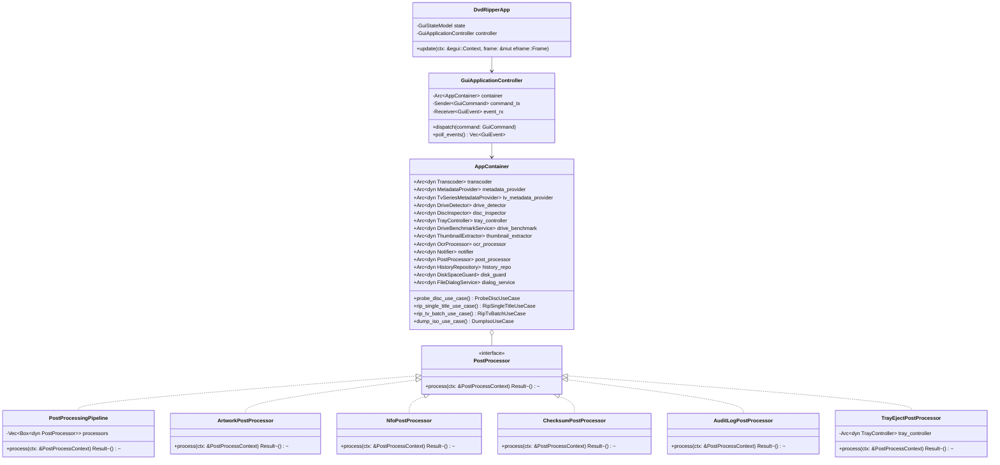

# SOLID Refactoring Plan: DVD Ripper Architecture

## 1. Executive Summary & Objective

This document outlines a comprehensive, concrete refactoring plan to transform the **DVD Ripper** codebase into a 100% **SOLID** architecture (Single Responsibility, Open/Closed, Liskov Substitution, Interface Segregation, and Dependency Inversion).

While previous phases established hexagonal architecture (domain ports, use cases, and modular GUI components), several critical violations of SOLID principles remain across the application, CLI, daemon, and GUI layers:

1. **SRP Violations**:
   - `src/gui/state.rs` (1,300+ lines) combines UI state management, background thread lifecycle coordination, raw filesystem operations, command execution, and history persistence.
   - `src/main.rs` (576 lines) interlaces CLI arg parsing, terminal prompt interactive loops, copy-protection checks, benchmark execution, ripping dispatch, and a hardcoded 8-step post-processing sequence (artworks, NFOs, checksums, audit logs, history purging, script hooks, media server scans, drive ejection/spindown).
   - `src/daemon.rs` duplicates disc inspection, metadata lookup, and execution logic while directly polling filesystem paths.

2. **OCP Violations**:
   - Post-processing is hardcoded; adding a new post-rip action (e.g., Discord notification, cloud backup, secondary transcode) requires modifying `main.rs`, `daemon.rs`, and `gui/state.rs`.
   - Title ranking and TV episode discovery use fixed static functions rather than pluggable strategy abstractions.
   - Drive throughput benchmarking is tightly coupled to FFmpeg null-muxer subprocess calls.

3. **LSP Violations**:
   - Historical storage and disk space checks have subtle differences between concrete implementations and mocks (e.g., error propagation vs default fallback).
   - Platform optical operations (Windows vs Linux vs macOS) must guarantee strictly identical contract behaviors without panicking or inconsistent failure modes.

4. **ISP Violations**:
   - `OpticalDrive` remains a monolithic trait combining device identity, volume label querying, title probing, protection inspection, and tray ejection.
   - Clients needing simple thumbnail extraction or stream probing are forced to depend on the heavyweight `Transcoder` or call low-level free functions.
   - Movie metadata lookups and TV series episodic lookups are split inconsistently between traits and loose functions.

5. **DIP Violations**:
   - `gui/state.rs`, `main.rs`, and `daemon.rs` directly invoke low-level free functions from `crate::dvd`, `crate::ffmpeg`, `crate::imdb`, `crate::ocr`, and `crate::utils`.
   - `AppContainer` currently manages only a subset of services (transcoder, metadata, drive detector, notifier, history, disk guard, dialogs), omitting disc inspection, tray control, benchmarking, thumbnail extraction, post-processing pipelines, and OCR.

---

## 2. Target SOLID Architecture Overview



---

## 3. SOLID Principles Gap Analysis & Concrete Solutions

### 3.1 Single Responsibility Principle (SRP)

| Component | Current Multiple Responsibilities | Proposed Single Responsibility Decomposition |
| :--- | :--- | :--- |
| `src/gui/state.rs` | UI form state + thread spawning + mpsc channel polling + direct CLI command calling + JSON history persistence + tray operations. | 1. `GuiStateModel`: Pure UI presentation state and form inputs.<br>2. `GuiApplicationController`: Background thread orchestrator & command dispatcher.<br>3. `GuiEventTranslator`: Converts `ProgressEvent` and worker outcomes into UI state mutations. |
| `src/main.rs` | CLI parsing + terminal prompt candidate selection + copy-protection checks + benchmark execution + ripping dispatch + 8 post-rip actions. | 1. `CliMetadataResolver`: Interactive terminal metadata candidate selection.<br>2. `CliApplicationRunner`: Command-line execution orchestrator.<br>3. `PostProcessingPipeline`: Executes decoupled post-rip actions. |
| `src/daemon.rs` | Drive filesystem polling + notification dispatch + title probing + auto-rip execution + disc tray ejection. | 1. `DaemonDrivePoller`: Optical disc arrival/departure detector.<br>2. `DaemonOrchestrator`: Delegates discovery, metadata matching, ripping, and ejection to `AppContainer`. |
| `src/api.rs` | Raw HTTP socket server + request/header parsing + routing + telemetry counters + OpenAPI spec generation + drive pool management. | 1. `HttpTransport`: TCP listener and raw HTTP parser.<br>2. `ApiRouter`: Maps HTTP request method/path to handlers.<br>3. `ApiHandlers`: Invokes application use cases and returns JSON responses. |

### 3.2 Open/Closed Principle (OCP)

| Domain Area | Current Closed Implementation | Proposed Open/Closed Abstraction |
| :--- | :--- | :--- |
| **Post-Processing Pipeline** | Fixed sequential calls in `main.rs`, `daemon.rs`, and `gui/state.rs`. | `PostProcessor` trait (Chain of Responsibility). Register new post-processors without modifying caller or use cases. |
| **Optical Benchmarking** | Hardcoded subprocess call to `ffmpeg -f null -`. | `DriveBenchmarkService` trait with `FfmpegDriveBenchmarkService` and `MockDriveBenchmarkService`. |
| **Title Ranking & Feature Selection** | Hardcoded static heuristic in `cluster_detector.rs`. | `TitleRankingStrategy` trait (`ClusterTitleRankingStrategy`, `LongestTrackStrategy`, `ManualTitleStrategy`). |
| **TV Episode Discovery** | Hardcoded static heuristic in `tv_detector.rs`. | `EpisodeDetectionStrategy` trait (`DurationClusteringTvStrategy`, `ExplicitTitleTvStrategy`). |
| **Thumbnail Extraction** | Loose free function in `ffmpeg.rs`. | `ThumbnailExtractor` trait (`FfmpegThumbnailExtractor`, `MockThumbnailExtractor`). |

### 3.3 Liskov Substitution Principle (LSP)

| Abstraction | Concrete Implementations | Substitution Invariants & Contract Guarantees |
| :--- | :--- | :--- |
| `HistoryRepository` | `JsonHistoryRepository`, `InMemoryHistoryRepository` | - `load_history` must return `Vec::new()` for nonexistent paths; never panic.<br>- `append_record` must atomically persist records.<br>- `clear_history` must reset records to empty without deleting unowned files. |
| `DiskSpaceGuard` | `SystemDiskSpaceGuard`, `MockDiskSpaceGuard` | - If available space < `min_free_gb`, must return `Err(DvdError::InsufficientDiskSpace)`.<br>- Non-existent paths resolve to parent directory without throwing unexpected I/O errors. |
| `TrayController` | `WindowsTrayController`, `UnixTrayController`, `MockTrayController` | - `eject_tray`, `close_tray`, `spindown` must return `Ok(())` on supported hardware or typed `DvdError::UnsupportedPlatform` / `anyhow` errors; never panic or terminate the process. |
| `Transcoder` | `FfmpegTranscoder`, `MockTranscoder` | - Cooperative cancellation via `cancel_flag` must promptly stop processing, clean up partial target files, and return `Err` indicating cancellation. |

### 3.4 Interface Segregation Principle (ISP)

| Monolithic / Oversized Interface | Segregated Fine-Grained Interfaces | Client Consumers |
| :--- | :--- | :--- |
| `OpticalDrive` (combines identity, label, title probe, protection check, tray eject) | 1. `DriveIdentity`: `get_path`, `read_volume_label`<br>2. `TitleProber`: `probe_titles`<br>3. `ProtectionInspector`: `inspect_protection`<br>4. `TrayOperator`: `eject`, `close`, `spindown` | - Detection loops only use `DriveIdentity`.<br>- Scanner tabs only use `TitleProber`.<br>- Diagnostic tools only use `ProtectionInspector`.<br>- Auto-eject only uses `TrayOperator`. |
| `MetadataProvider` (combines search and details) | 1. `MetadataProvider`: Film search & metadata lookups.<br>2. `TvSeriesMetadataProvider`: TV series episode catalog lookups (TVMaze). | - Movie ripper uses `MetadataProvider`.<br>- TV series ripper uses `TvSeriesMetadataProvider`. |
| `Transcoder` (used directly when only thumbnail needed) | 1. `Transcoder`: Full video/audio transcoding.<br>2. `ThumbnailExtractor`: Single frame video thumbnail extraction. | - GUI title preview and TV scan only depend on `ThumbnailExtractor`. |

### 3.5 Dependency Inversion Principle (DIP)

All high-level modules (`main.rs`, `daemon.rs`, `gui::DvdRipperApp`, `api::ApiServer`) must exclusively depend on abstractions registered within `AppContainer`. Low-level modules (`infrastructure::*`, `dvd::*`, `ffmpeg::*`, `imdb::*`, `ocr::*`, `utils::*`) implement those abstractions.

```
+-------------------------------------------------------------+
|                     High-Level Modules                      |
|       (CLI Runner, Daemon Watcher, GUI Controller, API)     |
+-------------------------------------------------------------+
                              |
                              v  depends on
+-------------------------------------------------------------+
|                     Domain Ports Layer                      |
|   (Transcoder, MetadataProvider, DiscInspector, TrayController,  |
|    PostProcessor, DriveBenchmarkService, ThumbnailExtractor)   |
+-------------------------------------------------------------+
                              ^
                              |  implements
+-------------------------------------------------------------+
|                 Infrastructure Adapters Layer               |
|   (FfmpegTranscoder, OmdbProvider, SystemDiscInspector,     |
|    WindowsTrayController, NativeFileDialog, JsonHistory)     |
+-------------------------------------------------------------+
```

---

## 4. Step-by-Step Implementation Roadmap

### Phase 1: Domain Ports & Segregated Interfaces Expansion (ISP & DIP)
- **Files**:
  - `src/domain/ports/optical_drive.rs`: Introduce `TitleProber`, `ProtectionInspector`, `TrayOperator`, and refine `OpticalDrive` as a composed trait.
  - `src/domain/ports/metadata.rs`: Introduce `TvSeriesMetadataProvider` trait for episodic season/episode catalog queries.
  - `src/domain/ports/media_probe.rs`: Introduce `ThumbnailExtractor` and `StreamProber` traits.
  - `src/domain/ports/benchmark.rs`: Introduce `DriveBenchmarkService` trait.
- **Verification**: Ensure all traits have clear contract documentation, `# Examples`, and `# Errors` sections.

### Phase 2: Post-Processing Pipeline & Extensible Strategies (OCP & SRP)
- **Files**:
  - `src/domain/ports/post_processor.rs`:
    - Define `PostProcessContext` (output file path, title, year, season, episode, media type, artwork bytes, NFO tags, disc drive path, checksum flag, audit log path, post script hook, no_eject, etc.).
    - Define `pub trait PostProcessor: Send + Sync { fn process(&self, ctx: &PostProcessContext) -> Result<()>; }`.
  - `src/infrastructure/post_processors/`:
    - `artwork.rs`: Saves poster artworks to `.jpg` / `cover.jpg`.
    - `nfo.rs`: Generates Kodi/Jellyfin/Plex compatible `.nfo` metadata documents.
    - `checksum.rs`: Calculates and writes `.sha256` verification files.
    - `audit_log.rs`: Records JSON audit entries for operational traceability.
    - `history_purge.rs`: Automatically purges expired rip history records.
    - `script_hook.rs`: Executes user-defined post-processing shell scripts safely.
    - `media_server.rs`: Triggers library refresh on Jellyfin, Plex, and Emby instances.
    - `tray_eject.rs`: Manages drive tray ejection, auto-close timers, and motor spindown.
    - `pipeline.rs`: `PostProcessingPipeline` implementing `PostProcessor` to execute all active processors sequentially.
- **Verification**: Unit tests verifying individual post-processors and composite pipeline execution.

### Phase 3: Infrastructure Adapters & Full Composition Root in AppContainer (DIP)
- **Files**:
  - `src/infrastructure/optical/benchmark.rs`: Implements `DriveBenchmarkService` using FFmpeg.
  - `src/infrastructure/ffmpeg/thumbnail.rs`: Implements `ThumbnailExtractor`.
  - `src/infrastructure/metadata/tvmaze.rs`: Implements `TvSeriesMetadataProvider`.
  - `src/lib.rs`: Expand `AppContainer` to hold:
    - `disc_inspector: Arc<dyn DiscInspector>`
    - `tray_controller: Arc<dyn TrayController>`
    - `drive_benchmark: Arc<dyn DriveBenchmarkService>`
    - `thumbnail_extractor: Arc<dyn ThumbnailExtractor>`
    - `tv_metadata_provider: Arc<dyn TvSeriesMetadataProvider>`
    - `post_processor: Arc<dyn PostProcessor>`
    - `ocr_processor: Arc<dyn OcrProcessor>`
- **Verification**: Doc tests for `AppContainer::build_production` and `AppContainer::build_from_args`.

### Phase 4: Application Layer & CLI/Daemon Decoupling (SRP & DIP)
- **Files**:
  - `src/application/cli_runner.rs`:
    - `CliMetadataResolver`: Handles interactive candidate selection without polluting `main.rs`.
    - `CliApplicationRunner`: Coordinates CLI execution flow using `AppContainer`.
  - `src/application/daemon_runner.rs`:
    - Refactor `daemon.rs` into a clean watcher loop that calls `AppContainer` ports and use cases.
  - `src/main.rs`:
    - Drastically simplify `main.rs` to bootstrap args, initialize `AppContainer`, and hand off execution to `CliApplicationRunner`, `DaemonRunner`, or `gui::run_gui`.
- **Verification**: Run `cargo test --test cli_tests` to verify CLI command-line behavior remains 100% backward compatible.

### Phase 5: GUI State Decomposition & Controller Extraction (SRP & DIP)
- **Files**:
  - `src/gui/controller.rs`:
    - Introduce `GuiApplicationController` owning background worker threads and mpsc channels.
    - Define `GuiCommand` enum: `StartRip`, `CancelRip`, `ScanDrive`, `SearchMetadata`, `PickOutputDir`, `PreviewThumbnail`, `RunBenchmark`, `ClearHistory`.
    - Define `GuiEvent` enum: `ProgressUpdated`, `RipCompleted`, `RipFailed`, `DriveScanned`, `MetadataFound`, `ThumbnailLoaded`, `BenchmarkCompleted`.
  - `src/gui/state.rs`:
    - Remove direct thread spawning, raw command execution, and direct persistence logic.
    - Retain pure UI presentation state and form bindings.
  - `src/gui/mod.rs`:
    - Wire `DvdRipperApp` with `GuiApplicationController` and `AppContainer`.
- **Verification**: Run `cargo check --features gui` and GUI unit tests.

### Phase 6: Contract Verification, Liskov Substitution Test Suite & Hardening (LSP)
- **Files**:
  - `tests/lsp_contract_tests.rs`:
    - Parametric contract tests testing both real and mock implementations of:
      - `HistoryRepository` (`JsonHistoryRepository` vs `InMemoryHistoryRepository`)
      - `DiskSpaceGuard` (`SystemDiskSpaceGuard` vs `MockDiskSpaceGuard`)
      - `TrayController` (`SystemTrayController` vs `MockTrayController`)
      - `Transcoder` (`FfmpegTranscoder` vs `MockTranscoder`)
      - `PostProcessor` (`PostProcessingPipeline` vs individual post-processors)
- **Verification**:
  - `cargo test --all-targets`
  - `cargo test --doc`
  - `cargo clippy --all-targets --features gui -- -D warnings`
  - `cargo fmt --check`

---

## 5. Verification Matrix & Quality Criteria

| Verification Step | Command | Success Criteria |
| :--- | :--- | :--- |
| **Type & Feature Checks** | `cargo check --features gui`<br>`cargo check --no-default-features` | Zero compilation errors across GUI and headless targets. |
| **Unit & Integration Tests** | `cargo test --all-targets` | All 214+ unit tests, CLI tests, and new LSP contract tests pass. |
| **Documentation Tests** | `cargo test --doc` | All doctests compile and pass with zero warnings. |
| **Linting & Code Quality** | `cargo clippy --all-targets --features gui -- -D warnings` | Zero clippy warnings with `-D warnings` enforced. |
| **Formatting** | `cargo fmt --check` | 100% compliant with standard Rust formatting. |
| **Git Working Tree** | `git status` | Clean working tree with modular commits. |

