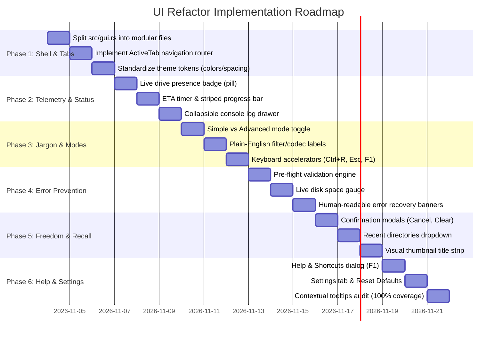

# User Interface (UI) Refactor Plan
**Target Codebase:** `dvd-ripper`  
**Reference Document:** `notes/UI.md` (Jakob Nielsen's 10 Usability Heuristics)  
**Date:** November 2026  
**Status:** Approved for Implementation  

---

## 1. Executive Summary

According to [`notes/UI.md`](notes/UI.md):
> *"Excellent user interface (UI) design relies heavily on Jakob Nielsen’s 10 Usability Heuristics, which serve as the industry-standard foundation for creating intuitive, efficient, and user-friendly digital applications."*

While `dvd-ripper` features a functional native desktop GUI powered by `eframe` and `egui`, its current implementation suffers from architectural and usability constraints:
1. **Monolithic Implementation**: The entire graphical interface resides in a single, 1,926-line source file (`src/gui.rs`) mixing state management, asynchronous thread channels, event polling, business rules, and UI widget layout.
2. **Infinite Vertical Sprawl**: Instead of the tabbed navigation envisioned in [`docs/GUI_GUIDE.md`](docs/GUI_GUIDE.md), all 6 workflow cards (Drive, Metadata, Video Encoding, Audio/Subs, Ripping Controls, History, and Logs) are rendered sequentially in a single scrolling panel, overwhelming users with 35+ technical controls simultaneously.
3. **Cognitive Load & Jargon Overload**: Cryptic technical abbreviations (`bwdif`, `hqdn3d`, `LUFS`, `dvdsub`, `subrip`, `IMAPI2`) are exposed directly without plain-English explanations or progressive disclosure for novice users.
4. **Lack of Error Prevention & Recovery**: Action buttons like "Start Rip" are active even when titles or drives are invalid; disk space exhaustion is discovered midway through a rip rather than validated beforehand; and irreversible actions like "Clear History" lack confirmation.

This refactor plan establishes a comprehensive, multi-phase roadmap to transform `dvd-ripper`'s GUI into an industry-leading, accessible, and intuitive desktop media utility that strictly adheres to **Jakob Nielsen's 10 Usability Heuristics**.

---

## 2. Codebase Audit Against Nielsen's 10 Usability Heuristics

| Usability Heuristic | Current Codebase Status | Key Deficiencies in `src/gui.rs` | Target Quality State |
| :--- | :--- | :--- | :--- |
| **1. Visibility of System Status** | ⚠️ Partial | Status label gets truncated; no visual optical drive presence badge; no ETA or elapsed time counter; no animated indicators during disc scanning. | Dynamic status pill (🟢 Ready, 🟡 Scanning, 🔵 Ripping, ⚪ No Disc); animated progress bar with percentage, current fps, speed multiplier, elapsed time, and real-time ETA calculation. |
| **2. Match Between System & Real World** | ⚠️ Partial | Raw FFmpeg/encoder flags exposed (`bwdif`, `hqdn3d`, `LUFS`, `copy`). | Plain-English primary descriptions with technical badges (e.g., "Motion-Adaptive Deinterlacing [bwdif]", "Loudness Leveling [EBU R128 -23 LUFS]"). Disc icons and physical media metaphors. |
| **3. User Control & Freedom** | ⚠️ Partial | Cancelling an active rip has no safety prompt; "Clear History" deletes records immediately without confirmation; no "Reset to Defaults". | Confirmation modal dialogs for destructive/cancelling operations; one-click "Reset All Settings to Defaults"; clean dismissal for logs and search modals. |
| **4. Consistency & Standards** | ⚠️ Moderate | Inconsistent input widths, mixed label alignments, ad-hoc button sizes, mixed drag ranges (`0..=99` vs `1..=99`). | Standardized design system tokens (colors, button sizes, spacing, typography hierarchy, input alignments) across all tabs and modals. |
| **5. Error Prevention** | ❌ Poor | "Start Rip" clickable when title is empty, drive is invalid, or output path is illegal; no disk space check before transcoding starts. | Proactive pre-flight validation guard: disables "Start Rip" with warning tooltip when prerequisites fail; live target disk space gauge with color-coded safety indicators. |
| **6. Recognition Rather Than Recall** | ⚠️ Partial | User must remember past output directories and search queries; TV episode titles require manual correlation; title thumbnails hidden. | Dropdown remembering last 5 output directories; search history; prominent cover art poster; visual title thumbnail strip; pre-populated TV episode names. |
| **7. Flexibility & Efficiency of Use** | ❌ Poor | No tab navigation; no Beginner vs Expert mode toggle; zero keyboard accelerators. | 5 dedicated workflow tabs (🎬 Rip, 📺 TV Box Sets, ⚡ Benchmark, 📜 History, ⚙️ Settings); Simple vs Advanced mode toggle; keyboard shortcuts (`Ctrl+R`, `Esc`, `Ctrl+O`, `Ctrl+F`, `Ctrl+B`). |
| **8. Aesthetic & Minimalist Design** | ❌ Poor | All 6 cards crammed into one towering vertical scroll; clutter of 35+ checkboxes competes for user attention. | Modular tabbed cards; collapsible disclosure panels (`egui::CollapsingHeader`); prominent accent-colored primary action; compact collapsible log drawer. |
| **9. Help Users Recognize, Diagnose, & Recover from Errors** | ❌ Poor | Errors dump raw FFmpeg/PowerShell stderr into log console; no actionable guidance. | Human-friendly diagnostic banners explaining errors in plain language (e.g., "Disc unreadable", "Disk space exhausted") with concrete solution suggestions and "Retry" / "Open Logs" buttons. |
| **10. Help & Documentation** | ⚠️ Partial | Only basic About modal exists; tooltips missing on >60% of checkboxes; no quick-start guide or shortcut reference. | Contextual hover tooltips on 100% of controls; dedicated "❓ Help & Shortcuts" dialog with 3-step Quick Start, Glossary of Terms, and hotkey list. |

---

## 3. Target UI Architecture & Navigation Layout

```mermaid
graph TD
    subgraph Window Shell
        Header[Header Bar: 📀 DVD Ripper Desktop │ ❓ Help (F1) │ ℹ️ About]
        TabBar[Navigation Tabs: [🎬 Rip Disc] [📺 TV Box Sets] [⚡ Benchmark] [📜 History] [⚙️ Settings]]
        
        subgraph Central Tab Views
            Tab1[🎬 Rip Disc: Simple/Advanced Toggle │ Drive │ Metadata │ Quality Preset │ Pre-Flight Guard]
            Tab2[📺 TV Box Sets: Show Name │ Season │ Start Ep │ Auto BoxSet │ Episode Thumbnail List]
            Tab3[⚡ Benchmark: Drive Selector │ Real-Time Read Speed Gauge │ Speed Rating]
            Tab4[📜 History: Filterable Rip Records │ Rerun Job │ Open In Explorer │ Clear Confirmation]
            Tab5[⚙️ Settings: Global Transcode Defaults │ HWAccel │ Audio/Sub Defaults │ Disk Space Thresholds]
        end

        subgraph Persistent Bottom Dock
            Telemetry[Telemetry Bar: Status Badge (🟢 Ready) │ Progress Bar │ FPS & Speed │ ETA & Elapsed]
            LogDrawer[Collapsible Log Console Drawer]
        end
    end

    TabBar --> Tab1
    TabBar --> Tab2
    TabBar --> Tab3
    TabBar --> Tab4
    TabBar --> Tab5
```

---

## 4. Proposed Component Decomposition (`src/gui/`)

To eliminate the monolithic 1,926-line `src/gui.rs`, the GUI code will be decomposed into clean, modular sub-components under `src/gui/`:

```text
src/
└── gui/
    ├── mod.rs                   # Top-level eframe::App implementation & update() loop
    ├── state.rs                 # DvdRipperApp state struct, channel receivers & default configs
    ├── theme.rs                 # Design tokens (colors, font sizes, margins, badge styles)
    ├── tabs/
    │   ├── mod.rs               # Tab navigation router & ActiveTab enum
    │   ├── rip_tab.rs           # Tab 1: Single-title & ISO extraction with Simple/Advanced toggle
    │   ├── tv_tab.rs            # Tab 2: TV box set multi-episode batch extraction
    │   ├── benchmark_tab.rs     # Tab 3: Optical drive speed diagnostics & benchmark visualization
    │   ├── history_tab.rs       # Tab 4: Persistent rip records, search filter, and safe clearing
    │   └── settings_tab.rs      # Tab 5: Global defaults, HWAccel, notifications, min free space
    └── components/
        ├── mod.rs               # Reusable UI component exports
        ├── status_banner.rs     # Live status pill, progress bar, fps, speed, and ETA countdown
        ├── disk_guard.rs        # Live free disk space gauge & pre-flight validation widget
        ├── thumbnail_strip.rs   # Title thumbnail preview carousels & poster renderer
        └── dialogs.rs           # Modals: Confirmation prompt, OMDb Search, About, and Help/Shortcuts
```

---

## 5. Detailed Implementation Phases

### Phase 1: Modular Decomposition & Tabbed Navigation Shell
**Heuristics Addressed:** #4 (Consistency & Standards), #7 (Flexibility & Efficiency), #8 (Aesthetic & Minimalist Design)

1. **ActiveTab Navigation Router**:
   - Introduce `enum ActiveTab { Rip, TvSeries, Benchmark, History, Settings }`.
   - Replace the vertical group-box scroll in `CentralPanel` with a clean horizontal navigation bar featuring icons and active indicator highlights.
2. **File Structure Refactor**:
   - Extract `src/gui.rs` into `src/gui/mod.rs`, `src/gui/state.rs`, `src/gui/theme.rs`, and `src/gui/tabs/`.
   - Maintain 100% backward compatibility with `dvd-ripper` CLI `--gui` entry points.
3. **Unified Styling Theme (`src/gui/theme.rs`)**:
   - Define semantic color tokens:
     - `ACCENT_COLOR`: `#38bdf8` (Cyan/Sky Blue for active tabs and primary buttons).
     - `SUCCESS_COLOR`: `#22c55e` (Green for completed operations and healthy disk space).
     - `WARNING_COLOR`: `#f59e0b` (Amber for scanning, warnings, and medium space).
     - `DANGER_COLOR`: `#ef4444` (Red for errors, cancellations, and low disk space).
     - `MUTED_TEXT`: `#94a3b8` (Slate for secondary labels and hints).
   - Standardize button dimensions: Primary action `[160.0, 32.0]`, Secondary action `[120.0, 28.0]`, Small button `[28.0, 24.0]`.

---

### Phase 2: Visibility of System Status & Real-Time Telemetry
**Heuristics Addressed:** #1 (Visibility of System Status), #8 (Aesthetic & Minimalist Design)

1. **Dynamic Drive Status Pill**:
   - Surface an immediate status badge in the header/drive bar:
     - 🟢 **Ready**: Disc inserted, valid title detected, ready to rip.
     - 🟡 **Scanning**: Hardware interrogation or OMDb search in progress (with animated spinner).
     - 🔵 **Ripping**: Transcoding/dumping active (pulsing blue).
     - ⚪ **No Disc**: Optical tray empty or drive detached.
     - 🔴 **Error**: Read failure or process error.
2. **Ripping Telemetry & Accurate ETA**:
   - In `components/status_banner.rs`, compute:
     - `Elapsed Time`: Clock timer formatted as `MM:SS`.
     - `ETA (Estimated Time Remaining)`: Calculated dynamically from `(remaining_seconds / speed_multiplier)` or `(1.0 - progress) * elapsed / progress`.
     - `Throughput`: Real-time FPS and encoding speed multiplier (`2.4x`).
3. **Animated Progress Indicator**:
   - Update `egui::ProgressBar` with striped animation during active rips.
   - Text overlay shows `45.2% • ETA: 04:12 • 28.5 fps (2.1x)`.
4. **Collapsible Bottom Log Drawer**:
   - Replace permanent 120px monospace box with a collapsible drawer (`egui::CollapsingHeader` with title `Console Logs (N lines)`). Expert users can expand it; novice users keep the interface clean.

---

### Phase 3: Real-World Language & Progressive Disclosure
**Heuristics Addressed:** #2 (Match Between System & Real World), #7 (Flexibility & Efficiency), #8 (Aesthetic & Minimalist Design)

1. **Simple Mode vs Advanced Mode Toggle**:
   - Add a toggle switch in the Rip Tab: `[ Simple Mode | Advanced Mode ]`.
   - **Simple Mode**:
     - Shows only 4 fields: Input Drive, Film Title (with Search button), Quality Profile (Standard, Archival, Mobile), and "Start Rip" button.
     - Hides all technical deinterlace algorithms, LUFS numbers, OCR languages, and webhook settings.
   - **Advanced Mode**:
     - Expands progressive disclosure sections for Fine-Tuned Encoding, Video Filters (Deinterlacing, Denoise), Multi-Language Audio, and Subtitle OCR.
2. **Plain-English Terminology Translation**:
   - `bwdif` -> "Motion-Adaptive (High Quality - recommended for TV/DVDs)"
   - `yadif` -> "Standard Deinterlace (Fast)"
   - `hqdn3d` -> "Noise Reduction (Clean analog film grain & tape noise)"
   - `EBU R128 (-23 LUFS)` -> "Loudness Normalization (Consistent volume across scenes)"
   - `dvdsub` -> "DVD Bitmap Subtitles (Original styling)"
   - `subrip` -> "Plain Text Subtitles (.srt)"
   - `Stream Copy` -> "Direct Passthrough (Zero quality loss, fastest)"
3. **Keyboard Accelerators**:
   - Implement `ctx.input(...)` key bindings:
     - `Ctrl + R` or `Enter`: Start Rip (when validated).
     - `Escape`: Cancel active rip or dismiss active modal.
     - `Ctrl + O`: Open destination directory in file explorer.
     - `Ctrl + F`: Open OMDb Search dialog.
     - `Ctrl + B`: Open folder browse dialog.
     - `F1`: Open Help & Shortcuts dialog.

---

### Phase 4: Proactive Error Prevention & Disk Space Guard
**Heuristics Addressed:** #5 (Error Prevention), #9 (Help Users Diagnose & Recover from Errors)

1. **Pre-Flight Validation Engine**:
   - Implement `fn validate_preflight(&self) -> Result<(), Vec<String>>`:
     - Checks if an optical drive is available or if input drive is set to invalid path.
     - Checks if film title / show name is non-empty (unless in ISO dump mode).
     - Checks if destination folder exists or can be created.
     - Checks if free disk space exceeds `min_free_gb` (defaults to 10 GB for DVD9).
2. **Interactive Action Button States**:
   - If pre-flight validation fails:
     - "▶ Start Rip" button is visually disabled (`ui.add_enabled(valid, ...)`).
     - Hovering over the button displays a yellow tooltip enumerating exactly what needs to be fixed (e.g. `⚠️ Please enter a movie title or search OMDb before ripping`).
3. **Live Target Disk Space Gauge**:
   - In `components/disk_guard.rs`, query disk space for `self.out_dir`:
     - Display: `💾 Output Disk: 142.5 GB Free on C:\ (8.5 GB needed)`.
     - Color-coded indicator: Green (> 20 GB), Amber (10–20 GB), Red (< 10 GB).
4. **Human-Readable Error Recovery Banners**:
   - Intercept raw FFmpeg/system errors and map them to actionable user guidance:
     - Scratched / unreadable sector -> `⚠️ Optical Read Issue: Scratched disc sectors encountered. Try cleaning disc or switch to 1:1 ISO Dump mode.`
     - Space exhausted -> `❌ Insufficient Disk Space: Output drive has run out of space. Free at least 5 GB and retry.`
     - Missing FFmpeg -> `❌ FFmpeg Not Found: Ensure ffmpeg is installed in PATH or specify path in Settings.`
   - Each error banner includes an actionable `[Retry]` and `[View Error Logs]` button.

---

### Phase 5: User Control, Freedom & Recognition over Recall
**Heuristics Addressed:** #3 (User Control & Freedom), #6 (Recognition Rather than Recall)

1. **Confirmation Modals (`components/dialogs.rs`)**:
   - **Cancel Rip Confirmation**:
     - When user clicks "⏹ Cancel" during an active rip:
     - Prompt: `⚠️ Cancel Ripping Operation? Ripping is 48% complete. In-progress files will be cleaned up. [Continue Ripping] [Yes, Cancel]`.
   - **Clear History Confirmation**:
     - When user clicks "🗑 Clear History":
     - Prompt: `⚠️ Clear All History Records? This will remove 15 recorded rip entries from history.json. [Cancel] [Clear Records]`.
2. **Recent Output Directories Autocomplete**:
   - Store the last 5 used output directories in user preferences (`dvd_ripper_gui_history`).
   - Add a small dropdown arrow next to the Output Folder input allowing instant one-click selection of recent folders.
3. **Visual Title Identification Strip**:
   - Display a horizontal carousel of video preview snapshots (thumbnails) for discovered titles.
   - Allows users to visually recognize the main movie feature vs trailers, bloopers, or warning screens without guessing title numbers.
4. **TV Box Set Cumulative Episode Manager**:
   - In the TV Series Tab, show detected episodes in an interactive table with checkboxes, formatted names (`S01E01 - Pilot`), duration in minutes, and preview thumbnails.
   - Allow re-ordering or unchecking unwanted tracks before batch ripping.

---

### Phase 6: Comprehensive Help, Documentation & Polish
**Heuristics Addressed:** #4 (Consistency & Standards), #10 (Help & Documentation)

1. **Interactive Help & Keyboard Shortcuts Dialog (`components/dialogs.rs`)**:
   - Open via `❓ Help` button in the header bar or `F1` key.
   - Contains 3 tabbed sections:
     - **Quick Start Guide**: 3 easy steps to insert a disc, search metadata, and rip.
     - **Glossary of Media Terms**: Explaining Deinterlacing, Video Codecs (H.264 vs HEVC vs AV1), Containers (MKV vs MP4), and ISO Dumps in accessible language.
     - **Keyboard Shortcuts Reference**: Table listing all hotkeys.
2. **Contextual Tooltips on All Controls**:
   - Audit and ensure 100% of checkboxes, inputs, and buttons feature `.on_hover_text(...)` explaining their purpose and when to use them.
3. **Settings Tab (`tabs/settings_tab.rs`)**:
   - Centralize all persistent preferences:
     - Default output directory.
     - Default video codec and container format.
     - Hardware acceleration fallback preference.
     - Minimum free disk space threshold (GB).
     - Webhook URL notifications (Discord / Slack / Home Assistant).
     - Reset All Settings to Factory Defaults button.

---

## 6. Implementation Roadmap & Milestones



---

## 7. Quality Standards & Verification Gates

```text
[Quality Gate 1: Zero Warnings & Style Compliance]
    ├── cargo clippy --all-targets -- -D warnings
    └── cargo fmt --check

[Quality Gate 2: Full Test Suite Integrity]
    ├── cargo test --all-targets (>225 unit, integration, and CLI tests)
    └── cargo test --doc (100% doctests passing)

[Quality Gate 3: UI Build Verification]
    ├── cargo check --features gui (GUI enabled compilation clean)
    ├── cargo check --no-default-features (Headless minimal core still builds cleanly)
    └── cargo build --release --features full (Optimized release artifact verified)
```

