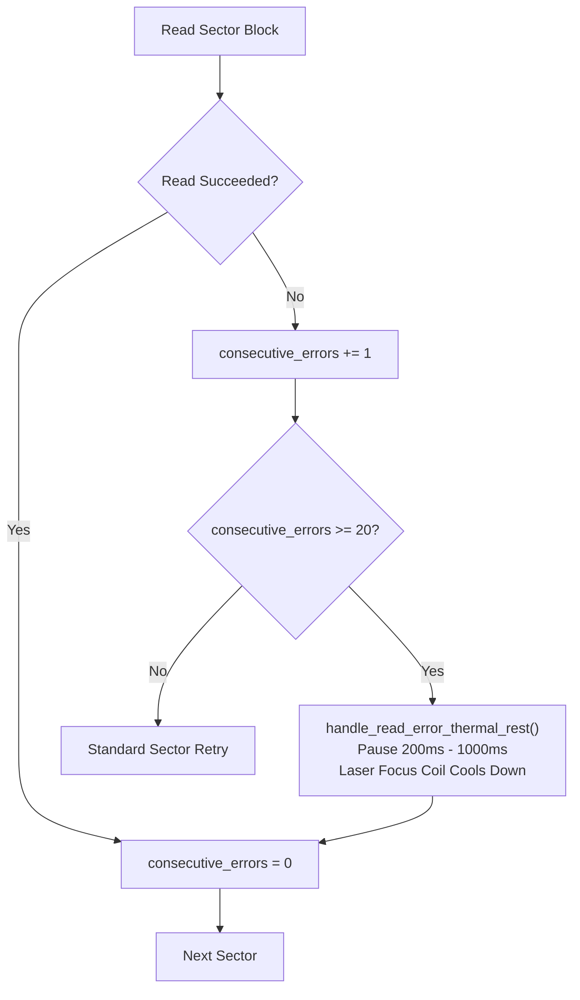

# Optical Drive Acoustic & Thermal Supervisor Guide - `dvd-ripper`

`dvd-ripper` features an enterprise-grade **Optical Drive Acoustic & Thermal Supervisor** (`src/infrastructure/optical/scsi_controller.rs` and `src/domain/ports/acoustic_supervisor.rs`). It gives users dynamic control over optical drive rotational speeds, eliminates jet-engine spindle noise during living-room playback or home server ripping, and actively protects optical pickup lasers from thermal focus-coil burnout on damaged or copy-protected discs.

---

## 1. The Optical Noise & Thermal Challenge

Standard optical DVD drives operate using Constant Angular Velocity (CAV) or Constant Linear Velocity (CLV). When reading at maximum speeds (16x+):
1. **Acoustic Noise**: The spindle rotates up to 9,200 RPM, producing intrusive mechanical vibration and acoustic noise (>50 dB), making living room or home office ripping disruptive.
2. **Thermal Stress**: When reading unreadable copy-protection sectors (such as Sony ARccOS intentionally damaged mastering sectors), the optical pick-up unit (OPU) executes thousands of rapid microscopic seek oscillations. The electromagnetic focus coil rapidly heats up without airflow, which can permanently burn out the laser diode or degrade reading calibration.
3. **Mechanical Disc Wear**: Unbalanced or micro-cracked discs spinning at 16x experience severe centrifugal strain, increasing jitter and the risk of read failure.

---

## 2. Acoustic Profiles

`dvd-ripper` defines three discrete acoustic profiles (`DriveAcousticProfile`):

| Profile | Target Speed | Target Throughput | Typical Acoustic Level | Primary Use Case |
|---|---|---|---|---|
| **`silent`** | ~4x | ~5,540 KB/s | Whisper-Quiet (<20 dB) | Home servers, living rooms, overnight un-attended batch jobs |
| **`balanced`** (Default) | ~8x | ~11,080 KB/s | Moderate (<32 dB) | Standard day-to-day desktop ripping |
| **`turbo`** | 16x+ (Max capability) | Max drive limit | High (~50 dB) | Rapid high-throughput bulk archival ingest |

*(Note: 1x DVD read speed = 1,385 KB/s).*

---

## 3. SCSI & Operating System Speed Negotiation

Speed negotiation is negotiated directly with drive firmware via standard SCSI / ATAPI commands:

### Windows Implementation
On Windows, `dvd-ripper` issues the IOCTL control code `IOCTL_CDROM_SET_SPEED` (`0x0002403E`) to the volume device handle (`\\.\D:`):

```rust
#[repr(C)]
struct CdromSetSpeed {
    request_type: u32,      // CdromSetSpeed (0)
    read_speed: u16,        // Speed in KB/s (e.g. 5,540 KB/s for 4x)
    write_speed: u16,       // Unchanged (0)
    rotation_control: u32,  // Default rotation control (0)
}
```

If the operating system or virtual drive returns `ERROR_NOT_SUPPORTED` or `ERROR_INVALID_FUNCTION` (e.g., when mounting an `.iso` file via virtual drive software), the supervisor logs a debug message and gracefully falls back to normal execution without breaking the pipeline.

### Linux Implementation
On Linux, speed negotiation delegates to `ioctl(fd, CDROM_SELECT_SPEED, speed)` or invokes `/usr/bin/setcd -x <speed> /dev/sr0`.

---

## 4. Laser Focus-Coil Thermal Cool-Down

When copy-protected bad sectors or surface scratches cause repeated read retries, `dvd-ripper`'s thermal guard intervenes:



- When 20 consecutive read errors occur, the supervisor inserts a 200ms cool-down sleep.
- For severe sector storms (>50 errors), the supervisor inserts a 500ms–1000ms pause.
- Thermal dissipation prevents the objective lens suspension wires from fatiguing, drastically improving reading success on marginal discs.

---

## 5. User Configuration

### CLI
```bash
# Whisper-quiet living room rip
dvd-ripper --input D:\ --acoustic-profile silent

# Max speed archival rip
dvd-ripper --input /dev/sr0 --acoustic-profile turbo
```

### TOML Configuration (`dvd-ripper.toml`)
```toml
# Set persistent default acoustic profile
acoustic_profile = "silent"
```

### Desktop GUI
In the **Main Rip Panel**, select the **Drive Acoustic Profile** dropdown to toggle between **🔇 Silent (4x)**, **⚖️ Balanced (8x)**, or **🚀 Turbo (16x)**.

### REST API
Switch drive speeds on the fly without restarting the daemon:
```http
POST /api/acoustic?profile=silent&drive=D:
```
**Response**:
```json
{
  "success": true,
  "profile": "silent",
  "drive": "D:",
  "message": "Drive acoustic profile set to silent"
}
```

