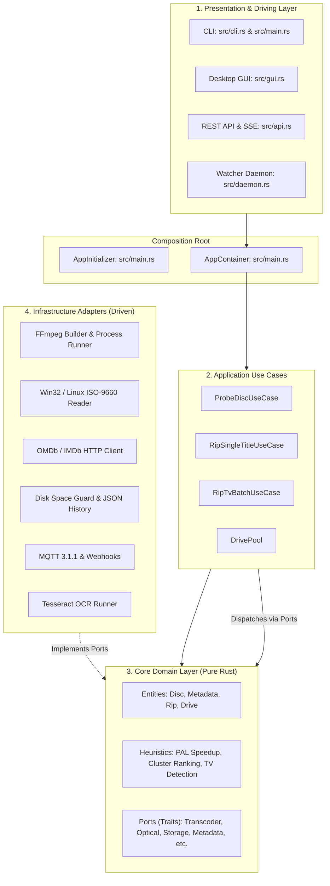

# System Architecture Guide - `dvd-ripper`

## 1. Overview

`dvd-ripper` is an enterprise-grade DVD backup and media processing appliance written in pure Rust. It features a modern **Clean Architecture** (Hexagonal / Ports & Adapters) design governed by the **SOLID Principles**, providing:
- A native desktop immediate-mode GUI powered by `eframe`/`egui`.
- A command-line interface (CLI) powered by `clap`.
- An embedded HTTP REST API, OpenAPI specification, and Server-Sent Events (SSE) server (`api`).
- A multi-drive parallel watcher daemon (`daemon`).
- Home Assistant MQTT smart home integration (`mqtt`) and multi-service HTTP webhooks.
- Disc fingerprinting and local database caching (`dvd`, `imdb`).
- Direct media server scan triggers (Plex, Jellyfin, Emby) and post-processing script hooks (`utils`).
- Pure domain heuristics for PAL 25fps speedup and multi-title decoy loop detection.

For an in-depth breakdown of the 5 SOLID principles and design patterns applied in this codebase, see the dedicated companion specification:  
👉 **[`docs/SOLID_ARCHITECTURE.md`](SOLID_ARCHITECTURE.md)**

---

## 2. Clean Architecture Layer Hierarchy

The codebase is organized into four concentric architectural layers:



---

## 3. Module Responsibilities

### 3.1 Presentation & Driving Adapters
- **`src/main.rs`**: Application entry point, CLI flag parsing, configuration default merging, and the **`AppContainer`** Composition Root.
- **`src/cli.rs`**: Schema definitions for command-line arguments (`Args`), segregated configuration traits (`TranscodeConfig`, `AudioConfig`, `SubtitleConfig`).
- **`src/gui.rs`**: Immediate-mode desktop GUI built with `eframe`/`egui`. Includes disc search modals, live progress gauges, output folder management (`📂 Browse...`, `↗ Open`, `↺ Reset`), and cooperative rip cancellation.
- **`src/api.rs`**: Embedded HTTP REST API server with Bearer token authentication (`--api-key`), OpenAPI v3 JSON (`/api/openapi.json`), Server-Sent Events live progress stream (`/api/events`), Prometheus metrics (`/metrics`), and Web UI dashboard.
- **`src/daemon.rs`**: Headless multi-drive watcher daemon that monitors optical drives, automatically detects inserted discs, fetches metadata, and coordinates ripping pipelines.

### 3.2 Application Use Cases (`src/application/`)
- **`probe_disc.rs`**: Coordinates optical drive inspection, volume label extraction, and title probing.
- **`rip_single_title.rs`**: Orchestrates single movie rip pipelines, including disk space verification, output folder routing, transcoding, subtitle extraction, and history recording.
- **`rip_tv_batch.rs`**: Orchestrates multi-episode TV series batch ripping, cumulative episode numbering, and cooperative cancellation.
- **`drive_pool.rs`**: Manages concurrent multi-drive ripping jobs and thread-safe drive status updates.

### 3.3 Domain Layer (`src/domain/`)
- **`entities/`**: Core data models (`DvdDisc`, `DvdTitleInfo`, `FilmMetadata`, `RipRecord`, `DvdDriveInfo`).
- **`heuristics/`**:
  - `speedup.rs`: PAL 25fps vs 23.976fps runtime adjustment (4% duration discrepancy resolution).
  - `cluster_detector.rs`: Title duration clustering and deterministic ranking to defeat anti-copying decoy loops (e.g. John Wick 3).
  - `tv_detector.rs`: Filter out studio intros and composite "Play All" tracks.
- **`ports/`**: Abstract interfaces (`Transcoder`, `DriveDetector`, `DiscInspector`, `TrayController`, `MetadataProvider`, `HistoryRepository`, `DiskSpaceGuard`, `Notifier`, `FileDialogService`).

### 3.4 Infrastructure Adapters (`src/infrastructure/`)
- **`ffmpeg/`**: Modular FFmpeg command assembly (`builder.rs`), process management (`process_runner.rs`), and output progress parsing (`progress_parser.rs`).
- **`optical/`**: Platform-specific optical drive readers (Windows Win32 API, Linux sysfs, ISO-9660 Sector 16 volume descriptor reader).
- **`metadata/`**: Online metadata fetching via OMDb and TMDb APIs with persistent local fingerprint caching (`fingerprints.json`).
- **`storage/`**: Enterprise disk space guard checks and thread-safe JSON history repository (`ripping_history.json`).
- **`notifications/`**: Home Assistant MQTT 3.1.1 auto-discovery telemetry and HTTP webhooks (Discord, Telegram, Ntfy, Gotify, Slack).
- **`ocr/`**: On-the-fly Tesseract OCR execution converting bitmap `dvdsub` overlays to `.srt` SubRip text sidecars.

---

## 4. Media Output Organization

Output paths are automatically separated into clean, media-server-compliant hierarchies:
- **Films**: `<out_dir>/Films/<Movie Title (Year)>/<Movie Title (Year)>.<ext>`
- **TV Series**: `<out_dir>/TV/<Show Name (Year)>/Season <SS>/<Show Name - S<SS>E<EE>>.<ext>`

### Sibling Root Auto-Resolution
The path resolution engine (`src/ffmpeg.rs: resolve_films_root`, `resolve_tv_root`) intelligently handles custom destination directories:
- If `out_dir` ends in `Films`, TV series are automatically saved in the sibling `TV` folder.
- If `out_dir` ends in `TV`, films are automatically saved in the sibling `Films` folder.
- Redundant nesting (such as `Films/Films`) is systematically prevented.

For full details, see [`docs/MEDIA_ORGANIZATION.md`](MEDIA_ORGANIZATION.md).

---

## 5. Testing & Verification

The codebase contains **163 automated unit and integration tests** covering:
- Pure domain heuristic validation (PAL speedup calculations, cluster ranking, duration tolerances).
- In-memory mock tests for application use cases (`RipSingleTitleUseCase`, `RipTvBatchUseCase`).
- Cooperative cancellation propagation and graceful cleanup.
- Video filter graph generation (`bwdif`, `yadif`, `hqdn3d`).
- Hardware acceleration encoder selection (NVENC, VAAPI, QSV).
- ISO-9660 disc fingerprinting and volume label parsing.
- Disk space guards, collision prevention, and output path routing.

Execute the test suite locally with:

```bash
cargo test
```

---

## 6. Technical Documentation Index

| Guide | File Path | Focus Area |
|---|---|---|
| **SOLID Architecture** | [`docs/SOLID_ARCHITECTURE.md`](SOLID_ARCHITECTURE.md) | Deep dive into SRP, OCP, LSP, ISP, DIP, heuristics, & mocks |
| **Media Organization** | [`docs/MEDIA_ORGANIZATION.md`](MEDIA_ORGANIZATION.md) | Folder conventions, sibling resolution, Plex/Jellyfin, & sidecars |
| **Developer Guide** | [`docs/DEVELOPER_GUIDE.md`](DEVELOPER_GUIDE.md) | Onboarding, coding standards, adding use cases & adapters |
| **CLI User Manual** | [`docs/CLI_GUIDE.md`](CLI_GUIDE.md) | Flags, syntax, video profiles, and automation examples |
| **Desktop GUI Guide** | [`docs/GUI_GUIDE.md`](GUI_GUIDE.md) | UI layout, search modal, progress gauges, & cancel flow |
| **Configuration Guide** | [`docs/CONFIGURATION.md`](CONFIGURATION.md) | `dvd-ripper.toml` parameters, priority order, & defaults |
| **REST API Reference** | [`docs/API_REFERENCE.md`](API_REFERENCE.md) | Endpoints, SSE streaming, OpenAPI v3 spec, & metrics |
| **Daemon Mode** | [`docs/DAEMON_APPLIANCE_MODE.md`](DAEMON_APPLIANCE_MODE.md) | Headless auto-rip, Home Assistant MQTT, & webhooks |
| **Hardware Acceleration** | [`docs/HARDWARE_ACCELERATION.md`](HARDWARE_ACCELERATION.md) | GPU transcoding (NVENC, VAAPI, QSV, V4L2) |
| **Media Server Integration**| [`docs/MEDIA_SERVER_INTEGRATION.md`](MEDIA_SERVER_INTEGRATION.md)| Plex/Jellyfin/Emby webhooks & NFO schemas |
| **TV Box Set Guide** | [`docs/TV_BOXSET_GUIDE.md`](TV_BOXSET_GUIDE.md) | Multi-disc TV season cumulative episode tracking |
| **Installer & Service Guide**| [`docs/INSTALLER_AND_SERVICE_GUIDE.md`](INSTALLER_AND_SERVICE_GUIDE.md)| Cross-platform installer CLI, systemd, udev, & PATH |
| **Troubleshooting Guide** | [`docs/TROUBLESHOOTING.md`](TROUBLESHOOTING.md) | RipLock bottlenecks, disk space guards, & CSS/CPPM |
| **Contributor Guide** | [`CONTRIBUTING.md`](../CONTRIBUTING.md) | Open source contribution workflow, style guide, & PRs |
