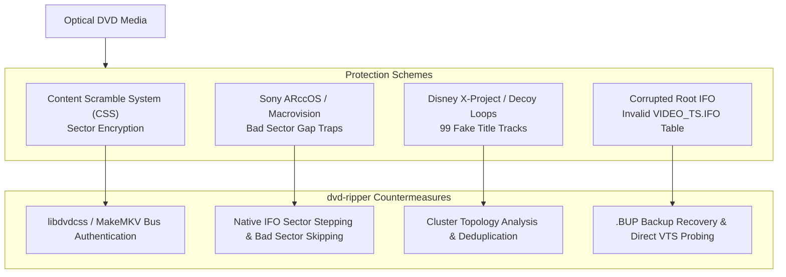

# Copy Protection, Bad Sectors, and Disc Recovery Guide

Commercial DVD-Video media frequently contains copy protection mechanisms designed to prevent digital backup. Furthermore, optical discs degrade over time through physical scratches, laser burn decay, and drive read wear.

This guide explains how `dvd-ripper` detects, diagnoses, and circumvents these mechanisms to deliver clean, uncorrupted rips.

---

## 1. Overview of Protection Schemes



---

## 2. Protection Types & Defensive Countermeasures

### 2.1. Content Scramble System (CSS) & CPPM
- **Mechanism**: 40-bit cryptographic sector scrambling. Optical drives enforce authentication handshakes between the computer operating system and the drive firmware.
- **Symptom**: Scrambled/pixelated video blocks or FFmpeg error `CSS support is unavailable`.
- **Countermeasure**:
  - `dvd-ripper` integrates with `libdvdcss` for dynamic sector key cracking.
  - When paired with **MakeMKV Engine** (`--engine makemkv`), it communicates directly with optical drive firmware for native bus key negotiation, unlocking CSS, CPPM, and Blu-ray AACS/BD+.

### 2.2. Sony ARccOS & Macrovision RipGuard (Bad Sector Traps)
- **Mechanism**: Physical bad sectors (unformatted or CRC error blocks) are deliberately pressed into areas of the disc that are *unreferenced* by the genuine DVD Program Chain (`PGC`), but are located sequentially between chapters or at the end of files. Generic rippers attempting sequential sector dumping hit these sectors, lock the drive head, and crash or freeze.
- **Symptom**: Ripping halts early at specific progress marks (e.g. `62.8%`) with OS read timeout errors (`I/O error 23`, `CRC failed`).
- **Countermeasures**:
  1. **Native IFO Sector Layout**: `NativeIfoTranscoder` parses the binary `VTS_PGCITI` cell tables to obtain only the exact sector ranges referenced by the video player. Unreferenced bad sector gaps are never read.
  2. **Sector-by-Sector Stepping**: When an unreadable sector is encountered within a referenced cell, the reader immediately drops from 64 KiB block reads to single 2048-byte sector reads. Unreadable damaged padding sectors are skipped, allowing extraction to continue to 100%.

### 2.3. Corrupted Root `VIDEO_TS.IFO` Structures
- **Mechanism**: Some mastering houses intentionally write corrupt data or invalid pointer offsets into the root `VIDEO_TS.IFO` file while leaving the title-specific `VTS_01_0.IFO` files valid.
- **Symptom**: FFmpeg aborts with:
  ```text
  [in#0] libdvdread: Invalid IFO for title 0 (VIDEO_TS.IFO).
  [in#0] libdvdread: Invalid IFO for title 0 (VIDEO_TS.BUP).
  [in#0] Error opening input: Generic error in an external library
  ```
- **Countermeasures**:
  1. **`.BUP` Table Fallback**: `dvd-ripper` automatically searches for `VIDEO_TS.BUP` and `VTS_xx_0.BUP` backup tables.
  2. **Direct VTS Probing**: If the root VMGI table is unreadable or corrupt, `dvd-ripper` bypasses `VIDEO_TS` completely, directly scanning `VTS_01_0.IFO` through `VTS_99_0.IFO` to discover title sets and Program Chains directly.

### 2.4. Disney X-Project Decoy Playlists (99 Titles)
- **Mechanism**: Discs contain up to 99 titles with identical runtimes, each referencing cells in random, scrambled order (e.g. scenes played out of sequence). Only one title contains the correct playlist.
- **Symptom**: Ripper lists dozens of titles with runtimes around 1 hour 45 minutes.
- **Countermeasures**:
  - `dvd-ripper` analyzes cell playback topologies (`probe_dvd_cell_topologies_ifo`), ranking titles by unique non-overlapping sector sequences.
  - Automatic cross-referencing with online database durations (OMDb/IMDb) and chapter count heuristics.

---

## 3. Diagnostic & Inspection Commands

### 3.1. Copy Protection & Bad Sector Audit
To run a fast structural diagnostic on an inserted optical disc without initiating a rip:

```bash
dvd-ripper --input D:\ --check-protection
```

**Diagnostic Output:**
```text
--- [Disc Copy Protection Diagnostic Report] ---
  • Optical Disc Path: D:\
  • Total VOB Video Objects on disc: 12
  • Total IFO Metadata Files on disc: 4
  • Primary DVD Volume Label: THE_MATRIX
  • Disc Structural Health: 12 VOBs accessible, 4 IFO headers verified.
  • CSS Key State: Decrypted / Unlocked via libdvdcss
------------------------------------------------
```

### 3.2. Optical Read Speed Throughput Benchmark
Test whether physical read speeds are throttled by firmware RipLock or surface scratches:

```bash
dvd-ripper --input D:\ --benchmark
```

**Benchmark Ratings:**
- `>= 15.0 MB/s` (16x+): High performance, ideal condition.
- `8.0 – 15.0 MB/s` (8x–12x): Standard read speed.
- `< 4.0 MB/s` (< 4x): Optical degradation, heavy scratches, or firmware RipLock active.

---

## 4. Recommended Recovery Workflow

When encountering a difficult or failing disc:

1. **Step 1: Check Disc Surface**: Inspect the silver data side for smudges, fingerprints, or circular scratches. Clean gently with a microfiber cloth from the center hole outward.
2. **Step 2: Try Auto-Fallback Mode**: Ensure `--engine auto` is active. If FFmpeg fails, `dvd-ripper` will automatically switch to `native_ifo`.
3. **Step 3: Force Native IFO Engine**:
   ```bash
   dvd-ripper --cli D: --engine native --search "Movie Title"
   ```
4. **Step 4: Use MakeMKV Engine for Heavily Encrypted Discs**:
   ```bash
   dvd-ripper --cli D: --engine makemkv
   ```
5. **Step 5: Create a Resilient 1:1 ISO with Sector Rescue**:
   ```bash
   dvd-ripper --cli D: --iso -o "C:\Backups\DiscBackup.iso" --ignore-errors
   ```
   *In ISO mode, `dvd-ripper` copies sectors directly and logs damaged sector maps for post-processing rescue.*
