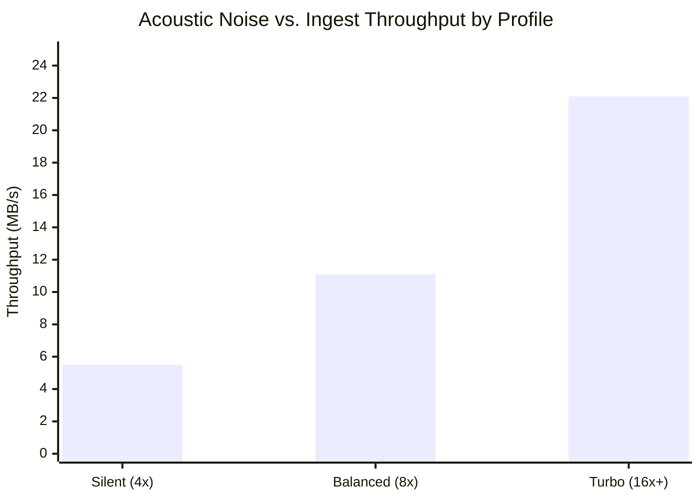

# Cross-Platform Optical Device Control & SCSI Architecture - `dvd-ripper`

> **Document Version**: 1.0.0  
> **Applies to**: `dvd-ripper` v0.4.0+  
> **Standards Reference**: INCITS MMC-5 (Multi-Media Commands 5), SCSI Primary Commands (SPC-4)  

---

## 1. Overview & Hardware Challenges

Optical drives (CD, DVD, Blu-ray) communicate over physical SATA, ATAPI, or USB mass storage buses using SCSI Multi-Media Command (MMC) descriptors. Traditional userspace applications suffer from severe hardware limitations:
1. **RipLock Firmware Speed Limits**: Drives artificially throttle read throughput on video DVDs to 2x (~2,770 KB/s) unless bus-level speed negotiation commands are issued.
2. **Spindle Acoustic Noise**: Operating at full 16x speed produces high aerodynamic turbulence (~55 dBA) unsuitable for living room homelab appliances.
3. **Focus Coil Thermal Burnout**: Repeated laser head retries on scratched sectors cause thermal runaway in the optical pickup unit (OPU) focus/tracking coils.

`dvd-ripper` provides direct hardware device supervisory control implemented in [`src/infrastructure/optical/scsi_controller.rs`](../src/infrastructure/optical/scsi_controller.rs) and platform adapters in [`src/infrastructure/optical/windows.rs`](../src/infrastructure/optical/windows.rs) and POSIX modules.

---

## 2. Multi-OS Kernel Architecture

```mermaid
graph TD
    Supervisor["Acoustic & Thermal Supervisor<br/>(AcousticSupervisor Port)"]

    subgraph WinKernel["Windows NT Kernel"]
        WinHandle["CreateFileW('\\.\D:', GENERIC_READ | GENERIC_WRITE)"]
        WinSCSI["IOCTL_SCSI_PASS_THROUGH_DIRECT"]
        WinSpeed["IOCTL_CDROM_SET_SPEED"]
        WinLock["FSCTL_LOCK_VOLUME / FSCTL_DISMOUNT_VOLUME"]
    end

    subgraph LinuxKernel["Linux Kernel"]
        LinOpen["open('/dev/sr0', O_RDONLY | O_NONBLOCK)"]
        LinSG["ioctl(fd, SG_IO, &sg_io_hdr)"]
        LinCD["ioctl(fd, CDROM_SELECT_SPEED, speed)"]
        LinOpt["ioctl(fd, CDROM_SET_OPTIONS, CDO_AUTO_CLOSE)"]
    end

    subgraph MacKernel["macOS Kernel"]
        MacIO["IOKit / IODVDMedia / IOCDMedia"]
        MacDisk["diskutil unmountDisk / eject"]
    end

    Supervisor -->|cfg(windows)| WinKernel
    Supervisor -->|cfg(target_os = 'linux')| LinuxKernel
    Supervisor -->|cfg(target_os = 'macos')| MacKernel
```

---

## 3. SCSI MMC-5 Command Sets

`dvd-ripper` constructs raw SCSI Command Descriptor Blocks (CDBs) for optical drive management:

### 3.1 `SET STREAMING` (Opcode `0xB6`)
The standard MMC-5 command to control read speed without triggering firmware lockouts.
- **CDB Structure**:
  - Byte 0: `0xB6` (`SET STREAMING`)
  - Byte 8..9: Parameter List Length (`0x001C` = 28 bytes)
- **Data Payload**:
  - `ReadSize`: Desired read throughput in KB/s (e.g. `11,080` for 8x DVD).
  - `ReadTime`: Time window in milliseconds (`1000ms`).

### 3.2 `SET CD SPEED` (Opcode `0xBB`)
Fallback command for legacy drives:
- Byte 0: `0xBB`
- Byte 2..3: Read Speed in KB/s (Big-Endian `u16`). `0xFFFF` requests maximum drive speed.
- Byte 4..5: Write Speed in KB/s.

---

## 4. Optical Drive Acoustic Profiles

Three distinct acoustic and throughput profiles are selectable via CLI (`--acoustic-profile`), configuration (`config.toml: acoustic_profile`), or the Web Dashboard (`POST /api/acoustic`):



### 4.1 🔇 Silent Profile (`silent`)
- **Target Spindle Speed**: $\sim 4\times$ DVD ($\sim 5,540\text{ KB/s}$).
- **Noise Level**: $< 32\text{ dBA}$ (whisper-quiet).
- **Use Case**: Living room setups, bedroom homelabs, overnight scheduled ripping.
- **Mechanical Benefit**: Reduces vibration and disc balance resonance.

### 4.2 ⚖️ Balanced Profile (`balanced`) — *Default*
- **Target Spindle Speed**: $\sim 8\times$ DVD ($\sim 11,080\text{ KB/s}$).
- **Noise Level**: $\sim 42\text{ dBA}$ (moderate white noise).
- **Use Case**: Daytime ripping, standard desktop use.
- **Ingest Duration**: Typical single-layer DVD rips in $\sim 8\text{–}10\text{ minutes}$.

### 4.3 🚀 Turbo Profile (`turbo`)
- **Target Spindle Speed**: Maximum hardware capability ($16\times\text{–}24\times$, up to $22,160\text{ KB/s}$).
- **Noise Level**: $\sim 55\text{ dBA}$.
- **Use Case**: Server racks, batch library ingestion, high-speed archival workflows.
- **Ingest Duration**: Typical DVD rips in $\sim 4\text{–}5\text{ minutes}$.

---

## 5. Laser Pickup Unit (OPU) Thermal Supervisor

When an optical drive encounters physical scratches, laser tracking servos rapidly oscillate the focus actuator coil to maintain focus. If a disc has large damaged sectors, continuous oscillation generates intense resistive heat ($I^2 R$), degrading the optical pickup unit.

`dvd-ripper`'s thermal supervisor addresses this via **Dynamic Error Rest Stepping**:
1. When read retries on a damaged LBA fail, a hardware pause is initiated:
   $$\Delta t_{\text{rest}} = 200\text{ ms} + (\text{retry\_count} \times 150\text{ ms})$$
2. Spindle speed is automatically dropped to `silent` ($4\times$) to reduce centripetal stress on the cracked or scratched substrate.
3. If bad sectors persist, the engine jumps past unreferenced ARccOS gap traps instead of hammering the physical media.

