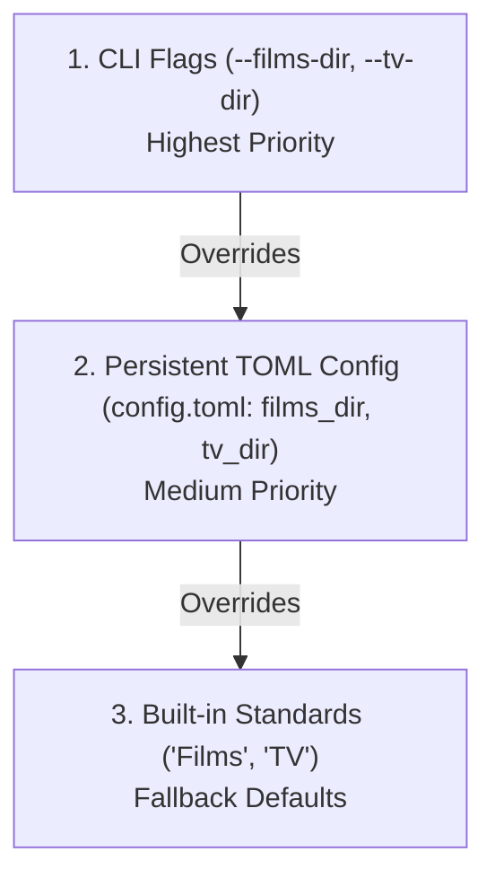
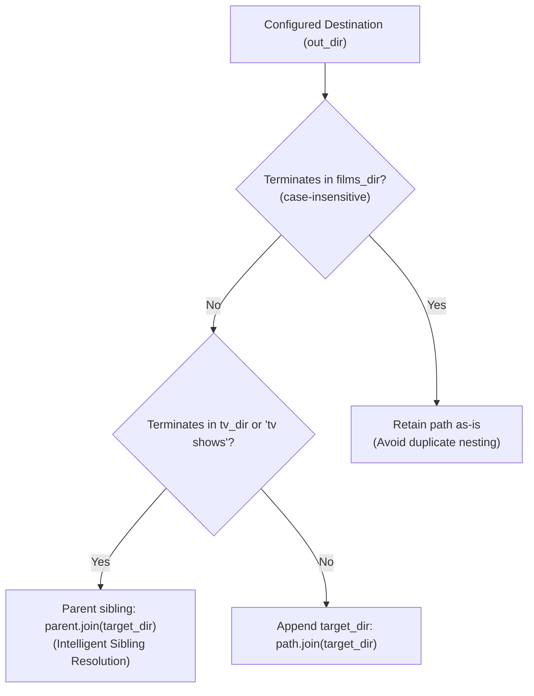

# Custom Media Taxonomy & Library Naming Guide - `dvd-ripper`

> **Document Version**: 1.0.0  
> **Applies to**: `dvd-ripper` v0.4.0+  
> **Standard Compliance**: Plex Media Server, Jellyfin, Emby, & Kodi Standards  

---

## 1. Overview

`dvd-ripper` features a pure domain naming engine located at [`src/domain/naming.rs`](../src/domain/naming.rs) that ensures optical disc rips are systematically structured for zero-configuration ingestion by modern home theater media servers.

Media is categorized into two top-level collections:
- **Feature Films / Movies**: Formatted as `<out_dir>/<films_dir>/<Movie Title> (<Year>)/<Movie Title> (<Year>).<ext>`
- **Television Series**: Formatted as `<out_dir>/<tv_dir>/<Show Name> (<Year>)/Season <SS>/<Show Name> - S<SS>E<EE> - <Episode Title>.<ext>`

Both subfolder names (`films_dir` and `tv_dir`) default to `"Films"` and `"TV"` respectively, but can be customized to any directory name (such as `"Movies"`, `"Cinema"`, `"Series"`, `"TV Shows"`, or language-specific titles) via CLI parameters, configuration files, or the desktop GUI.

---

## 2. Configuration & Priority Cascade

The naming engine resolves the target root subdirectories through an unambiguous 3-tier priority cascade:



### 2.1 CLI Flags
```bash
# Custom subfolders: 'Movies' for films and 'Series' for TV shows
dvd-ripper -i D:\ -d "C:\Media" --films-dir "Movies" --tv-dir "Series"
```

### 2.2 Configuration File (`~/.dvd-ripper/config.toml` or `./dvd-ripper.toml`)
```toml
# Base output directory
out_dir = "C:\\Media"

# Custom library subfolder names
films_dir = "Movies"
tv_dir = "Series"
```

### 2.3 Desktop GUI
In the **⚙️ Settings & Preferences** tab under the **📁 Storage & Paths** section, enter your preferred names in the **Films Subfolder Name** and **TV Subfolder Name** fields. The choices are instantly flushed to `config.toml` and previewed live on the **🎬 Disc Extraction** tab.

---

## 3. Intelligent Sibling Directory Resolution

To prevent pathological nesting errors (such as `Movies/Movies/...` or `Movies/Series/...`), `dvd-ripper` implements an intelligent bi-directional sibling resolution algorithm ([`src/domain/naming.rs: resolve_films_root_with_tv`](../src/domain/naming.rs)):



### Resolution Matrix

| Configured `out_dir` | `films_dir` | `tv_dir` | Ripping Mode | Resolved Output Directory | Behavior Rationale |
|---|---|---|---|---|---|
| `C:\Media` | `Films` | `TV` | Movie | `C:\Media\Films\<Title> (<Year>)\...` | Base folder; appends `Films/` |
| `C:\Media` | `Films` | `TV` | TV Series | `C:\Media\TV\<Show> (<Year>)\Season SS\...` | Base folder; appends `TV/` |
| `C:\Media` | `Movies` | `Series` | Movie | `C:\Media\Movies\<Title> (<Year>)\...` | Base folder; appends custom `Movies/` |
| `C:\Media` | `Movies` | `Series` | TV Series | `C:\Media\Series\<Show> (<Year>)\Season SS\...` | Base folder; appends custom `Series/` |
| `C:\Media\Movies` | `Movies` | `Series` | Movie | `C:\Media\Movies\<Title> (<Year>)\...` | Preserves folder; avoids `Movies/Movies/` |
| `C:\Media\Movies` | `Movies` | `Series` | TV Series | `C:\Media\Series\<Show> (<Year>)\Season SS\...` | **Routes to sibling `Series/` folder** |
| `C:\Media\Series` | `Movies` | `Series` | TV Series | `C:\Media\Series\<Show> (<Year>)\Season SS\...` | Preserves folder; avoids `Series/Series/` |
| `C:\Media\Series` | `Movies` | `Series` | Movie | `C:\Media\Movies\<Title> (<Year>)\...` | **Routes to sibling `Movies/` folder** |
| `.` (or empty) | `Films` | `TV` | Movie | `Films\<Title> (<Year>)\...` | Local relative directory fallback |

---

## 4. Feature Film Taxonomy Specifications

### 4.1 Folder and File Structure
```text
<out_dir>/<films_dir>/
└── <Sanitized Title> (<Release Year>)/
    ├── <Sanitized Title> (<Release Year>).<ext>     # Primary video stream (.mp4 / .mkv / .iso)
    ├── <Sanitized Title> (<Release Year>).nfo       # Kodi/Jellyfin XML metadata sidecar
    ├── <Sanitized Title> (<Release Year>).en.srt    # Normalized OCR text subtitle sidecar
    ├── poster.jpg                                   # Front cover artwork (JPEG)
    ├── fanart.jpg                                   # Background backdrop artwork
    └── <Sanitized Title> (<Release Year>).sha256    # Cryptographic SHA-256 verification hash
```

### 4.2 Sanitization Rules
The title sanitizer (`src/utils.rs: sanitize_filename`):
1. **Illegal Character Replacement**: Replaces OS-restricted characters (`< > : " / \ | ? *`) with space or underscores.
2. **Control Character Stripping**: Removes all non-printable ASCII/Unicode control characters (`\x00..\x1F`, `\x7F`).
3. **Punctuation Trimming**: Trims trailing periods, spaces, and duplicate whitespace.
4. **Year Parsing**: Verifies release years ($\ge 1888$) and prevents redundant parentheses (e.g., `Movie (1999) (1999)` $\to$ `Movie (1999)`).

---

## 5. Television Series Taxonomy Specifications

### 5.1 Episode Code Formatting
Episodes are standardized using the canonical `S<SS>E<EE>` format:
- `Season 1, Episode 5` $\implies$ `S01E05`
- Zero-padded to 2 digits for season numbers up to 99 and episode numbers up to 999.

### 5.2 Multi-Episode Batch Structure
```text
<out_dir>/<tv_dir>/
└── <Show Name> (<Release Year>)/
    ├── tvshow.nfo                                   # Series-level metadata sidecar
    ├── poster.jpg                                   # Series poster artwork
    └── Season <SS>/
        ├── <Show Name> - S<SS>E01 - <Title>.mp4     # Episode 1 with optional TVMaze title
        ├── <Show Name> - S<SS>E01 - <Title>.nfo     # Episode 1 metadata sidecar
        ├── <Show Name> - S<SS>E01 - <Title>.en.srt  # Episode 1 subtitle sidecar
        ├── <Show Name> - S<SS>E02 - <Title>.mp4     # Episode 2
        └── <Show Name> - S<SS>E03 - <Title>.mp4     # Episode 3
```

### 5.3 TVMaze Automated Episode Title Resolution
When an online connection is available, `dvd-ripper` queries the public TVMaze API:
- Discovered track: `Title #1 (2850s)` $\implies$ Identified as Season 1, Episode 1.
- TVMaze query result: `"Pilot"`.
- Formatted output file: `The Office - S01E01 - Pilot.mp4`.
- If offline, graceful fallback preserves the standardized numbering: `The Office - S01E01.mp4`.

---

## 6. Verification & Automated Contract Testing

The custom taxonomy engine is validated by automated unit tests in [`src/domain/naming.rs`](../src/domain/naming.rs) and [`src/ffmpeg.rs`](../src/ffmpeg.rs):
- `test_domain_naming_conventions`: Validates Plex standard stem and extension formatting.
- `test_domain_naming_films_root_handling`: Validates nested folder resolution and sibling detection.
- `test_domain_naming_custom_folders`: Validates arbitrary custom folder names (`Movies` / `Series`) across all sibling and parent traversal scenarios.

