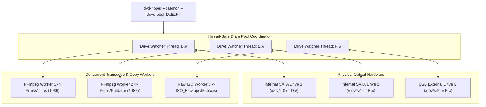

# Multi-Drive Pool & High-Throughput Appliance Guide - `dvd-ripper`

`dvd-ripper` features a **Multi-Drive Concurrent Pool Engine** capable of orchestrating simultaneous ripping operations across multiple physical or virtual optical disc drives. This allows automated disc-ripping stations, robotic autoloaders, and multi-drive NAS towers to maximize throughput.

---

## 1. Multi-Drive Hardware Topologies

`dvd-ripper` scales linearly across optical hardware configurations:



- **SATA Internal Arrays**: Multi-bay servers with 2 to 6 5.25" optical drives.
- **USB Multi-Drive Hubs**: Raspberry Pi or Mini PC connected to powered USB DVD-RW writer hubs.
- **Automated Disc Autoloaders**: Robotic disc loaders using `--no-eject` and external feeder scripts.

---

## 2. Launching Multi-Drive Pool Mode

### 2.1 CLI Flags
Specify target drives as a comma-separated list via `--drive-pool`:

```bash
# Windows (specifying drives D:, E:, and F:)
dvd-ripper --daemon --drive-pool "D:,E:,F:"

# Linux / Unix (specifying /dev/sr0 and /dev/sr1)
dvd-ripper --daemon --drive-pool "/dev/sr0,/dev/sr1"

# Unattended multi-drive automated ripping with automatic tray ejection
dvd-ripper --daemon --drive-pool "D:,E:" --auto-rip --min-free-gb 25
```

### 2.2 TOML Configuration (`dvd-ripper.toml`)
```toml
# Comma-separated list of drive paths
drive_pool = "D:,E:,F:"

# Enable unattended ripping across all drives
auto_rip = true

# Minimum free disk space guard across target storage
min_free_gb = 20
```

---

## 3. Concurrency & Collision Safety

When running multiple optical drives concurrently, `dvd-ripper` enforces strict process isolation:

1. **Independent Watcher Threads**: Each drive runs its own loop checking for media insertion (`spawn_drive_watcher`), preventing slow disc reads on one drive from delaying another.
2. **Per-Drive Cancellation Tokens**: An atomic boolean cancellation flag is maintained for each drive (`CANCEL_FLAGS`). Calling `POST /api/cancel?drive=E:\` terminates only the job on `E:\`, leaving `D:\` running uninterrupted.
3. **Collision-Safe Output Naming**: `--no-overwrite` automatically resolves duplicate filename collisions by appending numeric increments (`Title_1.mp4`, `Title_2.mp4`), preventing race conditions when ripping multiple discs of the same series simultaneously.
4. **Per-Drive Tray Control**: Eject signals (`POST /api/eject?drive=D:\`) and optical motor spindown commands are dispatched specifically to the targeted drive handle.

---

## 4. REST API & Web Dashboard Monitoring

In multi-drive mode, query the pool status programmatically or through the web dashboard:

### 4.1 Query Pool Status (`GET /api/pool/status`)
```bash
curl http://localhost:8080/api/pool/status
```

**JSON Response**:
```json
[
  {
    "drive": "D:\\",
    "status": "Ripping",
    "disc": "KILL_BILL_VOL1",
    "title": "Kill Bill: Vol. 1",
    "progress": 74.2,
    "speed": "8.4x",
    "fps": "54.1"
  },
  {
    "drive": "E:\\",
    "status": "Completed",
    "disc": "KILL_BILL_VOL2",
    "title": "Kill Bill: Vol. 2",
    "progress": 100.0,
    "speed": "0.0x",
    "fps": "0.0"
  },
  {
    "drive": "F:\\",
    "status": "Idle",
    "disc": "",
    "title": "",
    "progress": 0.0,
    "speed": "",
    "fps": ""
  }
]
```

### 4.2 Per-Drive Remote Operations
- **Trigger Ripping on Drive E:**:
  ```http
  POST /api/rip?drive=E:\
  ```
- **Cancel Ripping on Drive D:**:
  ```http
  POST /api/cancel?drive=D:\
  ```
- **Eject Tray on Drive F:**:
  ```http
  POST /api/eject?drive=F:\
  ```
