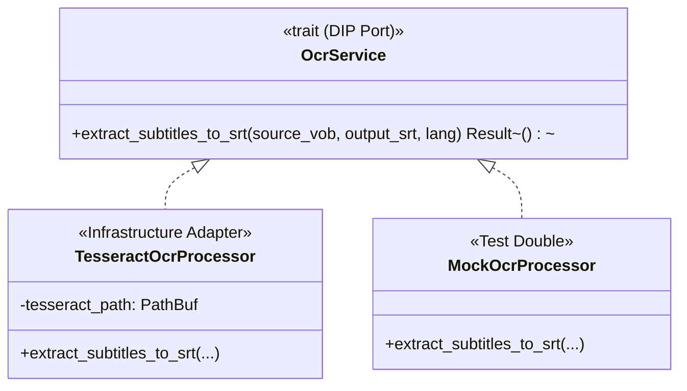

# Subtitle Extraction & Optical Character Recognition (OCR) Guide - `dvd-ripper`

`dvd-ripper` provides advanced subtitle extraction options, including on-the-fly conversion of standard DVD bitmap overlays (`dvdsub`) into clean, universal SubRip (`.srt`) text sidecars using **Tesseract OCR**.

---

## 1. Why OCR Subtitles? (Bitmap vs. Text Subtitles)

Standard optical DVDs store subtitles as compressed 2-bit or 4-bit graphical bitmap images multiplexed into the MPEG-2 program stream (known as **`dvdsub`** or VobSub). 

### The Direct-Play Problem
When streaming media with `dvdsub` bitmap streams to smart TVs, Apple TV, Chromecast, or web browsers via **Plex**, **Jellyfin**, or **Emby**:
1. Most client players cannot render DVD bitmap graphics natively.
2. The media server is forced to perform heavy real-time CPU/GPU **video transcoding** to hard-burn bitmap images directly onto video frames.
3. This creates unnecessary server load, high electricity consumption, and visual compression degradation.

### The OCR Solution
By enabling `--ocr`, `dvd-ripper` feeds extracted DVD bitmap subtitle graphics into Tesseract OCR, producing a clean, lightweight, UTF-8 encoded SubRip (`.srt`) text file alongside your video:
- **Instant Direct Play**: Supported natively by 100% of modern video players with zero server transcoding.
- **Styling Flexibility**: Viewers can resize text, adjust font colors, and reposition captions.
- **Searchable Text**: Indexers and media servers can search dialogue transcripts.

---

## 2. Prerequisites & Tesseract Installation

To use OCR extraction, install the Tesseract OCR engine on your host system:

### Windows
```powershell
# Using Winget (Recommended)
winget install UB-Mannheim.TesseractOCR

# Or Chocolatey
choco install tesseract
```
*Default installation path: `C:\Program Files\Tesseract-OCR\tesseract.exe`.*

### Linux (Ubuntu / Debian / Unraid)
```bash
sudo apt-get update
sudo apt-get install -y tesseract-ocr tesseract-ocr-eng
```

### macOS
```bash
brew install tesseract
```

---

## 3. CLI & TOML Configuration

### 3.1 Command-Line Flags
| Flag | Description | Default |
|---|---|---|
| `--ocr` | Enable on-the-fly Tesseract OCR transcription from DVD bitmap overlays to `.srt`. | `false` |
| `--ocr-lang <CODE>` | 3-letter or 2-letter language code for Tesseract trained models (e.g. `eng`, `fra`, `spa`, `deu`). | `"eng"` |
| `--tesseract <PATH>`| Custom binary path to the Tesseract executable if not in system PATH. | `"tesseract"` |
| `--sub-external-srt`| Save output subtitles as a standalone sidecar file (`<Movie>.eng.srt`). | `false` |
| `--sub-forced-only` | Extract only forced dialogue markers (e.g. alien or foreign language translation). | `false` |

### 3.2 TOML Configuration (`dvd-ripper.toml`)
```toml
# Enable OCR subtitle extraction
ocr = true
ocr_lang = "eng"
tesseract = "C:\\Program Files\\Tesseract-OCR\\tesseract.exe"

# Save as external .srt sidecar alongside video
sub_external_srt = true
```

---

## 4. Usage Workflows & Examples

### 4.1 Ripping Movie with English SubRip Sidecar
```bash
dvd-ripper --input D:\ --search "The Matrix" --ocr --ocr-lang eng --sub-external-srt
```
**Output Artifacts**:
```text
Films/The Matrix (1999)/
├── The Matrix (1999).mp4
└── The Matrix (1999).eng.srt
```

### 4.2 Multi-Language OCR
To extract subtitles in French or German, ensure language packs (`tesseract-ocr-fra`, `tesseract-ocr-deu`) are installed:
```bash
dvd-ripper --input /dev/sr0 --ocr --ocr-lang fra --sub-external-srt
```

### 4.3 Forced Subtitles Only
For movies where subtitles are only needed for non-English dialogue scenes (e.g. *Avatar*, *Kill Bill*):
```bash
dvd-ripper --input D:\ --ocr --sub-forced-only --sub-external-srt
```

---

## 5. Clean Architecture Integration

In `dvd-ripper`'s Ports & Adapters architecture, subtitle extraction is decoupled from external OCR binaries:



- **Domain Port**: `src/domain/ports/` defines the `OcrService` contract.
- **Infrastructure Adapter**: `src/infrastructure/ocr/tesseract.rs` coordinates FFmpeg subtitle stream demuxing and Tesseract page segmentation (`--psm 6`).
- **Test Doubles**: `src/ocr.rs` contains in-memory mock processors for regression testing without external binary dependencies.
