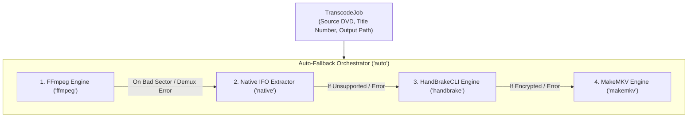

# Alternative Ripping & Transcoding Engines Guide

`dvd-ripper` provides a modular, multi-engine architecture designed to extract optical DVD-Video content reliably regardless of disc encryption, copy protection traps, or hardware constraints.

Users can choose between four distinct transcoding/remuxing engines or let the system dynamically select the best available engine through the **Auto-Fallback Composite Engine**.

---

## 1. Engine Comparison & Architecture



### Engine Feature Matrix

| Feature / Capability | FFmpeg (`ffmpeg`) | Native IFO (`native`) | HandBrakeCLI (`handbrake`) | MakeMKV (`makemkv`) |
| :--- | :---: | :---: | :---: | :---: |
| **Primary Mechanism** | `dvdvideo` Demuxer | Direct 2048-byte Sector Extractor | `libdvdnav` Navigation | Robot Mode (`makemkvcon`) |
| **External Binary Required** | Yes (`ffmpeg`) | **No (Pure Rust)** | Yes (`HandBrakeCLI`) | Yes (`makemkvcon`) |
| **Lossless Remuxing** | Yes (`--codec copy`) | **Yes (Direct VOB Copy)** | No (Always encodes) | **Yes (Bit-for-bit MKV)** |
| **Video Re-encoding** | H.264, HEVC, AV1 | Optional (via FFmpeg) | x264, x265, SVT-AV1 | No (Remux only) |
| **Hardware Decomb Filtering**| `bwdif`, `yadif`, `w3fdif` | Passthrough | `--comb-detect --decomb` | Passthrough |
| **Bad Sector Trap Resistance**| Moderate | **High (Sector Stepping)** | High (`libdvdnav`) | **Exceptional** |
| **Corrupt Root IFO Recovery** | Low (`libdvdread` aborts) | **High (.BUP Auto-Fallback)** | Moderate | High |
| **Hardware Bus Decryption** | Via `libdvdcss` | Via `libdvdcss` / OS | Via `libdvdcss` | **Native AACS/CSS/BD+ Engine** |

---

## 2. Detailed Engine Specifications

### 2.1. FFmpeg Engine (`--engine ffmpeg`)
- **Adapter**: `crate::infrastructure::ffmpeg::FfmpegTranscoder`
- **How it works**: Invokes `ffmpeg` with `-f dvdvideo -title <N> -i <DRIVE>` along with the project's flexible filter pipelines.
- **Strengths**: 
  - Rich filter graph support (motion-adaptive deinterlacing, 3D denoising, crop dimension detection, audio normalization).
  - Broad codec support including SVT-AV1, NVENC, QSV, and VAAPI hardware acceleration.
- **When to use**: Standard non-damaged DVDs, home video discs, or when specialized encoding filters (e.g. `--denoise`, `--deinterlace-algo bwdif`) are needed.

### 2.2. Native Rust IFO Cell-Sector Extractor (`--engine native`)
- **Adapter**: `crate::infrastructure::engines::NativeIfoTranscoder`
- **How it works**: Directly parses binary `VIDEO_TS.IFO` / `VTS_xx_0.IFO` Program Chain Tables (`VTS_PGCITI`) and Cell Playback Information Tables (`C_PBIT`). It resolves the exact `(first_sector..=last_sector)` 2048-byte logical sector spans belonging to the chosen title track and reads them directly from `VTS_xx_1..9.VOB`.
- **Strengths**:
  - **Zero External Dependencies**: Operates completely in pure Rust.
  - **Demuxer Immunity**: Bypasses all `ffmpeg -f dvdvideo` and `libdvdread` demuxer parsing bugs.
  - **`.BUP` Backup Recovery**: Seamlessly reads `VIDEO_TS.BUP` or `VTS_xx_0.BUP` if the primary `.IFO` has CRC read errors or bad sectors.
  - **Direct Title Set Bypass**: If the root `VIDEO_TS.IFO` is unreadable due to Sony ARccOS protection, it directly discovers and extracts `VTS_01_0.IFO` through `VTS_99_0.IFO`.
  - **Sector-by-Sector Stepping**: Steps down from 64 KiB block reads to individual 2048-byte sector reads when hitting damaged sectors, safely skipping unreferenced gap traps.
- **When to use**: Discs where FFmpeg outputs `Invalid IFO for title 0` or halts at arbitrary percentages due to ARccOS/Macrovision bad sector traps.

### 2.3. HandBrakeCLI Engine (`--engine handbrake`)
- **Adapter**: `crate::infrastructure::engines::HandBrakeTranscoder`
- **How it works**: Spawns `HandBrakeCLI` in headless mode, mapping the job specification to HandBrake's native flags (`-t <title>`, `-c <chapters>`, `-e <encoder>`, `--encoder-preset`, `--all-audio`, `--all-subtitles`, `--comb-detect --decomb`). Real-time progress is scraped from stdout (`Encoding: task 1 of 1, X.XX % (Y.YY fps, avg Z.ZZ fps, ETA HHhMMmSSs)`).
- **Strengths**:
  - Mature `libdvdnav` DVD virtual machine emulation.
  - Exceptional motion-adaptive decombing filter (`--comb-detect --decomb`).
- **When to use**: Discs with complex multi-angle camera angles, interlaced live-action concert discs, or when HandBrake's encoding presets are preferred.

### 2.4. MakeMKV Engine (`--engine makemkv`)
- **Adapter**: `crate::infrastructure::engines::MakeMkvTranscoder`
- **How it works**: Spawns `makemkvcon` in robot mode (`-r --progress=-same mkv disc:0 <title_idx> <out_dir>`) and captures real-time progress (`PRGV:current,total,max`). After extraction, it discovers the generated `.mkv` file and renames it to match the configured destination naming hierarchy.
- **Strengths**:
  - **Hardware Optical Decryption**: Directly negotiates drive bus authentication for AACS, BD+, and CSS without external wrappers.
  - **Lossless Extraction**: Zero video or audio recompression; 100% original MPEG-2 and Dolby Digital / DTS bitstreams are preserved in a modern Matroska container.
  - **Decoy Title Elimination**: Automatically resolves real feature titles from complex 99-title decoy playlists.
- **When to use**: Heavily encrypted discs, Criterion/Disney protected releases, or when bit-for-bit lossless archival remuxing is desired.

### 2.5. Auto-Fallback Engine (`--engine auto`) [Default]
- **Adapter**: `crate::infrastructure::engines::AutoFallbackTranscoder`
- **How it works**: Orchestrates an intelligent priority cascade:
  1. Attempts primary extraction via **FFmpeg**.
  2. If FFmpeg fails with a copy protection, demuxer, or bad-sector error, automatically falls back to **Native IFO Cell Extractor**.
  3. If HandBrake is detected in PATH or configured, it is called next.
  4. If MakeMKV is detected in PATH or configured, it serves as the ultimate decryption fallback.
- **When to use**: Recommended for all automated, headless daemon, and desktop usage.

---

## 3. Configuration & CLI Usage

### Command-Line Arguments
```bash
# Force pure Rust Native IFO cell extractor (bypasses FFmpeg demuxer entirely)
dvd-ripper --cli D: --engine native --search "The Matrix"

# Use HandBrakeCLI with custom binary location
dvd-ripper --cli D: --engine handbrake --handbrake-path "C:\Program Files\HandBrake\HandBrakeCLI.exe"

# Use MakeMKV for lossless robot-mode remuxing
dvd-ripper --cli D: --engine makemkv --makemkv-path "C:\Program Files (x86)\MakeMKV\makemkvcon64.exe"

# Default auto-fallback with all tools available in PATH
dvd-ripper --cli D: --engine auto
```

### Configuration File (`dvd-ripper.toml`)
```toml
# Default transcoding engine: "auto", "ffmpeg", "native", "handbrake", or "makemkv"
engine = "auto"

# Custom executable paths for third-party engines
handbrake_path = "HandBrakeCLI"
makemkv_path = "makemkvcon"
```

### Desktop GUI
In the desktop GUI:
1. Open the **Rip Disc** tab.
2. In the **Quality & Video Profile** section, open the **Transcoding Engine** dropdown.
3. Select **Auto Fallback**, **Native IFO Extractor**, **HandBrakeCLI**, or **MakeMKV**.
4. Configure paths in the **Settings** tab if executables are installed in custom non-system directories.

