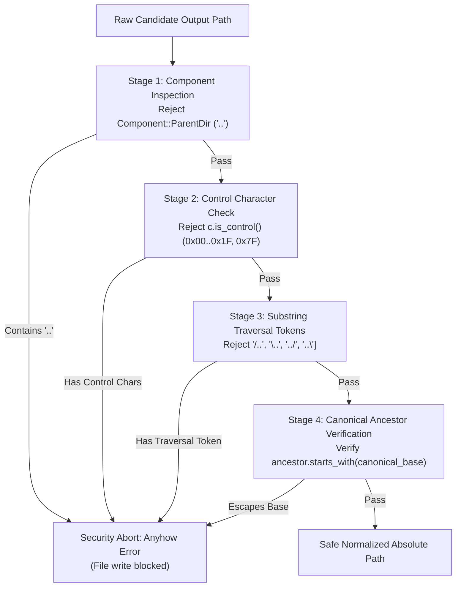

# Security Architecture & Path Traversal Safeguards - `dvd-ripper`

> **Document Version**: 1.0.0  
> **Applies to**: `dvd-ripper` v0.4.0+  
> **Auditing Standard**: OWASP ASVS v4.0.3 (File & Path Security) & CWE-22 Mitigation  

---

## 1. Threat Model & Overview

`dvd-ripper` frequently processes untrusted external metadata originating from:
1. **Optical Disc Volume Labels**: Burned ISO-9660 or UDF headers that can be maliciously crafted by an attacker (e.g., `../../../../etc/passwd` or `C:\Windows\System32\evil.dll`).
2. **Online Metadata APIs (OMDb, IMDb, TVMaze)**: Web payloads containing untrusted title strings, file extensions, or Unicode control characters.
3. **HTTP REST API Endpoints**: File paths submitted via JSON payloads to `/api/rip`.
4. **Symlink Redirections**: Filesystem targets manipulated to escape output directory boundaries.

To protect the host operating system against arbitrary file overwrite, directory climbing, and unauthorized disk writes, `dvd-ripper` implements defense-in-depth safeguards centered around [`src/utils.rs: ensure_path_contained`](../src/utils.rs).

---

## 2. The 4-Stage Containment Pipeline

Every destination path constructed by `resolve_output_path`, `resolve_movie_output_path`, or `resolve_tv_batch_destination_dir` must pass through the 4-stage validation pipeline:



---

## 3. Pipeline Stages Detailed

### Stage 1: Component-Level Parent Directory Check
Using `std::path::Path::components()`, the path is tokenized into structural segments. If any component matches `std::path::Component::ParentDir`, the operation is aborted immediately:
```rust
for component in target.components() {
    if matches!(component, std::path::Component::ParentDir) {
        return Err(anyhow!(
            "Path Traversal Safeguard Triggered: Target path '{}' contains '..' traversal segment.",
            target.display()
        ));
    }
}
```

### Stage 2: Control Character Sanitization
Attackers often use non-printable ASCII control characters (such as null bytes `\0`, carriage returns `\r`, or escape codes `\x1B`) to trick underlying OS APIs or demuxers into truncating strings:
```rust
let target_str = target.to_string_lossy();
if target_str.chars().any(|c| c.is_control()) {
    return Err(anyhow!(
        "Path Security Safeguard Triggered: Target path '{}' contains non-printable control characters.",
        target.display()
    ));
}
```

### Stage 3: String Traversal Token Scanning
Catches malformed or unnormalized slash combinations such as `/..`, `\..`, `../`, and `..\` that may evade component parsers under non-canonical forms.

### Stage 4: Canonical Ancestor Prefix Verification
Even without explicit `..` segments, paths can attempt to write to system directories (e.g. `C:\Windows` or `/etc`) or jump across symlinks.
1. `base` is resolved to its real physical path using `canonicalize()`.
2. `target` is resolved to its deepest existing ancestor on the filesystem.
3. The deepest existing ancestor is canonicalized.
4. The normalized ancestor prefix **must strictly start with** `norm_base`. If the target attempts to write to a parent or sibling volume outside the designated library root, execution is terminated.

---

## 4. Windows Verbatim Path Normalization (`\\?\`)

On Microsoft Windows, `std::fs::canonicalize()` prefixes absolute drive paths with the Win32 verbatim prefix:
```text
C:\Media\Films  -->  \\?\C:\Media\Films
```
If one path possesses the verbatim prefix (`\\?\C:\...`) while another uses a standard DOS path (`C:\...`), naive `starts_with()` checks will fail with a false-positive security error.

`dvd-ripper` solves this by stripping the prefix via `strip_verbatim_prefix`:
```rust
fn strip_verbatim_prefix(path: &Path) -> PathBuf {
    let s = path.to_string_lossy();
    if let Some(stripped) = s.strip_prefix(r"\\?\") {
        PathBuf::from(stripped)
    } else {
        path.to_path_buf()
    }
}
```
This ensures consistent security validation across Windows 10, Windows 11, Windows Server, Linux ext4/btrfs, and macOS APFS.

---

## 5. Defense-in-Depth File Operations

Beyond path validation, `dvd-ripper` incorporates additional runtime file safety measures:
1. **Atomic File Writes (`atomic_write_file`)**: Configuration, history, and cache files are written to a temporary UUID file (`.tmp.UUID`) on the same volume and atomically renamed via `std::fs::rename()`, preventing file corruption during power failures or sudden process termination.
2. **Minimum Free Disk Space Guard (`check_disk_space_guard`)**: Evaluates available partition space using OS APIs (`GetDiskFreeSpaceExW` on Windows, `statvfs` on POSIX). If available storage drops below `--min-free-gb` (default: 10 GB), ripping halts gracefully before running out of disk space.
3. **Overwrite Safeguard (`no_overwrite`)**: When `--no-overwrite` is active, destination files are collision-checked. If `Movie.mp4` exists, the engine safely resolves `Movie_1.mp4`, `Movie_2.mp4`, etc., without ever clobbering existing media.

