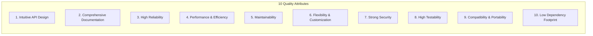

# Software Library Quality Attributes

A production-grade software library is more than functional code; it is an artifact designed for others to use, understand, and rely upon.

`dvd-ripper` is engineered around the **10 Software Library Quality Attributes**, ensuring enterprise reliability, safety, testability, and architectural maintainability.

---

## 1. Quality Attributes Summary

---

## 2. Implementation in `dvd-ripper`

### Attribute 1: Intuitive API Design
- **Hexagonal Domain Ports**: Clear, single-responsibility traits in `crate::domain::ports`:
  - `Transcoder`: Abstraction for video encoding and remuxing engines (`transcode`, `transcode_chapter_range`).
  - `ProgressObserver`: Decoupled event notification handler (`on_progress`, `on_log`).
  - `HistoryRepository`: Ripping ledger persistence (`load_history`, `append_record`, `clear_history`).
  - `DiskSpaceGuard`: Storage pre-flight verification (`check_free_space`).
  - `Notifier`: Multi-channel telemetry dispatcher (`send`).
- **Consistent Types**: Strongly typed configuration structs (`TranscodeJob`, `TranscodeOptions`, `RipTaskSpecification`) prevent parameter confusion.

### Attribute 2: Comprehensive Documentation
- **Docstrings Everywhere**: All public structs, enums, functions, and modules include detailed Rustdoc comments with `# Errors`, `# Panics`, and `# Examples`.
- **Markdown Manuals**: Over 20 specialized guides under `docs/` covering CLI, GUI, REST API, Prometheus, Daemons, Hardware Acceleration, and Copy Protection.
- **Architectural Diagrams**: Mermaid sequence, state, and layer diagrams embedded across documentation.

### Attribute 3: High Reliability
- **Cooperative Cancellation Tokens**: All long-running operations accept `Arc<AtomicBool>` cancellation flags for instantaneous, non-blocking termination without orphan processes.
- **Child Process Lifecycle Guards**: Subprocesses (`ffmpeg`, `HandBrakeCLI`, `makemkvcon`) are wrapped in `ChildGuard` RAII containers that automatically terminate child processes on drop or panics.
- **Atomic File Operations**: Outputs and databases (`ripping_history.json`, `boxsets.json`) are written via temporary staging files and atomic renames (`atomic_write_file`) to prevent corrupt partial writes during power loss.

### Attribute 4: Performance & Efficiency
- **Sub-10ms Binary IFO Probing**: The `ifo_parser` module reads optical disc structures (`VIDEO_TS.IFO`, `VTS_xx_0.IFO`, and `.BUP` tables) directly in pure Rust in under 10 milliseconds, eliminating the multi-second overhead of launching FFmpeg subprocesses.
- **Zero-Allocation Progress Parsing**: `parse_progress_bytes` parses raw byte slices into percentages without heap string allocations.
- **Buffered Sector Extraction**: 64 KiB chunked reads with 1 MB buffered writes (`BufWriter`) optimize sequential optical read speeds.

### Attribute 5: Maintainability
- **Clean Architecture & SOLID Compliance**: Strict dependency rule: Domain has zero external dependencies; Infrastructure depends on Domain; Application orchestrates Use Cases; Presentation (CLI/GUI) depends on Application.
- **Dependency Inversion**: `AppContainer` serves as the single Composition Root wiring adapters to ports.

### Attribute 6: Flexibility & Customization
- **Composite Auto-Fallback Engine**: `AutoFallbackTranscoder` allows hot-swappable fallback chains across diverse engines.
- **Pluggable Post-Processing Pipeline**: `PostProcessorPipeline` allows arbitrary composition of post-processors (NFO generators, checksum calculation, media server refresh triggers, custom shell scripts).

### Attribute 7: Strong Security
- **SSRF (Server-Side Request Forgery) Defense**:
  - `validate_safe_http_url` verifies all webhook and media server URLs before dispatch.
  - Automatically rejects IPv4 loopback (`127.0.0.0/8`), RFC 1918 private subnets (`10.0.0.0/8`, `172.16.0.0/12`, `192.168.0.0/16`), link-local (`169.254.0.0/16`), and non-standard schemes.
- **Path Traversal Guards**:
  - `ensure_path_contained` validates canonical paths to prevent `../` directory traversal attacks.
  - `is_safe_filename` and `sanitize_filename` strip illegal characters (`<>:"/\|?*`), null bytes, control codes, and Windows reserved device names (`CON`, `PRN`, `AUX`, `NUL`, `COM1-9`, `LPT1-9`).
- **Command Injection Prevention**:
  - All external tools (`ffmpeg`, `HandBrakeCLI`, `makemkvcon`) are spawned via direct argument vectors using `std::process::Command::arg` rather than shell string interpolation.

### Attribute 8: High Testability
- **In-Memory Test Doubles**: Reusable, thread-safe test doubles in `crate::domain::ports::testing`:
  - `InMemoryHistoryRepository`: Volatile history tracking without filesystem I/O.
  - `RecordingNotifier`: Records notification events for test assertions.
  - `FixedDiskSpaceGuard`: Configurable disk space simulation.
  - `RecordingProgressObserver`: Captures progress events and log lines.
- **Extensive Test Coverage**: Over 376 automated unit tests and integration contract tests executing in under 60 seconds without physical optical hardware or network access.

### Attribute 9: Compatibility & Portability
- **Multi-OS Support**: Full support for Windows, Linux, and macOS.
- **Optical Drive Abstraction**: Platform-specific tray eject and drive polling adapters in `infrastructure/optical/` with seamless Win32, Linux IOCTL, and macOS fallbacks.

### Attribute 10: Low Dependency Footprint
- **Minimal Core Dependencies**: Pure Rust standard library used for optical parsing, HTTP parsing, and serialization.
- **Feature Flags**: GUI can be omitted completely via `--no-default-features --features cli` for ultralight container and embedded deployments.

