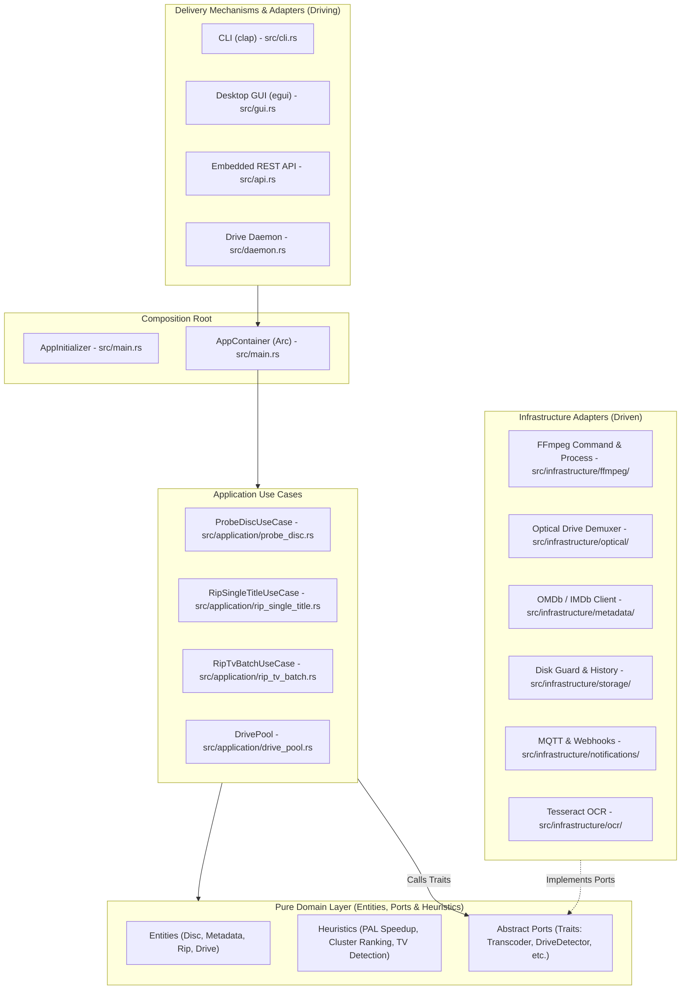

# SOLID & Clean Architecture Specification - `dvd-ripper`

> **Document Version**: 1.0.0  
> **Status**: Active Architecture Standard  
> **Target Crate**: `dvd-ripper`

---

## 1. Architectural Vision & Principles

`dvd-ripper` is structured around **Clean Architecture** (Hexagonal / Ports & Adapters) combined with strict adherence to the **5 SOLID Principles**.

### High-Level Hexagonal Topology



The core tenet is the **Dependency Rule**: *dependencies must point inward toward the pure domain*. The domain layer has zero dependencies on external libraries (no network I/O, no process execution, no file system writes).

---

## 2. Single Responsibility Principle (SRP)

*Every component must have one, and only one, reason to change.*

### 2.1 FFmpeg Pipeline Decomposition
Previously, `src/ffmpeg.rs` combined command-line string assembly, child process lifecycle management, stderr progress regex parsing, and subtitle extraction into a 1,800-line monolithic file.

SRP decomposition separated these concerns into specialized modules:
- **`src/infrastructure/ffmpeg/builder.rs`**: Single responsibility is constructing the `std::process::Command` argument vector given user encoding options, video filters, and container specs.
- **`src/infrastructure/ffmpeg/process_runner.rs`**: Single responsibility is spawning the child process, wiring non-blocking stderr pipes, managing graceful process termination, and watching cooperative cancellation tokens (`Arc<AtomicBool>`).
- **`src/infrastructure/ffmpeg/progress_parser.rs`**: Single responsibility is reading raw line buffers and parsing numeric transcoding telemetry (FPS, frame count, speed ratio, percentage, ETA).
- **`src/infrastructure/ffmpeg/transcoder.rs`**: Orchestrates builder, runner, and parser to fulfill the domain's `Transcoder` port.

### 2.2 Application Bootstrapping
- **`src/main.rs: AppInitializer`**: Isolated from runtime execution. Its only reason to change is changes in configuration precedence (CLI flags vs TOML config vs environment variables).

---

## 3. Open/Closed Principle (OCP)

*Software entities should be open for extension, but closed for modification.*

### 3.1 Video Codec Strategy Resolver
Instead of hardcoding codec strings inside command generation logic, codec resolution is abstracted behind an extensible strategy trait:

```rust
pub trait VideoCodecResolver: Send + Sync {
    fn resolve(&self, codec: &str) -> &'static str;
}
```

New video encoders (e.g., AV2, ProRes, VP9) can be registered without modifying existing command execution pathways.

### 3.2 Extensible Video Filter Strategies
Video processing filters (motion-adaptive deinterlacing, 3D denoising, SDR tonemapping) assemble modular filter components:
- `bwdif` (Bob Weaver Deinterlacing Filter)
- `yadif` (Yet Another Deinterlacing Filter)
- `w3fdif` (Weston 3-Field Deinterlacing Filter)
- `hqdn3d` (High-Quality Denoise 3D)

---

## 4. Liskov Substitution Principle (LSP)

*Subtypes must be substitutable for their base types without altering program correctness.*

All domain port trait implementations adhere strictly to unified contracts:

### 4.1 Optical Drive Demuxing (`OpticalDriveReader`)
- `WindowsDriveReader`: Interacts with Win32 `IOCTL_STORAGE_GET_DEVICE_NUMBER` and `GetVolumeInformationW`.
- `LinuxDriveReader`: Interacts with Linux `/sys/block/sr*` and ISO-9660 sector descriptors.
- `MockOpticalDriveReader`: Operates purely in-memory.

All implementations guarantee deterministic error handling (`Result<T, OpticalError>`), uniform volume label sanitization, and non-panicking sector bounds checks.

### 4.2 Storage & History Repositories (`HistoryRepository`)
- `JsonHistoryRepository`: Persists records to `ripping_history.json`.
- `MockHistoryRepository`: Persists records to an in-memory `Arc<Mutex<Vec<RipRecord>>>`.

Switching between them does not alter application use case execution, progress broadcasting, or UI rendering.

---

## 5. Interface Segregation Principle (ISP)

*Clients should not be forced to depend upon interfaces that they do not use.*

Large monolithic traits have been split into focused, single-purpose role interfaces:

### 5.1 Granular Optical Drive Interfaces
Instead of a single monolithic `DriveManager` trait, interfaces are segregated:

```rust
/// Dedicated to detecting connected optical drives on the host
pub trait DriveDetector: Send + Sync {
    fn detect_drives(&self) -> Vec<DvdDriveInfo>;
}

/// Dedicated to querying volume labels and disc fingerprints
pub trait DiscInspector: Send + Sync {
    fn read_volume_label(&self, drive_path: &Path) -> Result<String>;
    fn compute_fingerprint(&self, drive_path: &Path) -> Result<String>;
}

/// Dedicated solely to optical tray ejection
pub trait TrayController: Send + Sync {
    fn eject_tray(&self, drive_path: &Path) -> Result<()>;
}
```

A client that only needs to eject a disc (e.g., the web REST API tray ejection route) depends only on `TrayController`, not the entire drive reader or probe engine.

### 5.2 Segregated CLI Encoding Configurations
In `src/cli.rs`, the large `Args` struct implements segregated configuration traits:
- `TranscodeConfig`: codec, profile, preset, crf, hwaccel.
- `AudioConfig`: all_audio, normalize, norm_target, downmix, dual_audio.
- `SubtitleConfig`: subtitles, sub_forced_only, sub_lang, sub_external_srt.

---

## 6. Dependency Inversion Principle (DIP)

*High-level modules should not depend upon low-level modules. Both should depend upon abstractions.*

### 6.1 Port Declarations in Domain
Use cases in `src/application/` never import `std::process::Command`, Win32 API bindings, or HTTP clients. They interact exclusively with port traits defined in `src/domain/ports/`:

- `crate::domain::ports::transcoder::Transcoder`
- `crate::domain::ports::optical_drive::{DriveDetector, DiscInspector, TrayController}`
- `crate::domain::ports::metadata::MetadataProvider`
- `crate::domain::ports::storage::{DiskSpaceGuard, HistoryRepository}`
- `crate::domain::ports::notification::Notifier`
- `crate::domain::ports::dialogs::FileDialogService`

### 6.2 Composition Root (`AppContainer`)
Dependency injection is centralized in `src/main.rs`:

```rust
pub struct AppContainer {
    pub drive_detector: Arc<dyn DriveDetector>,
    pub transcoder: Arc<dyn Transcoder>,
    pub metadata_provider: Arc<dyn MetadataProvider>,
    pub history_repo: Arc<dyn HistoryRepository>,
    pub disk_guard: Arc<dyn DiskSpaceGuard>,
    pub notifier: Arc<dyn Notifier>,
    pub file_dialog: Arc<dyn FileDialogService>,
}

impl AppContainer {
    pub fn production() -> Self { ... }
}
```

---

## 7. Domain Heuristics & Copy Protection Traps

Commercial DVDs frequently employ anti-copying schemes and regional timing differences. These algorithms are encapsulated as pure domain heuristics:

### 7.1 Duration Cluster Ranking (Bypassing Decoy Title Traps)
Discs with copy-protection schemes (e.g., *John Wick: Chapter 3 – Parabellum*) generate up to 99 false titles with disordered chapter segments, all claiming identical durations (e.g., 2h 10m).
- **Cluster Heuristic** (`src/domain/heuristics/cluster_detector.rs`): Identifies clusters of titles whose runtimes match the target theatrical film within a ±1% tolerance window. It ranks clustered titles deterministically to pick the true playback angle, bypassing decoy traps.

### 7.2 PAL Speedup Correction
European/Australian PAL DVDs run at 25 frames per second, whereas original theatrical films run at 24 fps (23.976 fps).
- **Speedup Heuristic** (`src/domain/heuristics/speedup.rs`): Automatically applies a 4.167% duration scaling factor (`duration * 0.96`) when comparing DVD title runtimes against online theatrical runtimes (OMDb/IMDb).

### 7.3 Multi-Episode TV Series Filtering
- **TV Detection Heuristic** (`src/domain/heuristics/tv_detector.rs`): Filters out short title tracks (<10 minutes, studio warnings, intros) and overly long "Play All" composite tracks (>2.5x standard episode duration) to isolate individual TV episodes cleanly.

---

## 8. Testability & Mock Architectures

With DIP in place, application pipelines are tested in-memory with zero process spawning, zero disk I/O, and zero network calls.

```rust
#[test]
fn test_rip_tv_batch_sequential_episodes() {
    let mock_transcoder = Arc::new(MockTranscoder::default());
    let mock_history = Arc::new(MockHistoryRepository::default());
    let use_case = RipTvBatchUseCase::new(mock_transcoder.clone(), mock_history.clone());

    let result = use_case.execute(request);
    assert!(result.is_ok());
    assert_eq!(mock_history.records().len(), 3);
}
```

The test suite validates:
1. **Cooperative cancellation propagation**: Testing that cancellation tokens immediately abort running mock transcoders and record `Cancelled` state.
2. **Sequential episode batch processing**: Ensuring episode indexes increment accurately.
3. **Decoy cluster rejection**: Ensuring studio traps are rejected deterministically.
