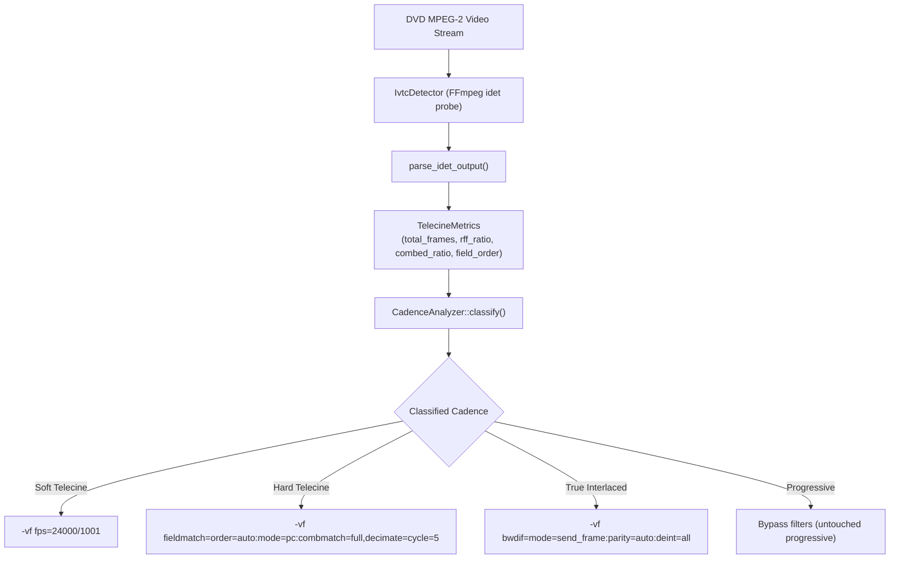

# Cadence-Aware 3:2 Pulldown (IVTC) Guide - `dvd-ripper`

`dvd-ripper` includes a **Cadence-Aware 3:2 Pulldown Inverse Telecine (IVTC) Pipeline** (`src/domain/heuristics/telecine.rs` and `src/infrastructure/ffmpeg/ivtc_detector.rs`). It automatically inspects MPEG-2 sequence headers and video field cadence to determine whether video is progressive, soft telecine, hard telecine, or true interlaced, applying lossless frame reconstruction without deinterlacing artifacts or motion judder.

---

## 1. Background: The 24p vs. 29.97i Dilemma

Theatrical movies are filmed at **24 frames per second (fps)** (or 23.976 fps in digital production). However, the NTSC DVD standard mandates a broadcast frame rate of **29.97 fps (59.94 fields per second)**. To display 24 fps films on NTSC televisions, studios use a technique known as **3:2 Pulldown**:

```text
Film Frames (24 fps):      |    A    |    B    |    C    |    D    |
NTSC Fields (60 fields/s): | A_t A_b | B_t B_b | B_t C_b | C_t D_b | D_t D_b |
Fields per Film Frame:     |    2    |    3    |    2    |    3    |
```

In 3:2 pulldown, four film frames are spread across five video frames (10 fields). The third and fourth frames contain fields from two different film moments, creating horizontal comb lines (**interlacing artifacts**) whenever motion occurs.

---

## 2. Telecine Varieties

`dvd-ripper` classifies video into four fundamental cadence categories:

### 2.1 Soft Telecine (MPEG-2 RFF Flags)
- **Mechanism**: The DVD video stream is physically encoded at native **23.976 fps progressive**. The MPEG-2 bitstream includes Repeat First Field (`RFF`) and Top Field First (`TFF`) flags instructing the hardware DVD player to generate the 3:2 field cadence on analog outputs.
- **Handling**: `dvd-ripper` detects the high RFF ratio (>= 35%) and discards repeated fields, extracting the pristine 23.976p progressive frames directly without any lossy deinterlacing filters (`-vf fps=24000/1001`).

### 2.2 Hard Telecine (Burned 3:2 Fields)
- **Mechanism**: Film frames were telecined prior to MPEG-2 compression. The 59.94i / 29.97 fps video stream contains permanently burned-in combed frames (exactly 2 out of every 5 frames exhibit combing, corresponding to ~40% combed frames).
- **Handling**: Applying a standard deinterlacer (like Yadif or BWDIF) destroys 50% of the spatial resolution. Instead, `dvd-ripper` applies **Inverse Telecine (IVTC)**:
  `fieldmatch=order=auto:mode=pc:combmatch=full,decimate=cycle=5`
  - `fieldmatch`: Reconstructs original whole film frames by pairing matching temporal fields.
  - `decimate`: Discards the 1 duplicate frame out of every 5, recovering the pure 23.976 fps progressive source with 100% vertical resolution intact.

### 2.3 True Interlaced (Video / Concert / Sports)
- **Mechanism**: Shot natively with 50i (PAL) or 59.94i (NTSC) interlaced video cameras (each field captured at a distinct point in time, e.g. 50 or 60 motion samples per second).
- **Handling**: IVTC cannot be applied because no paired frames exist. `dvd-ripper` applies high-quality motion-adaptive deinterlacing:
  `bwdif=mode=send_frame:parity=auto:deint=all`

### 2.4 True Progressive (PAL 25p / NTSC 24p)
- **Mechanism**: Entire frame captured at once with progressive sequence headers.
- **Handling**: All deinterlacing and field-matching filters are bypassed completely, preserving maximum visual sharpness and avoiding CPU processing overhead.

---

## 3. Cadence Detection Architecture



---

## 4. Usage & Options

### CLI
```bash
# Enable Cadence-Aware Inverse Telecine
dvd-ripper --input D:\ --detelecine --transcode --codec hevc
```

### TOML Configuration (`dvd-ripper.toml`)
```toml
# Enable IVTC detelecine
detelecine = true
```

### Desktop GUI
In the **Main Rip Panel**, check the **Cadence-Aware 3:2 Pulldown IVTC** checkbox.

