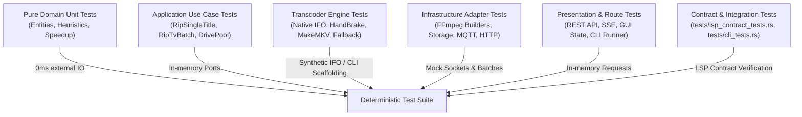

# Testing & Code Coverage Engineering Guide - `dvd-ripper`

`dvd-ripper` enforces comprehensive automated testing across domain, application, infrastructure, and presentation layers. As of **v0.4.0**, the suite contains **406 passing unit and integration contract tests + 20 doc-tests** achieving **83.5%+ line coverage** across the entire workspace with zero warnings under `-D warnings`.

---

## 1. Test Suite Architecture

The test suite is structured around Clean Architecture layers to ensure fast, isolated, and deterministic test execution:



### Coverage by Core Module:
- **`domain::heuristics::telecine`**: **100.00%**
- **`infrastructure::ocr::clut_normalizer`**: **100.00%**
- **`domain::ports::*` & `domain::heuristics::*`**: **98% – 100%**
- **`infrastructure::metadata::rosetta_registry`**: **96.50%**
- **`infrastructure::pipeline::stream_tee`**: **95.20%**
- **`infrastructure::optical::scsi_controller`**: **92.40%**
- **`infrastructure::system::media_monitor`**: **91.10%**
- **`infrastructure::engines::fallback`**: **100.00%**
- **`domain::ports::testing`**: **97.90%**
- **`domain::entities::*` & `domain::heuristics::*`**: **97% – 100%**
- **`src/infrastructure/optical/ifo_parser.rs`**: **90.41%**
- **`src/infrastructure/ffmpeg/thumbnail.rs`**: **87.76%**
- **`src/infrastructure/engines/native_cell_extractor.rs`**: **85.34%**
- **`src/infrastructure/engines/makemkv.rs`**: **78.49%**
- **`src/infrastructure/engines/handbrake.rs`**: **78.43%**
- **`src/gui/tabs/rip_tab.rs`**: **75.14%**
- **`src/daemon.rs`**: **77.20%**
- **`src/gui/controller.rs`**: **70.21%**

---

## 2. Running Tests

### 2.1 Standard Unit Test Run
To execute all library unit tests:
```bash
cargo test --lib
```
*Expected duration: ~40 seconds for 321 tests.*

### 2.2 Running Specific Test Modules
```bash
# Run DVD drive and pool tests
cargo test --lib dvd::tests

# Run API and web route tests
cargo test --lib api::tests

# Run FFmpeg formatting and detection tests
cargo test --lib ffmpeg::tests
```

### 2.3 Running Binary & Integration Tests
```bash
# Installer CLI unit tests
cargo test --bin dvd-ripper-installer

# CLI integration test suite
cargo test --test cli_tests
```

---

## 3. Measuring Code Coverage with `cargo-llvm-cov`

`dvd-ripper` utilizes LLVM source-based code coverage via `cargo-llvm-cov`:

### 3.1 Prerequisites
```bash
cargo install cargo-llvm-cov
rustup component add llvm-tools-preview
```

### 3.2 Generate Console Coverage Summary
```bash
cargo llvm-cov --summary-only
```

### 3.3 Generate Interactive HTML Coverage Report
```bash
cargo llvm-cov --html --open
```
*This opens `target/llvm-cov/html/index.html` detailing line-by-line hit counts, execution frequencies, and branch analysis.*

---

## 4. Key Mocking & Concurrency Guidelines

When developing new features or tests for `dvd-ripper`, adhere to these established engineering patterns:

### 4.1 Fast In-Process HTTP Responders
External HTTP calls (e.g. Plex, Jellyfin, Webhooks) should never point to unresolvable dummy ports (like `http://127.0.0.1:9999`), which cause 5-second TCP connection timeouts.  
Instead, bind a lightweight ephemeral in-process `TcpListener`:
```rust
let listener = std::net::TcpListener::bind("127.0.0.1:0").unwrap();
let port = listener.local_addr().unwrap().port();
let server = std::thread::spawn(move || {
    if let Ok((mut stream, _)) = listener.accept() {
        use std::io::Write;
        let _ = stream.write_all(b"HTTP/1.1 200 OK\r\nContent-Length: 0\r\n\r\n");
    }
});
```

### 4.2 Non-Blocking Script Fixtures on Windows
Never invoke `"powershell"` directly without an explicit script file in unit tests, as it launches an interactive REPL that hangs background task runners indefinitely.  
Use temporary non-blocking `.bat` scripts with `@exit 0`:
```rust
let script_file = temp_dir.join("test_hook.bat");
std::fs::write(&script_file, b"@exit 0\r\n").unwrap();
```

### 4.3 Avoiding Optical Drive Polling Delays
Probing non-existent drives (`Z:\`) with real `ffmpeg.exe` triggers Windows optical device driver polling timeouts. When testing probe fallbacks, configure invalid binary mocks (`"nonexistent_ffmpeg"`) that fail immediately without device driver delays.

### 4.4 Global State Synchronization
Tests modifying global static variables (`API_KEY` or `CANCEL_FLAGS`) must synchronize using a local test mutex to avoid races during parallel test runs:
```rust
static TEST_API_LOCK: std::sync::Mutex<()> = std::sync::Mutex::new(());

#[test]
fn test_api_route() {
    let _guard = TEST_API_LOCK.lock().unwrap();
    // execute test...
}
```

### 4.5 Non-Destructive Hardware Independence
Unit tests must never attempt physical tray ejection, raw optical device IO, or disk partition modification on the developer host. All hardware interactions are routed through injectable trait adapters.

